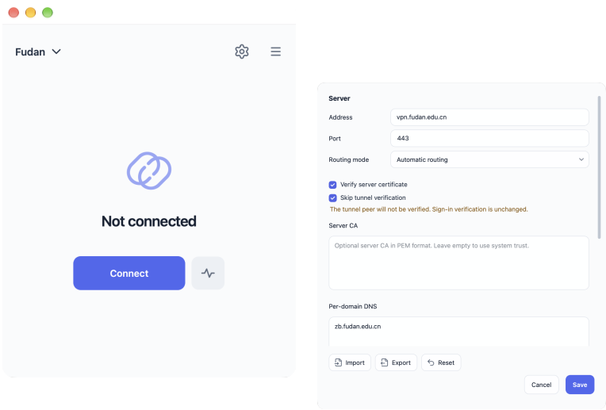

  

<h1 align="center">JustConnect</h1>

<strong>Connect to campus. Keep your network.</strong>

  An open-source aTrust client for Windows and macOS.

  <a href="https://github.com/wtalioy/JustConnect/releases">Download</a>
  · <a href="#get-started">Get started</a>

## Features

### Keep the rest of your network running intact.

- **Browse as usual.** Campus traffic goes through your school’s gateway. Other traffic keeps using your existing network setup.
- **Clash coexistence.** Leave Clash running when you connect. Flip the system proxy or TUN switch freely as you prefer. Quit and reopen it whenever you like. Your campus connection stays up.
- **Stay direct on Tailscale.** Avoid forcing an existing direct tailscale connection through a relay.

### Sign in once. Reconnect in a click.

Always remember your saved sign-in between launches. As long as it’s still valid, just click Connect.

### Lightweight. Ready to go.

14–22 MiB for JustConnect vs. 201–224 MiB for official aTrust client. Get onto your campus network with about a tenth of the download.

## Screenshots

  

## Get started

### Install

| Platform | How to install |
| --- | --- |
| **Windows** · x64 or ARM64 | Run the installer, or extract the portable ZIP and open `JustConnect.exe`. |
| **macOS** · 14.4 or later, Apple silicon or Intel | Open the DMG and drag JustConnect into Applications. |

Windows installers are unsigned, so Windows may show a warning.

macOS builds are not notarized. If macOS blocks the first launch, confirm you downloaded the DMG from [JustConnect Releases](https://github.com/wtalioy/JustConnect/releases), then go to **System Settings → Privacy & Security → Open Anyway**.

### Connect

Use the built-in Fudan University profile or add one for your aTrust gateway. Both modes are available under **Edit connection → Routing mode**.

#### Automatic routing

The default. Click **Connect** and follow the sign-in and network permission prompts. JustConnect routes campus traffic through the gateway and leaves the rest on your existing network.

#### Local proxy only

Select **Local proxy only**, then click **Connect** and sign in. Point your proxy app at `127.0.0.1` and the Local SOCKS5 port in your connection settings. Your proxy app handles routing; JustConnect leaves system routes, DNS, and proxy settings alone and needs no privileged network helper.

**Using Clash Verge Rev?** Once connected, choose **Copy Clash Extend Script** from JustConnect’s connection menu. In [Extend Script](https://www.clashverge.dev/guide/script.html) for your active profile:

- **New script:** Paste the whole script.
- **Existing script:** Paste the `addJustConnect` function and call `addJustConnect(config);` before your `main` returns.

Apply the script in **Rule** mode. It adds a node named after your connection and uses the gateway’s campus rules, including protocol and port limits, while keeping your existing rules. If an authorized SSH destination is missing, add its IPv4 address and port under **Additional Clash destinations** (for example, `192.0.2.10:22`), then reconnect and copy the script again.

## License and credits

JustConnect’s own code is licensed under the [GNU General Public License v3.0](LICENSE).

See [Third-Party Notices](ThirdPartyNotices.txt) for upstream credits and license terms.
