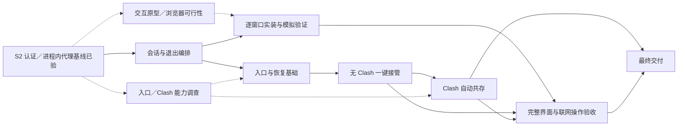

# JustConnect 实施计划与进度

更新日期：2026-10-23。当前已完成同仓 aTrust 核心库、C ABI／Qt 接入及 S2-09 的清理瘦身；Windows Fudan 的代理网页／SSH、断开及重启恢复、清除后重新认证已验证；S2 的认证、进程内代理恢复与包基线已验，S2-06 的宿主强杀恢复及六组实际包已验，恢复进程自身重启随 S4 补齐；设备权限、透明访问与自动共存仍按对应任务验收。

## 使用方式

1. 按“后续实施顺序”推进；S 编号是稳定的需求／验收追踪，不要求逐号独立开发。围绕同一可验证功能的多个 ID 可合并实施，仍按独立工作单元验证／提交并逐 ID 完成收尾；不为机械拆分编号增加空壳实现或独立开发回合。
2. 开始任务时更新“当前工作”，记录状态、依赖、验收证据和具体缺口。
3. 每个任务 ID（如 S1-10）完成其明确的交付、验证及全仓收尾复查后才勾选，并附清理／保留结论、提交、测试或实测记录；不等到整个 S1 结束才收尾。仅代码完成或尚未完成收尾时保持未勾选，标为“待验收”。
4. 每次实现同时更新相关任务、阶段状态和受影响的验收记录。阶段状态使用：未开始、进行中、待验收、已完成、受阻；受阻须写明缺少的输入、设备或能力及可继续的独立工作。
5. 三平台可分别推进同一依赖链；某个平台通过不能替其他平台勾选。阶段完成须满足本阶段的全部完成条件，构建通过不能替代网络实测。
6. 已验证的实现及实测结果作为后续基线，不重复开发或重复计为多个新验收任务；证据注明构建、平台、配置及网络路径，未变链路可追溯复用。后续改动只补受影响链路和新增场景的回归；新构建先确认改动影响，核心、入口、DNS、接管、授权或 UI 流程改变时重验对应项，不能将其他平台或旧路径的结果冒充新能力已通过。验证强度、CI 等待与独立开发重叠及预览包生成时机按[协作规则](AGENTS.md#开发节奏)执行。

本文件只保留任务状态、最终结论、关键证据和未验收项；逐次实施流水由 Git 追溯，不再重复累计。[架构说明](docs/ARCHITECTURE.md)描述当前代码，[开发说明](docs/DEVELOPMENT.md)维护构建操作；来源与历史案例放在文末参考索引。

## 当前工作

| 项目 | 当前记录 |
| --- | --- |
| 当前任务 | 按用户要求依次完成 S3 → S4 → S5；S3-02／03／04／06 已收尾，S3-01／05 的接管就绪与独立恢复随 S4／S5 补验；S4-01 初始保护与 S4-02 策略契约已验，当前推进 S4-03 的设备／路由所有权后端及 S4-04／06 的最小权限与独立恢复。S4 恢复／权限通过前不应用透明接管 |
| 实测状态 | Windows Fudan `8fefd1c` 启用隧道证书例外后认证／隧道成功；Clash Verge TUN 开启时，用户确认手动设置系统代理后网页正常，普通断开及退出重启均无需再次认证，清除缓存后出现认证窗口、手动认证后连接成功。显式 SOCKS／HTTP 的校内 SSH 通信及 HTTP 代理密钥交换通过，未登录；终端直连与自动接管尚未实现 |
| 验收范围 | 仅要求 Fudan 实测；按用户决定取消另一台 aTrust 服务器的硬性要求，保留 Custom 实现与服务器／账户隔离回归 |
| 剩余缺口 | S1-04 真实样本、S1-06 其余设备权限、透明访问、Clash 共存、真实桌面／旧系统、正式签名／公证仍未验收；D2 设备入口已收敛，路由／DNS／回环仍待验证 |
| 最新交付 | 通用隧道证书选项预览 `8fefd1c`：[Windows x64](https://github.com/wtalioy/JustConnect/actions/runs/39595437026/artifacts/12343204224)／[ARM64](https://github.com/wtalioy/JustConnect/actions/runs/39595437026/artifacts/12343943637)；代理网页／SSH、断开及重启恢复、清除后重新认证已验证；透明访问待验收，完整验证见[验证与收尾](#implementation-history) |

## 阶段总览

| 阶段 | 交付目标 | 前置依赖 | 状态 |
| --- | --- | --- | --- |
| [S0](#s0) | 仓库、命名、工作流与文档基线 | 无 | 已完成 |
| [S1](#s1) | 同仓库 aTrust 核心库、C ABI、Qt 适配与六组构建 | 已交付库化；余下样本／设备随对应网络路径验证 | 进行中 |
| [S2](#s2) | aTrust 配置、认证复用与基础设施结果可靠 | S1-01；核心交互需 S1 库化契约与 Qt 适配 | 进行中：S2-06 独立恢复待验，其余基线已验 |
| [S3](#s3) | 会话、保活、重连和正常关闭可靠 | S1 已验收的会话能力、S2 | 进行中 |
| [S4](#s4) | 策略、平台网络操作和原型恢复基础 | 先明确入口／权限；同组接入 S7-03 恢复保障 | 进行中 |
| [S5](#s5) | Clash 未运行时的三平台透明原型 | 对应平台的 S3、S4 | 未开始 |
| [S6](#s6) | Clash 各开关组合的可行路径 | 对应平台的 S5 | 未开始 |
| [S7](#s7) | 一键流程、自动共存、UI 与完整恢复 | 按下表分别并入会话／网络／Clash／界面组 | 未开始 |
| [S8](#s8) | 完整实测、安装包和交付文档 | S1—S7 | 未开始 |

## 后续实施顺序

每组交付一个用户可验证的结果，不是一整批待 CI 的改动；组内按依赖分小批，本地逐单元验证、提交，再合并推送。跨组 ID 先完成当前必需部分，全部要求及收尾满足后才勾选。先在可实测的 Windows 打通路径，共享契约变更及时跑三平台／ABI CI；不等全部平台实机验收才推进已满足前置的平台，最终仍覆盖三平台。S1-04 真实样本随相关协议问题补齐，S1-06 设备验证随选定入口推进，不阻塞独立会话工作。

| 顺序 | 交付结果 | 小批推进与依赖验证边界 |
| --- | --- | --- |
| 1 | 会话状态、重连与退出可靠 | 先稳定 S3-01／05 与 S7-02 的当前状态、取消和有界退出；契约检查通过后，S3-02／03 复用维护链，S3-04 补退避，S3-06 随行为补回归。复用 S2 协调器；网络恢复及最终就绪随第 2／3 组接入，不预建空后端 |
| 2 | 确定透明方案，网络修改可撤销 | S4-01／D2 先收敛入口，结合提前取得的 D3 结论核对共存约束；按平台接入 S1-06 权限、S4-02 策略、S4-03／04 操作与 S7-03 最小恢复。ABI／权限检查及 S4-06 故障恢复通过后才修改日常网络；S4-05 出口随入口验证 |
| 3 | 无 Clash 时连接即网页／SSH 可用 | S5-01 复用代理基线补缺；S5-02 IP 入口通过后接 S5-03 系统 DNS，S5-04 冲突随策略验证，接入同一 S7-02 会话及 S3-05 退出。安全恢复具备后逐链验 V1，S5-05 只汇总，不另交付手工版 |
| 4 | Clash 运行时仍一键可用 | S7-01 只读发现与 S6-03／D3 能力核对提前做；共存所需的无 Clash 路径与恢复通过后即可接入，不等 V1 全平台汇总。先验 S6-01／04 出口无回环，再接 S6-05 DNS 和 S7-04／05 联动；S6-02 随组合验收，S6-06 汇总 V2—V5 |
| 5 | 简洁、双语且一致的完整界面 | 可穿插第 1—4 组：S7-08 原型确认、相关会话契约通过后，所需 S7-12 偏好与 S7-11 翻译随 S7-06／09 逐窗口落地；S7-07／10 诊断与操作验证随功能接入。网络未完成用模拟状态验证，真实一键访问仍等第 3／4 组实测 |
| 6 | 最终版本与平台缺口收尾 | S8 汇总已有证据，仅补改变路径、未测格、实际包／桌面及发布文档；同一交付提交生成六组预览并检查，不随小批打包，不无条件重跑全部实测 |

等待 CI 或实机反馈时，可穿插 D2 只读／隔离调查、S7-01／D3 只读发现与能力核对、S7-08 模拟原型或 S7-13 交接可行性；实际联动写入仍等入口、权限及恢复验证。浏览器选择先于认证窗口美化，不阻塞数据路径；正常连接无需重复认证时不另做 SSO 自动填充，A2／A4／A5 非主线。

每个单元结束查看已有 CI，失败优先修复；批内不得继续依赖待验证的接口或平台结果。新契约、权限／恢复、透明入口、Clash 写入分别按影响设置验证边界，不按固定任务数或整组结束才检查。需用户确认或真实设备的项目记明具体缺口，继续独立工作，不降低验收要求。

## 全程保持的目标与约束

| ID | 要求 |
| --- | --- |
| R1 | Windows、macOS、Linux 同等支持网页和终端。PowerShell、zsh、bash 保持原用法，不配置代理环境变量、SSH 配置或 ProxyCommand，不重启已有终端；开启后可直接 SSH 到校园 IP／域名。已有连接不保证跨路径切换保持。 |
| R2 | 校园资源 → JustConnect → aTrust；普通流量沿用本地 Clash 分流，Clash 不可用时直连；局域网、WSL、Tailscale 等受保护目标保持原解析与路由。不能以 HTTP 代理连通推断任意 TCP／UDP 都受支持。 |
| R3 | 覆盖 Clash 未运行，以及运行时系统代理与 TUN 的四种开关组合，包含两者均关闭。两个开关独立，运行中切换不得要求重新配置校园访问，也不得强制切回用户刚修改的状态。另行核对 `rule/global/direct` 模式。 |
| R4 | 保护回环、实际局域网、WSL、Tailscale IPv4／IPv6、MagicDNS、子网路由、出口节点及检测到的其他覆盖网络。冲突默认保护原网络，允许按明确的目标／网段选择校园侧并撤销；不假定同一目标 IP 的两侧可同时访问。Tailscale 能否点对点直连仍受两端网络条件影响。 |
| R5 | 依据校园下发的域名、IP、端口及协议资源分流，不把整个 `10.0.0.0/8` 或整校域名强制送进 VPN。校园失败返回错误，不偷偷改走别的出口；用户明确选择原网络侧的冲突目标按选择处理。 |
| R6 | 产品仅启动 aTrust；提供 Fudan 与 Custom。复旦入口为 `vpn.fudan.edu.cn:443`，认证方式实时获取，优先 Fudan UIS OAuth2，登录域和登录地址不写死。保留其他学校的 aTrust 支持及必要 MFA。 |
| R7 | 修改网络前保存快照与所有权记录；任一步失败撤销本次修改，正常退出先解除接管、再停止核心。恢复不覆盖外部新设置，不猜测旧版本未保存的原始配置，不自动终止官方 VPN 或其他程序。 |
| R8 | 不导入其他应用的数据。自身配置升级保留有效值与用户选择，仅清理废弃字段和确认失效的缓存。认证缓存按学校／服务器／账户隔离并限制当前用户访问；密码和 TOTP 持久保存使用系统凭据服务，不回退到明文或 Base64；不默认关闭 TLS 校验，日志隐藏凭据、令牌、控制接口密钥及回调参数。 |
| R9 | VPN 核心在 Qt 宿主进程内运行，通过内部 C ABI 调用；不以外部核心程序、本地控制 HTTP 服务或插件系统作为最终架构。必要的最小权限助手、恢复守护和 Qt WebEngine 子进程各有职责，不承载另一份 VPN 核心。同进程取消不能依赖杀子进程，宿主崩溃的网络恢复必须有独立保障。 |
| R10 | 围绕 JustConnect 的校园访问、共存和恢复需求主动优化、重构、精简代码及 UI，允许重新设计布局与操作流程；每次改动有明确改善目标、行为或性能验证和独立提交，不以改名、增加抽象层或堆砌选项代替改进。 |
| R11 | 确认学校／服务器后一次连接完成认证、隧道、分流／DNS 和应用接管，浏览器及已有终端随即可用，无需另设系统代理、修改 SSH／终端配置或重开应用。仅保留必要认证、授权及冲突选择；接管就绪并通过有界检查后才显示“已连接”，失败撤销本次修改。窗口与托盘共用流程，关闭行为及认证保留按日常使用要求。 |
| R12 | 应用界面与文案默认英文，可显式切换简体中文并保存选择；主窗口、托盘、设置、认证交互和应用生成的错误／通知使用同一语言。按钮文字由最终设计确定，不把本计划的示例当作固定文案。 |
| R13 | 提供可发现的设置页面，至少包含语言与主窗口关闭行为；应用偏好与学校配置分开管理，保存后按约定生效并跨重启保留。本节需求是基本目标，允许继续完善信息结构、视觉与交互设计，扩展须有实际用途并保持日常操作简洁。 |

沿用 Qt Widgets 和轻量分层：`core/` 保存 C++ 规则与状态，`application/` 定义 `CoreEngine` 端口并组织用例，`infrastructure/` 的 `EmbeddedCoreEngine` 实现 C ABI／存储／系统能力，`presentation/` 展示结果并接收操作。`corelib/` 统一放 JustConnect 的 Go 会话、C ABI 入口及整合后的协议源码，使用单一 Go 模块，不保留独立上游模块或 `third_party/zju-connect/`。来源和许可证就地记录，源码可直接优化、重构与精简；模块路径迁移服务于一体化构建，包名和协议实现不做批量改名。Go 协议细节不混入 C++ 领域模型。应用层可继续使用 Qt Core、QObject 和定时器，不依赖 Widgets、WebEngine 或 Go 实现细节。状态机决定动作，会话执行动作；主窗口与托盘使用同一会话。上述名称和目录是迁移目标，当前实现仍见架构说明。

## 日常使用要求

以下为基本要求，设计可进一步扩展，保持操作简洁；页面布局、控件和视觉风格由原型确定。`Connect`、`Disconnect`、`Open JustConnect`、`Exit` 仅为英文示例，最终文案以清晰、简洁及平台习惯为准。

| 场景 | 预期行为 | 实现与验收落点 |
| --- | --- | --- |
| 启动与确认服务器 | 正常启动显示主窗口及当前学校／服务器；首次未配置时可选择学校或填写 Custom。保留上次有效选择，日常确认后点击一个主操作即可连接，不必每次进入设置或重新输入服务器。默认不因启动或打开窗口自行发起连接，已有用户明确选择的自动连接设置单独保留 | S2-02／07、S7-06／08 |
| 主窗口连接／断开 | 一次连接覆盖认证、隧道与网络接管；网页和已有终端的普通 SSH 命令无需其他操作即可使用后，才展示“已连接”。单独核心 ready 或系统代理成功不足以代表完整就绪。连接、认证、恢复和断开过程中显示实际状态并提供适当取消，阻止重复启动。断开结束校园隧道及接管、取消重连并恢复自身网络修改，程序保持运行；不把隐藏窗口或保留认证等同于连接仍在后台继续 | S3-01／04、S7-02／06 |
| 关闭窗口与后台驻留 | 托盘可用且未选择其他关闭行为时，点击主窗口关闭键默认隐藏到托盘，无论当前是否连接；保持既有连接与认证流程。设置可改为关闭即有序退出，保存偏好本身不执行关闭，下次关闭按选择生效。窗口最小化与关闭是不同动作，不额外要求把普通最小化改为隐藏。Windows 使用通知区域，macOS 使用菜单栏，Linux 使用桌面提供的托盘入口；选择隐藏但无托盘或入口不可用时保留可访问窗口及退出入口，不把唯一窗口隐藏到无法找回的位置 | S3-05、S7-06／08／12、S8-03 |
| 托盘操作 | 左键默认打开／恢复并激活主窗口；右键菜单未连接时可连接、已连接时可断开，并始终提供打开窗口与明确退出；处理中按同一会话状态禁用重复操作并提供适当取消。连接使用当前已确认配置，需要学号／密码、SSO 或 MFA 时才展示并激活相应交互，取消后回到一致状态，不重复弹窗。平台托盘点击／菜单事件差异须实测，保留等效且可发现的打开、连接／断开和退出路径 | S2-05、S7-06／10、S8-03 |
| 托盘状态 | 图标至少清楚区分已连接与未连接，提示文字／菜单与主窗口同步；连接中、需要认证、断开中或失败不能伪装为已连接。不仅依赖颜色，兼顾深浅主题、macOS 菜单栏图标和高 DPI。只由同一会话状态派生显示，不另维护托盘连接标志 | S3-01、S7-06／09 |
| 尽量免重复认证 | 将校园连接寿命与可复用认证状态分开：窗口隐藏、主窗口或托盘断开不主动清除仍有效的认证；再次连接先按服务器支持的方式恢复有效票据／会话，确需重新认证才弹窗。正常退出也不默认清除允许安全持久化的有效认证，重启后能否恢复按实测能力说明。明确“清除登录状态／登录数据”才删除对应缓存；服务器已失效、撤销或要求 MFA 时如实重新认证，不承诺永久免登录，也不靠静默重放密码或后台维持已断开的隧道实现 | S2-04／08、S3-02、S7-10 |
| 明确退出 | 托盘或应用菜单的 Exit 始终执行有序退出，不受关闭行为设置影响；选择“关闭即退出”后的主窗口关闭也进入同一退出流程。即使窗口已隐藏或认证弹窗打开，也须取消交互及重连、撤销自身网络修改、停止核心并结束程序。清理失败／超时走已有恢复约束，退出与普通断开均不顺带清空有效配置或认证缓存 | S3-05、S7-03／06、S8-02 |
| 设置页面 | 主窗口提供清楚的设置入口，至少可更改语言和主窗口关闭行为。语言默认 English、可选简体中文；关闭行为默认隐藏到托盘、可选退出应用，并说明连接与后台运行的影响。两项均为应用偏好，不随学校／账户切换，不要求断开连接才能修改；保存失败保留原有效值并明确反馈，不显示虚假的保存成功。无托盘时提示后台隐藏不可用并保留可访问窗口及明确退出入口，不静默变更或覆盖用户偏好；已选择的关闭即退出不依赖托盘可用性 | S7-08／11／12、S7-10、S8-03 |
| 默认英文与中文切换 | 未选择语言时使用英文，不随系统中文环境自动改成中文；设置可切换简体中文，选择属于应用而非学校配置，重启后保留。切换更新已有窗口、托盘及随后出现的交互，不重连、不清认证；应用可控制的文案完整翻译，学校自身 SSO 网页和系统授权界面的语言遵循各自设置 | S7-11、S7-10、S8-03 |

## JustConnect 的产品取向与持续收敛

自己的特色落实在日常使用和实现质量上：一键进入校园网络，日常终端与网页照常使用，Clash／Tailscale／局域网保持原有行为；状态与失败原因可理解，改动范围可解释且能够恢复。核心实现可围绕这些目标直接调整，保留有价值的协议和平台能力，不受上游 CLI 的配置粒度、类划分与窗口布局限制。

| 方向 | 具体做法与验收落点 |
| --- | --- |
| 一致的校园策略 | 校园资源、保护目标、地址冲突选择形成同一份策略，由核心、Clash 联动和诊断共同使用；同一目标不能在不同入口产生互相矛盾的解释。S4、S6、S7-07 |
| 简洁的操作流程 | 首次选择 Fudan／Custom 并完成必要认证；日常确认当前学校／服务器后连接，主窗口与托盘均可断开／重连，窗口默认关闭到托盘。有效认证尽量复用，MFA、权限和冲突只在需要时出现；高级参数归入设置，日志按需展开。具体行为按上方交互要求验收。S2、S3、S7-06／08／10 |
| 清楚的运行状态 | 首页说明当前学校／配置、是否真正就绪、正在等待什么，以及可执行的下一步；校园、Clash 共存与原网络保护按实际观测展示，未知明确标注。状态不依赖用户阅读日志，也不以进程存在代替连通。S3-01、S7-06／07 |
| 针对性的代码收敛 | 优先收回分散的配置读写／校验、重复状态映射、主窗口与托盘的平行流程、旧核心兼容分支和重复平台逻辑。复用已有会话、配置服务和端口，按实际变化原因拆分职责；每次重构说明删减了哪些重复和保持了哪些行为。S1-10／11、S2-01／07、S7-06 |
| 有证据的性能优化 | 按真实场景测启动、连接／取消、重连、CPU／内存、日志积压和吞吐；优先处理重复资源解析、无界日志／缓存、忙轮询、同步阻塞和不必要跨 FFI 拷贝等实测热点。记录前后数据及网络行为回归，不承诺仅凭库化或代码减少就提高性能。S1-04／11、S7-09／10、S8 |
| 舒服且统一的视觉 | 以重新设计并美化整套 UI 为明确目标，按日常连接流程重做页面布局、信息层级和视觉风格；沿用 Qt Widgets 实现，默认英文、可切简体中文，统一字号层级、留白、间距、图标、色彩和状态文案；支持浅／深色、高 DPI、键盘与屏幕阅读器，保留三平台菜单和窗口习惯。视觉强调当前状态与主操作，默认展示的信息量与用户当前任务相称。S7-08／09／11、S8-03 |

实施时以用户场景确定边界；每次只改一个可验证的功能或重构单元，及时删除被替代的分支、样式和配置项，同时维护有效配置迁移与测试。设计和代码优化是持续工作，不另起一次全面重写，也不要求先建通用插件或设计框架。界面只展示已实现的能力，静态原型与真实联网验收分别记录。

## S0 仓库与开发流程基线

- [x] **S0-01**：完成 JustConnect 命名、配置路径、来源与许可证基线（`954fc37`）；旧进程命名已由 S1 的正式库替代。
- [x] **S0-02**：独立仓库保留上游 remote，在 develop 开发；测试／预览／main 打包与 Release 规则见[开发说明](docs/DEVELOPMENT.md#分支与-actions)。
- [x] **S0-03**：建立三平台测试与六组预览基线：[测试](https://github.com/wtalioy/JustConnect/actions/runs/39243039993)、[打包](https://github.com/wtalioy/JustConnect/actions/runs/39243056960)。

README 暂留空，文件图标暂用系统默认；正式签名／公证及用户旧网络设置恢复仍按后续任务验收。

## S1 核心库化与同进程集成

前置：S0。应用、测试与打包已统一使用本仓库核心；S1 整体仍因真实样本和设备权限保留待验收。

- [x] **S1-01**：本地 SDK、编译与应用测试通过；当前版本／路径见[本地环境](docs/DEVELOPMENT.md#当前-linuxwsl2-开发环境)。
- [x] **S1-02**（历史基线）：完成固定上游核心的独立程序构建；已被 S1-05／09／10 替代，旧清单／下载／补丁链路已删除，来源留在 [UPSTREAM.md](corelib/UPSTREAM.md)。
- [x] **S1-03**：ABI v1 采用不透明句柄、有界 JSON 事件、调用者缓冲区和能力查询；支持一个活动会话、会话／请求标识、认证回应、取消及安全释放。契约与边界回归见 [CORE-ABI.md](docs/CORE-ABI.md)。
- [ ] **S1-04**（自动回归已交付，仅补真实样本）：现有 Go／C11／C++／Qt 受控网关及错误输入、所有权、取消、超时、端口冲突、终态、事件积压、旧回应和支持环境的 race 复用 S1／S2 结果，不重建测试体系。剩余为将获准取得的脱敏真实资源／认证样本纳入夹具，覆盖模拟数据未表达的协议差异；S2 在线实测不等于已有可复现样本。未来设备／路由所有权验证随 S1-06／S4-06 接入相应能力后执行。
- [x] **S1-05**：协议源码整合为 `corelib/` 单一 Go 模块，固定工具链／依赖锁、来源与许可证；无独立上游模块、运行时下载或补丁队列（`1611e9c`）。
- [ ] **S1-06**：用最小 C ABI 库链接当前 Qt 的 Windows／macOS／Linux x64 与 ARM64 宿主，验证初始化、调用、工作线程、缓冲区及重复创建／销毁。优先 `c-archive` 静态链接；必须实测 Windows cgo 编译器、Qt MSVC、COFF／CRT／链接器组合，不能由 Go 宣称支持某 buildmode 推断 MSVC 已兼容。静态路径确有阻碍时验证随包固定的 `c-shared` 库，仍同进程调用；选择和证据写入 D5，不退回外部核心，不为库化整体更换 Qt。剩余设备验证跟随 D2 选定的透明入口，不先假定所有平台必须采用 TUN；使用设备时核对创建、权限、句柄／fd 生命周期及 GUI／WebEngine 权限边界；不能假定 Windows Wintun 句柄可像 Unix fd 一样跨进程交付。必要助手只做最小网络操作；若某平台尚无法让非提权宿主持有数据路径，明确记录阻塞，不能默认将整个 GUI 提权或把核心移入助手。CI 链接通过与真实设备权限验收分别记录。
  - 六组实际调用已通过，Unix 选 c-archive，Windows 选固定 c-shared DLL；Windows 静态路径首次 Go 调用超时，不再重复试探。WSL2／Linux x64／ARM64 的隔离 TUN fd 交付、普通用户双向收发及正常／强杀清理通过；Go／Qt 设备接入、真实授权和 macOS／Windows 非提权设备交付仍待验收。证据与复现见 [CORELINK-PROBE.md](docs/CORELINK-PROBE.md)。
- [x] **S1-07**：会话拥有认证／隧道、gVisor、解析与监听；消除进程退出／stdin／全局日志接管，完成 setup 与长期会话的取消、幂等释放及部分失败清理（`00fcf5d`）。
- [x] **S1-08**：CoreEngine／EmbeddedCoreEngine 替代旧进程、命令／文本解析和 CLI 查询；专属 Qt 线程驱动 C ABI，排队交付事件，验证晚到回应与销毁竞态（`29932b3`、`8c9c23c`）。
- [x] **S1-09**：共享 CMake 构建 Go／C ABI，三平台测试和六组实际包统一验证来源、ABI、架构、依赖、系统下限及签名；维护源码归档可无 Git 重建。操作与约束见[开发说明](docs/DEVELOPMENT.md)。

- [x] **S1-10**：删除旧核心下载／补丁／EXE 校验、Wintun 分发、无用 action／依赖与专属测试，保留系统操作所需 QProcess（`8d79d47`）。全仓调用／测试／构建复查及三平台／六组包验证通过。

- [x] **S1-11**：删除无调用的 CLI／EasyConnect／移动端专用分支、旧策略及包装，合并无独有契约的测试；保留协议、失败／取消／平台回归、许可证及实际数据栈依赖。全仓收尾与六组验证通过（`6db2c06`）；包体积、CPU／RSS、TCP／UDP、20 次重连和慢节点基线摘要／原始证据见[性能基线](docs/DEVELOPMENT.md#s1-11-历史测量基线)。

完成条件：正式会话与六组包已验收；真实样本及设备权限仍须完成 S1-04／06。透明入口不由库化决定，继续按 D2／S5／S6 选型。

## S2 aTrust 配置、认证与基础结果

前置：基础设施和纯配置可独立推进，核心交互使用已验收的 S1 契约；本阶段按用户确认的实机验收范围完成；真实过期／MFA 不作硬性门槛，相关处理与自动回归保留。

- [x] **S2-01**：SystemProxyBackend 返回经 API／子进程及必要回读验证的结果，区分失败、权限、取消、不支持与部分修改；弹窗归界面，平台／自启动按系统拆分，由共享 CMake 选择。

- [x] **S2-02**：仅提供 aTrust 的 Fudan／Custom 配置；真实 C ABI 纯校验替代任意 CLI 参数，删除旧高级／EasyConnect 控件和运行字段。升级保留有效值、未知键与其他账户；导入／重置先改草稿，导出原子提交（`06c23a0`、`2ec3237`、`4c27335`）。

- [x] **S2-03**：AuthMethodsQuery 异步查询并等待清理终态，交付完整认证身份及运行时登录 URL；统一 TLS 拨号与信任／协议／网络分类，默认严格校验。学校 CA 仅作用于本会话，不改全局信任；清理过期查询和重复握手包装。

- [x] **S2-04**：密码／TOTP、账户级认证材料使用系统安全存储，失败可手动登录且不写明文；迁移先验证安全写入再清旧值。串行 CredentialAccess 校验来源、账户及修订，覆盖锁定、失败保值、取消和晚到结果。

- [x] **S2-05**：结构化 Handler／ABI 交付短信、TOTP、RADIUS、CAS／OAuth2、文字／点击验证码及可信设备；支持取消、超时和过期回应拒绝。回调验证网关来源／路径／唯一票据，SSO 使用独立内存 Profile 与会话 TLS 策略，日志不含票据；不支持的后续步骤明确失败。

- [ ] **S2-06**（宿主强杀恢复与六组实际包已验；恢复进程自身重启待验收）：系统代理按快照和所有权恢复，部分写入失败回滚自身修改，外部新值不覆盖；异常／强杀由独立恢复任务继续处理。产品已改由同包 `JustConnectProxyRecovery` 持有原后端及快照，宿主通道断开后继续恢复，独占锁阻止重入；强杀／部分应用／恢复拒绝／坏回复及真实超时通过三平台原生与六组实际包检查（`3f45114`，见 S4 证据），恢复进程自身强杀／重启仍缺持久记录；普通退出和隔离结果不代替用户桌面／校园验收。

- [x] **S2-07**：ProfileService 统一公开配置映射、校验、编辑／保存／切换；窗口持来源快照，异步凭据与独立密码／TOTP 清除复用串行入口。覆盖保存失败、取消、切换、晚到窗口结果及重启迁移；删除重复读写，保留当前仍需的 QSettings 后端。

- [x] **S2-08**（实现、实机验收与任务收尾完成）：建立与活动隧道分离的认证缓存生命周期，复用实际核心支持的票据／Cookie／设备身份恢复路径；若 C ABI 缺少必要输入／输出，按现有版本化契约补齐并验证真实 Qt／Go 调用，不另起登录后端。按学校／服务器／账户隔离，窗口隐藏、普通断开或退出不主动注销／清除仍有效且允许保存的材料；切换账户只使用该账户的缓存，显式清除或服务器明确失效时按作用域处理，不误删其他账户。有效期及恢复结果遵循协议与服务器，不硬编码免登录时长；不可恢复时进入一次必要认证，瞬时网络失败不直接抹掉有效缓存。覆盖安全存储失败、缓存损坏／过期、同账户断开重连、账户隔离、显式清除及重启恢复，记录目标学校的实际支持范围。
  - **实现与回归已完成**：ABI／Qt 支持有界认证缓存输入／更新／明确失效；授权保存的认证在普通停止及重启时按账户恢复，明确清除推进代次，旧回调不能重建。首次 SSO 先绑定服务器确认账户，正常退出等待核心／后台存储／绑定续接。
  - **Fudan 实测与边界**：Windows `8fefd1c` 显式开启通用隧道证书例外后认证／隧道成功；Clash Verge TUN 开启时，用户确认手动设置系统代理后的网页、普通断开及退出重启免重复认证通过；明确清除后出现认证窗口，手动认证后连接成功。显式 SOCKS／HTTP 的 SSH 通信及 HTTP 代理密钥交换通过，未登录或修改主机信任记录。登录 HTTPS 仍校验证书；完整自动接管按 R11／S3—S7 验收，当前手工代理仅为数据路径基线，操作见[开发说明](docs/DEVELOPMENT.md)。
  - **验收范围与收尾**：按用户决定取消另一台 aTrust 及真实过期／MFA 的 S2 实测门槛；过期／MFA 未触发，不宣称已通过，后续自然触发时补观察。受控失效／MFA、隔离、取消及晚到结果回归保留。全仓复查调用方、夹具、配置、构建／CI 和文档后，无新增废弃实现或临时产物；旧配置迁移与当前构建／报告按[收尾保留条件](#implementation-history)保留。

- [x] **S2-09**：复测前完成职责收拢、旧路径清理和包瘦身（`c72c68b`、`7cbb82a`、`0c4cd2a`、`e1853a4`）。AuthenticationCacheCoordinator 维护保存／失效／SSO 绑定，UI 处理意图与提示；删除 ResourceData／canResume／直接 Restore 旁路及专属测试，生命周期夹具改走正式恢复。Release 省略 Go DWARF、按配置隔离产物；Windows 移除非英语／简中语言包及 QML 调试插件，并验证实际安装和包内双语言页面／JavaScript。全仓收尾与最终六组包通过，保留条件和证据见[验证与收尾](#implementation-history)。

| Windows 包 | 旧 ZIP MiB | 当前 ZIP MiB | 减少 | 当前安装字节 |
| --- | ---: | ---: | ---: | ---: |
| x64 | 143.63 | 126.34 | 12.03% | 293,201,230 |
| ARM64 | 126.11 | 109.19 | 13.42% | 270,432,918 |

Linux x64／ARM64 AppImage 分别减少约 2.07%／1.90%；macOS 安装体积基本不变，不把压缩波动计为运行时收益。Windows 原生文件由各 47 减至 35；WebEngine 主库及必需资源仍保留，替代方案由 S7-13 验证。

完成条件：三平台后端／凭据与真实 FFI 自动回归已通过；OAuth2／隧道、代理网页／SSH、普通断开及退出重启免重复认证、明确清除后重新认证已通过实测；S2-06 的宿主强杀恢复和六组实际包已验，恢复进程自身重启仍待验收，其他已验基线保留；真实过期／MFA 不作本阶段实机门槛。保留 Custom 与服务器／账户隔离，不再要求另一台 aTrust 实测。

## S3 会话、保活、重连与正常退出

前置：S1 已验收的库／Qt 会话能力、S2；不等待透明设备交付。先复用认证恢复、清除与普通退出，补在线状态、续期反馈、有界重连及退出；S3-05 先验当前链路，新增网络撤销／独立恢复随 S4／S7-03 接入后补验，不因这些后续能力阻塞当前会话契约，也不提前算全项完成。

- [ ] **S3-01**（`88613c9` 状态契约已通过本地、三平台 Tests 与六组 Core ABI；产品接管后补就绪验收）：区分库初始化、会话启动、认证成功、续期／恢复、需要重新认证、通道就绪与校园访问就绪；核心 ready 仅表示通道及本地代理可用，完整接管／DNS／分流由 S7-02 汇总后才可显示产品“已连接”。主窗口与托盘展示同一会话状态、最后一次保活时间与结果。没有事件时显示未知，不能以宿主存活、库调用返回成功或日志安静推断在线。
- [x] **S3-02**（`87e2a12` 受控续期／在线失效、手动登录／MFA 与跨平台检查通过，已收尾）：复用已有 Go 定时刷新、明确失效通知、S2-08 认证恢复及 S2-09 协调器，不重写票据恢复／保存／清除。补齐运行中续期结果到应用状态的传播及重新认证入口，区分瞬时网络失败与明确失效；失效只停止一次并提供一次必要认证，旧／重复结果不能覆盖新会话，不静默重放密码或靠断开后继续转发维持认证。
- [x] **S3-03**（`907de55` 三种模式、迁移／设置／维护反馈及禁用 DNS 已通过跨平台检查，已收尾）：与 S3-02 一起核实并复用现有会话刷新／节点维护，仅补自动／指定目标／关闭的产品行为及反馈，不另建重复维护线程；新增配置默认自动，旧配置保留关闭选择和生效目标。区分 DNS 探测、应用流量保活与会话续期；仅使用获授权、可重复访问的资源，不向 SSH 等服务发送 HTTP 探测，不把 HTTPS／CONNECT 连通推断为续期成功。能力不足时明确说明。
- [x] **S3-04**（`e52e958` 有界预算、错误分类与换算边界已通过跨平台检查，已收尾）：按具体错误执行有界退避，限定次数与最大间隔并显示进度；错密、限流、证书、权限、核心不兼容和明确失效不进入自动登录循环，不能把所有初始化失败归为网络错误。断开／切换／退出取消计时器，恢复就绪后再重置预算，避免瞬断反复清零。
- [ ] **S3-05**（当前进程内代理／核心／凭据、系统请求及关闭偏好已通过跨平台自动回归；系统代理宿主强杀恢复已验，恢复进程自身重启及新接管随 S4 补验）：复用 S2 已验证的普通退出、核心／凭据写入及 SSO 绑定等待；补齐系统会话结束、可捕获终止请求与同一关闭入口的有界处理；认证／提权模态窗口不阻断，重复请求幂等，由 Qt 宿主管理进程级信号。先解除网络接管，再取消库会话并等待有界清理，最后停止事件泵／销毁句柄；不通过 kill 子进程或强杀 Go／Qt 工作线程模拟关闭。超时停止重连和新会话启动，记录残留、执行独立恢复并提示重启；不卸载仍有执行线程的库。界面在有序关闭前保留事件循环，平台操作不长期阻塞主线程。主窗口关闭由 S7-12 的应用偏好决定，默认隐藏到可用托盘；选择关闭即退出、明确 Exit 或系统结束均进入同一有序关闭入口，无托盘时不得隐藏唯一可操作窗口。设置页和认证对话框的关闭／取消按各自语义处理，不套用主窗口退出偏好。
- [x] **S3-06**（`e52e958` 当前链路增量回归及收尾通过；新接管按改变路径补验）：沿用已有核心替身及认证缓存／会话回归，只补 S3-01—05 新增状态、在线失效、重连预算、取消及退出超时的场景，核对最终状态和副作用次数。断开／重启恢复及明确清除的协议基线引用 S2-08；仅在相关实现改变时重验。续期／失效／MFA 使用受控网关稳定复现，真实学校自然触发时补观察，不重新引入等待自然过期的硬性门槛。

当前证据：

- `e52e958` 的[三平台 Tests](https://github.com/wtalioy/JustConnect/actions/runs/39646841255)／[六组 Core ABI](https://github.com/wtalioy/JustConnect/actions/runs/39646840951) 全部通过，覆盖状态、退出、在线重新认证、保活／禁用 DNS 及节点组预算。最新收尾代码另通过完整 Go 19 包／vet、aTrust 及维护重点 race、应用 CTest 36/36、正式 ABI 14/14（含性能、原生 KDE／凭据）；Windows 两架构的权限错误回归及秒数换算边界均已通过相应原生 CI。
- S3-01：观测按代次及 ABI 顺序更新，时间仅展示；主窗口／托盘共享认证、恢复、续期及维护结果／时间，未知不推断在线，ready 只显示通道就绪。产品接管后就绪由 S7-02 补验。
- S3-02：复用既有续期与认证缓存协调器；受控网关验证临时 503 后恢复、明确失效仅停止／清缓存一次且不重登录；受控 UI 验证在线失效明确提示、重复终态无副作用，用户手动登录并完成一次 MFA 后恢复。全仓复查调用、存储修订／代次、夹具、设置、构建／CI／文档，未另建登录循环或缓存后端，保留独有账户隔离／安全／取消回归。
- S3-03：复用续期循环，自动仅探测获授权校园 DNS；目标仅标准 HTTP(S) GET，不重定向、传认证头或回退原网络／公共 DNS。关闭只停流量探测，禁用校园 DNS 同样限制探测；受控包计数／实际 TCP／UDP、信任、ACL、取消及零流量对照通过。Profile／设置／导入／导出共用配置与校验，旧关闭及目标、已有新模式优先，关闭保留目标，保存／取消不丢选择；能力不足明确报告。全仓复查确认旧布尔值仅为迁移输入、有效 URL 保留为正式配置；无重复维护线程或旧参数旁路，保留 HTTP(S) 信任／授权／取消及空闲流量独有回归，弃用开关仅在停止支持相应旧配置后删除迁移。
- S3-04：应用与节点组重拨均最多五次、指数间隔封顶 30 秒，持续就绪 60 秒才重置；结构化分类排除权限、信任、协议及明确失效。完成 MFA 后允许网络恢复，退避撤销失效代理，取消清旧错误；虚拟时钟验证完整预算、永久失败、短暂连通及稳定恢复。删除旧无限重拨分支，保留共享连接／conntrack／取消回归；节点组预算已随 `907de55` 通过六平台检查。共享权限分类已补 Winsock WSAEACCES（Go 不映射到 fs.ErrPermission），优先于混合超时；Linux 相关 race／TLS 检查及实际 Windows x64 两项错误回归通过，Windows ARM64 测试交叉编译通过，相应原生矩阵已通过。秒数在换算毫秒前限幅，设置页上限／次数派生自状态机，极大值／旧长间隔／零／负值及关联 15 项应用回归通过，全仓调用／设置／测试／构建／CI／文档收尾通过，未保留旧无限重拨或重复上限定义。
- S3-05：当前代理链路 15 秒有界关闭，禁止新连接／重连，异步恢复代理后取消核心，等待凭据／SSO／查询；失败或超时保留事件循环及线程所有者，显式重试，不误报成功。同步退出旁路及隐式最小化隐藏已删除。宿主信号、Qt 会话结束、应用 Quit 共用入口；实际 Linux SIGTERM、SIGINT／SIGHUP 及窗口回归通过。全局关闭偏好复用 state.ini，默认可用托盘隐藏，无托盘保留窗口，保存本身不关闭／断开。真实 OS 注销／控制台关闭未测，透明网络独立恢复随 S4 补验。
- S3-06：校时回拨／同毫秒、新代清空／停止后晚到结果、失效／MFA、重连预算、取消、退出超时与所有者保留均有针对性回归。全量每包预算统一为 ABI CI 的 90 秒，场景短时限不变，依据见[验证说明](docs/DEVELOPMENT.md#集成-go-源码的离线基线)。当前链路自动回归与预算／DNS／权限边界均通过原生 CI，新接管集成后补相关回归。 混合 TLS 诊断夹具已移除多余静默等待，保留真实握手超时、信任／隐私断言及五秒读取上限；本地完整 Go 21 包普通／race 与三轮重点 race 通过，macOS 双架构普通／race 与完整九项原生矩阵 `ad04efd` 通过，原始失败证据归 `build/reports/system-proxy-recovery.json`。
- 清理：全仓复查覆盖生产调用、测试／夹具、配置、生成契约、构建／CI 和文档；删除重复 Go 临时缓存及已解压工具下载包约 239 MiB、修复后的失败夹具和旧失败索引。保留当前构建、最新日志／性能报告、S2 唯一包／源码证据、SDK 与原生凭据／KDE 工具及 actionlint 许可证；续期完成通知仍支撑独有退出等待回归，迁移入口仍服务旧配置，无废弃原型重新引入。

完成条件：三平台状态、有界重连／退出及受控续期／空闲对照回归通过；S2 的有效认证恢复、清除与普通退出证据复用，新增行为另记结果。当前已有代理恢复不得误报成功；异常强杀和新网络接管的完整恢复仍需 S4／S7。

## S4 策略与网络操作的恢复基础

前置：已验收的 S1／S2 及当前需要的会话状态、取消与退出契约，不等 S3 整阶段结束。资源／网络只读调查和 D2 隔离实验可先做，结合 D3 共存约束选入口；再实现所需策略、权限与所有权恢复，同组接入 S7-03，避免原型与正式版各写一套。

- [ ] **S4-01**（资源／原生接口、路由／DNS 及初始保护已验，运行中协调及透明接入待验收）：读取校园资源、实际接口／路由／DNS、局域网、WSL、Tailscale 和其他覆盖网络，形成可解释的规则模型；保护目标优先，冲突仅按明确范围手动选择。策略同时约束透明入口与核心分流，不把所有受保护目标统一绑定物理网卡。
- [x] **S4-02**（`e1d2c00` 当前已验证路径的 API 契约及全仓收尾通过；Clash 字段随对应路径增补）：仅为已验证路径的实际需要，通过核心库 API 传入带版本与会话代次的策略；保护范围／冲突选择先接入，上游代理等字段随 Clash 联动补齐，不预建完整策略框架；先校验完整快照，再原子替换并回报生效代次，无效更新保留最后有效版本。取消原跨进程策略文件轮询作为主路径的设计；文件仅按实际需要用于诊断导出。更新与关闭竞态、旧代次拒绝和错误分类须有回归，能力通过 S1 的 ABI／能力查询核对。
- [ ] **S4-03**：在 S2-06 的代理恢复基础上，为原型需要的路由、DNS、TUN 操作提供读取快照、应用、回读及按所有权恢复的后端；记录原值、实际修改和本次连接标识，失败能撤销部分完成的操作。外部新设置不被恢复覆盖，未知遗留配置只报告，不猜测或清空。
- [ ] **S4-04**：按 S1-06 的实际设备权限结论实现最小授权路径：核心仍在 Qt 进程，助手只执行经验证的设备／路由／DNS 操作，验证调用者、会话所有权、参数和授权结果；拒绝或取消不留修改，不交付可任意执行命令的高权限接口。验证 AppImage 挂载路径、只读包、助手可信来源与句柄／fd 归属，不默认给 GUI／WebEngine 整体提权。检测到官方 VPN 运行时提示冲突，不自动终止它。
- [ ] **S4-05**：统一认证方式查询、登录、网关解析和重连的出口策略，避开 Clash Fake-IP 与 TUN 回环；分别处理控制连接、校园 DNS、业务和受保护网络出口。VPN 网关地址落在校园资源前缀内时仍可达，校园 DNS 必须经允许的资源路径到达，不靠任意换公共 DNS 掩盖错误。
- [ ] **S4-06**：在受控环境验证现有系统代理及新网络操作在应用失败、部分成功、取消和外部改写时的恢复。原型变更前先有可验证的回滚及独立测试进程清理保障，不能依靠主窗口仍存活；未经这一项验证，不在日常网络环境应用透明接管。

当前证据与保留结论：

- 已验基线：`3f45114` 的[六组 Core ABI／设备](https://github.com/wtalioy/JustConnect/actions/runs/39853459730)及[三平台 Tests](https://github.com/wtalioy/JustConnect/actions/runs/39853459672)全部通过；归并报告 `build/reports/network-baseline-3f45114.json` 保留原生／真实 Qt 协议、严格反向路径、容量、规则模糊测试及有／无 NRPT 独有证据。受控地址／DNS 预览 `build/reports/network-name-choices.png` 及 `.dns.png` 已检查。
- S4-01 初始保护／模型已验：实际接口、全路由和 DNS 保留来源，保护回环及实际 LAN／WSL／覆盖网 IPv4／IPv6；不以默认路由保护全部网络或扩大为所有私网。连接／重连先安装地址／名称保护，读取或推导失败不启动。精确地址／名称的校园选择仍须学校协议／端口授权，原网络名称优先于校园记录／缓存；失败不偷回落。模型区分后缀／完整名称／NRPT 前缀、根域／搜索及 macOS State／Setup，localhost 统一提供；畸形／超限不发布部分结果，实际 Windows 70 项来源／规则及 68 条 NRPT 引用已验。界面并列来源、读取模型与核心已确认策略，读取中／失败可撤回所属例外，旧代／停止清空；实际原网络→校园→原网络往返已验。运行中协调和透明入口仍待，设计／限制见[架构说明](docs/ARCHITECTURE.md)。
- S4-02 已收尾：全仓复查 C／Go 导出、Qt 线程及调用方、初始／实时配置、夹具、生成契约、构建／CI 与文档；完整校验后原子替换不可变快照，地址／名称字段互保，修订递增且按会话确认，失败／旧代／关闭不发布，已解析请求保留原策略。64 个并发更新与关闭、Qt 排队确认及重启回归通过；无策略文件轮询、废弃通道或新增依赖，保留 ABI／授权／竞态独有回归。证据归当前基线，API 见[保护策略更新](docs/CORE-ABI.md#保护策略更新)。
- 原生读取已验：Linux 保留 resolver 文件及已运行 resolve1 的全局／接口／路由域／搜索域／安全选项，不启动服务；网络包含全表、多下一跳及策略路由属性。Windows 原生 MI 子进程固定系统库及本地会话，保留 NRPT／安全字段／可选 DoH，十秒预算；本机与旧查询完整等价（含 68 条 NRPT），仅保留计数。macOS 使用公开 SystemConfiguration 保留原生作用域。空结果、故障／超时和畸形／非法 UTF-8／超限无截断；完整 NSS／最终解析顺序缺口见[只读契约](docs/CORE-ABI.md#原网络只读快照)。
- Unix 设备／配置已验：共用 `UnixTunDevice` 及原生测试，Linux 排他非持久原始 IP TUN、macOS 新 utun 地址族帧；交付前配置点对点 IPv4 `/32`、MTU／启用并回读，失败关闭私有设备，不重配已交付设备。双架构 fd 确认交付、创建方退出后普通用户双向收发、正常／强杀清理通过；Linux PI／virtio／回读／MTU 故障、既有设备冲突、权限拒绝和宿主不变回归保留。Python 分配／配置副本已删除；证据 `build/reports/unix-tun-backends.json`、`unix-tun-configuration.json`。地址避让、正式授权／Go 入口和持久恢复仍待，底层未确认移交失败不作归因，见[设备边界](docs/CORELINK-PROBE.md#设备与权限边界)。
- Linux 捕获路由已验：只新增所属 TUN 的 main 表 IPv4 `/2`—`/32`，拒绝已有目标；记录连接／设备、原先不存在及完整应用值，受信 iproute2 数字参数批次，无 shell。部分失败／恢复重试、外部改写／读后竞争、重命名、容量和零 capabilities 拒绝通过双架构隔离内核，实际 UDP 保持严格 rp_filter；证据 `build/reports/linux-owned-routes.json`。交付增量已删除两处 Linux Python 捕获命令，由分配方在 fd 交付前调用正式后端并发送完整所属快照，接收方独立核对内核实际值；创建方退出后的普通用户收发、正常／强杀清理及 Go 原出口在本地双构建通过，原预算及断言不变，完整九项原生／应用矩阵已通过，证据 `build/reports/linux-capture-handoff.json`。助手／持久日志、IPv6、其他平台和任意属性原子比较仍待，见[捕获后端](docs/CORELINK-PROBE.md#linux-owned-routes)。
- Linux 原出口／新进程恢复已验：正式后端仅新增所属专用表／精确源规则，支持原接口直连／网关，未知表／早期规则／外部引用拒绝；先确认规则删除再清路由，失败保留记录，同值重建不接管。可信快照绑定系统启动／网络命名空间；实际持有者 SIGKILL 后新进程恢复、畸形／跨命名空间拒绝、外部改写保留／重试及 4096 行完整序列化通过双架构和完整九项矩阵，Go TCP／UDP 保持严格 rp_filter。证据 `build/reports/linux-source-routes.json`、`linux-source-journal.json`；长期限制见[原出口边界](docs/CORELINK-PROBE.md#linux-source-routes)。
- 受保护源记录已验：root 私有目录 fd／独占锁、私有单链接文件、原子发布及文件／目录同步、原字节／文件身份比较、首次不替换和删除后同值重建保留，通过本地双构建及完整九项矩阵；同步故障／重试、错连接、畸形／超限／符号／硬链接拒绝及强杀后从保护文件恢复保留，证据 `build/reports/linux-source-journal.json`。旧记录恢复报告已归并，root 临时夹具在永久降权前清理。
- 源记录应用／恢复检查点已验：应用前意图与成功应用值由后端同步；恢复阶段在规则／路由删除前、规则释放后及最后移除记录时复用同一存储端口；删除前重验存储期间的外部变化，写入失败停止后续内核修改。恢复进程强杀后，匹配对象仍在则保留未决状态（含同值重建），对象已消失则可继续；存储拒绝／外部改写／最终移除重试通过本地双构建及当前九项矩阵，应用前意图报告已归并，证据 `build/reports/linux-source-checkpoints.json`。旧标准输入恢复及事后写快照夹具已删除，正式助手／授权、自动守护重启、出口选择及 IPv6 仍待，不据此勾选 S4-03／04／06。
- 系统代理宿主强杀恢复已验：`3f45114` 同包轻量进程复用三平台代理后端，核心／GUI 不提权或移出；私有通道限查询／应用／恢复、完整 UTF-8／64 KiB 及十五秒请求，丢失确认保留责任，独占锁阻止重入。宿主强杀、应用途中退出、恢复拒绝／重试、部分失败、外部改写和通知失败后同值重建保护通过三平台原生回归；已恢复项不重新接管，无产品后端副本。本地应用 49/49、正式 ABI 27/27 与打包 Python 19 项通过（Linux 保留原有一项 Windows 限定跳过），当前九项矩阵及[六组实际包](https://github.com/wtalioy/JustConnect/actions/runs/39853484956)全部通过，包内恢复进程版本／依赖及归档源码已核对，证据 `build/reports/system-proxy-recovery.json`。Windows x64 首次浏览器 TLS 页面超时保留证据，同源码单作业重跑通过，原因未确认，未改断言／沙箱／预算。Linux 受保护记录接入另列下项；恢复进程自身强杀／自动重启及注销仍待，S2-06／S3-05／S4-06／S7-03 保持未完成。
- 代理记录与受保护存储已验：三平台原生新实例交接、凭据写／删回读及 Windows 原值未变时释放的取消修复通过。当前 `3522015` 的[六组 Core ABI](https://github.com/wtalioy/JustConnect/actions/runs/39897672172)与[三平台 Tests](https://github.com/wtalioy/JustConnect/actions/runs/39897672173)全部通过，应用 Linux／Windows／macOS 为 53／48／44 项，正式 ABI 为 31／30／23 项。范围、敏感类型及存储契约归[架构说明](docs/ARCHITECTURE.md)，证据归 `build/reports/system-proxy-recovery.json`。
- Linux 产品持久恢复与 GNOME 强杀已验：写前意图、成功确认与恢复进度由原后端维护，损坏／外来记录保持拒绝；固定用户锁防止不同数据／临时目录的新版本重入，当前目录旧锁防止同目录升级重叠，兼容锁在不再支持仅使用旧锁的恢复进程后删除。上列矩阵通过六个强杀边界、实际恢复程序重启及私有凭据提供者重启后的完整原值恢复；未确认同值项保留并报告。无后端副本或产品故障钩子，原有正常关闭、锁、取消与平台独有回归保留，临时日志归纳后删除，测试未留全局锁。
- KDE 6 强杀回归已验：同一夹具覆盖六个边界，核对 PAC、绕过／反向标志及未管理字段；本地双构建与上列九项原生矩阵通过，共享用户锁的 GNOME／KDE／正常恢复测试由同一 CTest 资源锁串行。Windows／macOS 锁范围及持久接入、客户端自动重连与注销仍待，不据此勾选任务。
- Linux 观察检查点已验：读原值／外部值前记录意图，组写回前覆盖完整观察并重验认证、模式／PAC 与反向绕过依赖；确认丢失的匹配项保留，不误恢复。原值／外部值中断、读取失败重试、存储等待安全及旧格式回归通过本地双构建各 8 项和上列完整矩阵，含私有 GNOME／KDE、受保护存储及原六个强杀边界。schema 3 保留已交付 schema 2 读取兼容，停止支持对应旧记录后删除；无后端副本／新增依赖／临时产物，证据归 `build/reports/system-proxy-recovery.json`。
- Windows 写前检查点已验：同一后端按模式／地址／绕过字段释放已恢复或外部接管项，其他字段失败不重新接管；保存应用意图／确认及恢复读取／写回前状态，不确定同值项由新实例保留；存储等待后重读，拒绝存储不继续修改，最终删除／通知失败可重试。14 个存储／交接场景、原有 16 个字段释放及严格输入回归通过本地类型兼容检查、双架构原生和上列完整矩阵。本机无 Windows SDK，产品存储与锁范围接入另验；临时程序／副本／日志已归纳删除，最小类型工具保留至产品持久恢复原生验收，证据归 `build/reports/system-proxy-recovery.json`。
- 共用受保护代理适配已验：现有 Linux 实现收拢为 `PersistentProxyBackend`，Windows／Linux 共用日志与拒绝状态，无旧类、副本或新增依赖，Linux 存储键不变。惰性读取、受保护写前顺序、坏记录／未决所有权、失败重试／外部改写及取消通过本地兼容、双构建各 8 项和上列完整矩阵；Windows 双架构真实 Credential Manager／WinINet 私有条目交接、确认删除及退出清理已验。产品用户锁和持久进程接入仍待，旧对象与临时检查产物已归纳删除，证据归 `build/reports/system-proxy-recovery.json`。
- Windows 用户锁后端已验：按进程 SID 固定全局命名空间、显式 SID 权限和非继承句柄，非阻塞获取，正常／遗弃仅取得锁，不跳过记录校验。19 个身份／大小／权限／等待／清理边界及目录／应用元数据、不同 SID 回归通过本地类型兼容检查；真实进程竞争、普通／强杀后内核接管通过双架构和上列完整矩阵，Windows 原生代理相关测试共用资源锁。真实跨登录会话／不同账户进程未测；产品握手与旧目录锁接入另验。临时程序／日志已归纳删除，必要类型工具保留至产品原生验收，证据归 `build/reports/system-proxy-recovery.json`。
- macOS 原值恢复已验：提交拒绝且原值未变时不重复写入／提交，仍完整回读并确认激活；私有 SystemConfiguration 验证拒绝提交后无残留责任及新实例零写入，双架构与上列九项矩阵通过。复用原后端／夹具，无新增依赖或临时产物；真实桌面授权、持久检查点仍待，证据归 `build/reports/system-proxy-recovery.json`。
- Windows 设备增量已验：签名／配置共用 CI 选择的 pwsh，配置前记录原生身份、配置后确认同一设备；双架构均通过收发、超大帧、异常退出及部分配置失败的所属设备／路由清理，预算不变。MI 的 MSVC 双架构 ABI 及实际安装目录读取通过；证据 `build/reports/windows-dns-native.json`、`wintun-signature-host.json`。当前六组包通过运行时检查，设备正式交付仍待；旧入口前超时及图形／页面偶发停顿未作根因归属，关键失败证据保留。
- D2／D3：Linux 真实原出口、严格 rp_filter 与独立源表保留；普通用户数据、帧拒绝及设备强杀清理沿用已验路径，Unix 先降权再 exec 和原八秒预算不变，原型不代替正式权限／恢复。Mihomo 1.19.32 临时实例验证完整 PUT、无效更新保留、恢复回读及 Fake-IP 与 API 真实地址差别；运行中 TUN、真实配置所有权及其余平台仍待，见[设备记录](docs/CORELINK-PROBE.md#设备与权限边界)和[接口记录](docs/CORELINK-PROBE.md#mihomo-api-probe)。
- 清理／保留：已删被替代上游串联／专属测试、模型副本、测试专用 TTL 覆盖、重复 lastSeen、原型分配／配置／源表命令及已归并报告／日志／临时程序／stash、定位用 DNS 工作流；原出口、Windows 设备及 Linux 捕获移交说明已合并为当前契约、验证与剩余范围，删除被替代的待验结论。保留独有授权／信任／取消／平台回归，conntrack 16384 项／20000 次插入／90 秒预算及优化前后证据；不为通过删有效测试。当前构建、必要 SDK／工具、关键报告／预览及 S2 唯一包证据保留；隔离移交夹具保留独有收发／强杀断言，macOS 捕获命令在对应正式路由后端通过后删除；正式助手接入时复用后端，不另留产品副本。

未完成：系统代理恢复进程自动重启／注销、Windows／macOS 持久恢复、网络变化自动策略协调、透明入口、正式最小权限助手、完整路由／DNS 所有权记录及独立恢复。S4-06 验证之前不在日常网络应用透明接管；S3-01／05 的接管就绪与独立恢复仍待验收。新增恢复进程的打包链路已通过对应源码六组实际包检查；不以此代替透明网络恢复验收。
完成条件：三平台具备原型需要的操作与恢复路径，故障注入证明只撤销自身修改；资源、出口和 DNS 规则可解释。记录原型环境与尚未覆盖的系统网络管理方式。

## S5 无 Clash 的透明原型

前置：对应平台的会话、入口选型及安全恢复基础。用同一正式实现证明连接后网页／已有终端直接可用、断开后恢复；机制探索只在隔离环境进行，不先交付手工配置版再重写自动版。

- [ ] **S5-01**（补齐代理数据基线）：SOCKS5／HTTP 的实现、回环限制及受控 TCP／UDP 回归沿用 S1／S2，Windows Fudan 网页／SSH 的实测引用 S2-08。剩余为 Clash 未运行场景、非校园实际出口和校园 UDP 实测，核对实际监听／UDP 中继端口，并补其余平台结果；不重新实现代理，不把 TCP 或 `udp: true` 当成真实 UDP 已通。
- [ ] **S5-02**：实现最小透明入口，使未设置代理的已打开终端在单次连接后可用普通 SSH 命令直接访问校园 IP，不设置 ProxyCommand／环境变量或重开终端；同时验证非校园 TCP／UDP、局域网和受保护网络行为，不强制使用系统代理覆盖终端。
- [ ] **S5-03**：复用已交付的核心内部解析器及回归，补系统 DNS 与透明入口的衔接，验证校园域名 SSH、网页、公共域名和 MagicDNS；覆盖 A／AAAA、CNAME、缓存和断开重连。Fake-IP 过滤、选择解析服务器和解析请求的转发分别验证，不清空用户整套 DNS 配置。
- [ ] **S5-04**：验证地址重叠的默认保护、选择校园侧、切回原网络及撤销；明确不能同时访问的相同 IP。保护范围不得扩大成所有私网，校园失败不得偷走直连。
- [ ] **S5-05**（阶段汇总）：归并 S5-01—04 的 V1 三平台结果，记录实际入口／DNS／出口和关闭后的恢复证据，不另建重复测试轮次。确认 TCP／UDP 与相应 IPv6 能力，某平台缺少入口时补该项，不以其他平台代替。

完成条件：V1 在三平台通过；实现路径和限制已有决策记录，校园访问、普通网络与受保护目标均能在开启／关闭后保持预期。

## S6 Clash 共存原型

前置：实际共存接入依赖对应平台无 Clash 的透明路径与恢复；S7-01／S6-03 的只读发现和控制能力调查不依赖 V1，可随会话工作提前做。转发／DNS／回环验证与 S7-04／05 增量联动同组实现；写入验证在具备恢复的隔离环境进行，手填端口／临时规则仅供诊断，不另维护手工版本。

- [ ] **S6-01**：验证 JustConnect → Clash 的非校园出口和 Clash → JustConnect 的校园入口，两侧使用一致的校园资源策略。从 Clash 转入的校园请求若不匹配核心资源则返回错误，不能经上游送回 Clash；本地代理、认证端点和网关不递归进入校园链。
- [ ] **S6-02**：逐项填写 V2—V5，覆盖网页先进入 Clash、终端直接连接以及两个开关运行中分别／同时切换。另测 `rule/global/direct`，不得通过强制切换用户模式或固定开关组合通过验收。
- [ ] **S6-03**：核对目标 Clash／Mihomo 控制接口能读取和修改的实际字段及重载方式；确定无需永久改写订阅的联动路径。需要临时规则时只增量处理本软件拥有的项，保留用户 DNS、过滤模式、代理组选择与其他规则；读取配置不等于能安全修改任意字段。
- [ ] **S6-04**：验证同进程核心出站如何避开自身和 Clash 的再次捕获，排除先于校园分流；覆盖多网卡、网络切换、提权和 AppImage 路径。原 `zju-connect` 进程排除规则不再适用，也不能仅把它改成整个 JustConnect 进程直连：同一进程的控制连接、校园转发、普通上游流量和网页／更新访问必须分别遵守 R2。以实际 socket／接口／路由等机制证明出口，自动网口检测或进程规则存在均不能单独计为通过。
- [ ] **S6-05**：覆盖不同 Fake-IP 过滤模式、校园解析与现有缓存，以及用户已有的 `route-exclude-address`。若从 Clash TUN 排除校园目标，必须已有另一条验证过的接管路径；不能排除整段校园地址，`no-resolve` 也不代替校园 DNS。
- [ ] **S6-06**（阶段汇总与补缺）：归并 S6-01—05 在三平台的 IPv4／IPv6、TCP／UDP、校园 SSH／网页和受保护网络结果，记录两端命中及实际出口；不重复执行同一环境／版本下的 V2—V5，缺格或策略改动时只补相关项。确认无回环且普通流量保持 Clash 分流。

完成条件：V2—V5 全部通过，三平台均有可行的接管、DNS 和回环排除方案。不能将手工配置原型写成已交付的自动共存。

## S7 自动化、UI 重设计与完整恢复

本节保留跨组任务 ID，不代表全部延后到 S6：S7-02 随会话起步、网络接管时完成，S7-03 在网络修改前提供恢复，S7-01 只读发现提前，S7-04／05 随共存接入。UI 原型／浏览器可行性可提前；原型确认及相关契约通过后即可逐窗口实装布局、翻译与设置，不等全部 Clash 验收，S7-10 随功能补真实操作。不把模拟结果、现有普通退出、SSO 窗口或包内双语言资源当作完整新 UI 已完成。

- [ ] **S7-01**：自动发现 Clash／Mihomo 实例、控制接口和实际代理端口，不固定假设为 `7890/11080`；Windows 覆盖 Clash Verge 命名管道，macOS／Linux 使用可用的本地接口。进程／端口／接口共同判断可用性，系统代理或 TUN 关闭不等于 Clash 未运行；多实例首次选择，失败允许手工填写，不记录控制密钥。
- [ ] **S7-02**：由同一个应用层会话在一次连接动作中串联认证、核心启动、分流／DNS 和应用接管，汇总各环节的生效确认与有界检查后再发布校园访问就绪；任一环节失败逆向撤销已完成操作，不先显示“已连接”再等待用户补设置。复用 S3 会话与 S2 认证协调器，增量接入网络就绪／恢复；重连、会话失效和授权取消共用此生命周期，主窗口与托盘不维护第二套业务状态。
- [ ] **S7-03**：随 S4 网络操作实现独立于 Qt／Go 宿主的最小恢复守护，复用同一快照／所有权后端；先保证将要交付的接管可恢复，再随功能扩展，覆盖宿主崩溃／强杀、库不可恢复故障、系统会话结束、超时关闭及恢复进程重启；同进程核心不再配置独立 Job Object。必要权限助手的生命周期另行约束，不能把“核心不再是子进程”视为不需恢复。只恢复仍属于本软件的设置，不终止其他软件或其核心实例。
- [ ] **S7-04**：自动响应 Clash 启停、端口变化、订阅刷新、核心重启、出口和系统代理／TUN 切换，幂等更新有效策略，必要时重连校园隧道。普通用户切换 Clash 不导致争抢设置或关闭校园访问；其他外部修改只停止争抢受影响的项并提示，恢复不覆盖对方的新值。
- [ ] **S7-05**：接入已验证的临时联动与按所有权撤销；重复开启／关闭不积累代理、规则或 DNS 项，订阅刷新后重新核对，退出保留用户期间的新选择。清理确认属于旧版本的网络／自启动遗留，无法判定的项目明确提示。
- [ ] **S7-06**：主窗口与托盘共用 S7-02 的“开启／关闭校园访问”，按 R11 一次完成连接与接管，不另设系统代理或终端配置。按日常使用要求处理主操作、进度／取消、失败／冲突、配置切换及关闭／退出；普通后台成功不强制弹窗，必要认证才恢复窗口。UI 只派生状态和交付意图，复用／收拢已有 controller／coordinator，不模拟点击或复制业务状态；手工代理入口仅供诊断／高级用途。
- [ ] **S7-07**：复用现有固定诊断码，各组接入网络步骤时补齐监听、DNS、规则、回环和恢复结果，界面组负责统一展示；包含入口、解析来源、命中规则和出口并脱敏，不另造诊断后端或要求读完整抓包。操作异步可取消，旧代次不能修改新状态。
- [ ] **S7-08**：在实装前确认信息结构和可点击原型，不受现有窗口约束；首页突出学校／真实状态／一个主操作，设置与诊断分层，覆盖日常使用要求中的首配、认证、取消、后台／托盘、重连、冲突及退出。用模拟状态验证中文／英文、语言／关闭偏好与无托盘回退，不修改系统网络；记录步骤与问题后按窗口落地，不为原型搭另一套后端。
  - **已确认的设计输入**：首配串联服务器、认证方式查询／选择、保存与连接；普通进度和成功结果就地反馈，不增加确认弹窗，失败／取消不得偷偷启动连接。复用 S2 的认证保存／清除及退出等待，原型不接管票据规则；浏览器选择先按 S7-13 收敛。
- [ ] **S7-09**：按原型逐个窗口完成布局、主题、图标和交互，同时接入 S7-11 翻译与 S7-12 设置；统一构图、字体、留白、控件和浅／深色，删除被替代样式／状态分支，只提取实际复用组件。按 V7 检查缩放、长名称／错误、高 DPI、键盘、可访问名称／对比度及减少动画；日志按需展开且有容量边界，托盘状态不只依赖颜色。认证窗口在 S7-13 结论后实施，避免替换浏览器前重复美化。
- [ ] **S7-10**（增量操作验收）：按日常使用要求及 V7，在预先打开的浏览器和 PowerShell／zsh／bash 中验证一键连接／关闭，直接访问校园 IP／域名网页与普通 SSH，不设代理或重开应用。覆盖新流程的取消、保存失败、配置／冲突、托盘／无托盘、语言／关闭偏好及退出恢复，比较步骤并保留三平台关键截图。S2 认证基线直接引用，仅重验 UI／接管改变的调用链；失效／MFA 用受控场景，真实学校自然触发时补观察。静态稿、换色或编译不算操作验收。
- [ ] **S7-11**：沿用 Qt 翻译机制，逐个窗口与布局一同接入默认 English／可切简体中文的文案及 Qt 标准对话框翻译；去掉全局固定中文 locale／字体和直写用户文案，错误码在展示层翻译。复用 S7-12 全局偏好，切换更新活动窗口／托盘及后续交互，不重连或清认证；学校与系统页面遵循自身语言。构建打包同一资源，缺项回退英文；扩展语言时同步 S2-09 部署／WebEngine 包验证及体积基线，不新建翻译框架。
- [ ] **S7-12**（S3-05 已接入独立应用偏好入口及全局关闭行为；语言与最终统一界面待后续）：随界面提供可发现的统一设置页，至少包含语言和关闭行为；复用现有存储／校验，应用偏好不混入学校 Profile，不新增并行配置框架。按日常使用要求落实默认隐藏到托盘／可选有序退出、明确 Exit 及无托盘回退；保存偏好本身不关闭或断开。迁移保留明确选择，无效值明确回退，写入失败保留原值并反馈；语言切换／重启、跨学校与活动连接的行为由 S7-10 统一验收。

- [ ] **S7-13**：验证系统浏览器认证能否替代内置 WebEngine，先于认证浏览器的视觉重做作出选择。当前 Fudan／aTrust 由内置页面在请求到达网关前截获一次性 code／ticket，再由核心用自己的会话完成交换；打开外部网页不能直接代替这一交接。优先核对服务端是否支持安全、自动返回应用的原生回调或会话交接，不能默认允许修改 redirect URI，不能把浏览器已有 Cookie 当成核心会话，也不以手动复制 Cookie／票据作为日常流程。复用现有 authchallenge 结构化端口、代次与取消语义，不新增登录后端或插件框架；若采用回环监听，只用于短时单次认证回调，绑定当前请求并验证来源／状态，不提供核心控制服务。覆盖成功、取消、超时、旧／重放／错账户结果、学校 CA 与系统信任差异，以及窗口隐藏后的返回；外部浏览器登录状态不承诺学校／账户隔离，必须核对最终账户。取得 Fudan Windows 的完整交接实测后才替换；若服务端不支持，记录结论并在当前版本保留内置实现；系统 WebView 只在另有明确收益时评估，不串行试遍候选或阻塞数据路径。移除 WebEngine 时同步删除所属库／资源／专属测试与 CI 安装、更新 S7-11 和 S8-03／04 的浏览器验证及体积基线；仍保留认证回调、账户、TLS、取消与失败回归。规范依据：[RFC 8252](https://www.rfc-editor.org/rfc/rfc8252) 推荐原生 OAuth 使用外部浏览器，但不构成当前 aTrust 服务端支持该交接的证据。

完成条件：无需手工维护原型配置即可完成连接与共存，V6 的动态切换和异常恢复通过；新 UI 的关键状态、精简操作流程及三平台视觉／交互通过 S7-08—12 与 V7 验收，认证浏览器按 S7-13 的可行性结论选择并验证。完整恢复保障验证前不交付自动修改日常网络的版本。

## S8 实测与交付

前置：S1—S7。按实际构建的应用／核心组合验收，任务和记录注明提交、平台、架构与网络环境。

- [ ] **S8-01**（最终矩阵审查）：汇总 S5-05／S6-06 的 V1—V5 三平台证据，补最终版本新增／改变路径及未测格，不无条件重跑全矩阵。核对 IPv4／IPv6、TCP／UDP、校园 IP／域名 SSH／网页、普通流量、Tailscale／MagicDNS／子网／出口节点、局域网、WSL 和冲突的开启／关闭行为。
- [ ] **S8-02**：汇总 S3-06／S4-06／S7-03—05 的故障证据并补 V6 缺项及最终集成后改变的行为，包括端口占用、认证取消、权限拒绝、固定代理／PAC／自定义 DNS 和路由、睡眠唤醒、网络切换、长期离线、外部设置改写、同进程宿主崩溃／强杀、库停止超时、带模态窗口退出。无静默重复登录、无限重试或遗留网络设置。
- [ ] **S8-03**：复用 S7-10 的 V7 交互／视觉结果，补实际安装包、目标桌面及最终改动的检查：标准菜单／快捷键、键盘焦点、主题／字体／高 DPI、Dock／主窗口恢复及无托盘入口；目标 KDE／GNOME、X11／Wayland 行为可用。实际包按 S7-13 选定的浏览器入口验证认证（现为 WebEngine）、AppImage 最小权限路径及 Windows ARM64 宿主／核心库／所选透明入口的架构与运行；覆盖同进程权限边界。按 V7 实测托盘可用／缺失的桌面、单击恢复和上下文菜单、隐藏后的认证窗口激活及连接状态图标；覆盖默认英文、切换中文及重启后的语言选择。
- [ ] **S8-04**：运行与改动相符的自动测试和三平台 CI；复用 S2-09 的实际包体积基线及采用 WebEngine 期间的 Windows 包内双语言页面／JavaScript 检查，新增运行库或资源时记录体积变化与必要性。手动生成同一提交的六组开发预览包，核对源码来源、库 ABI、实际宿主自检、动态依赖与可启动性。新增库或合入上游修改同时检查许可证，打包成功不代替 V1—V7。
- [ ] **S8-05**：更新安装、认证、Clash 共存、冲突选择、恢复和诊断文档，明确已验证范围与限制；README 在使用流程稳定后补写真实内容。按开发说明执行 main／Release 工作流；未配置 Apple 凭据时仅标注临时签名预览，开发者签名与公证必须另有真实通过记录。

完成条件：V1—V7 全部通过，当前安装包可追溯且文档匹配实际行为；尚未覆盖的系统／学校明确记录，不能以默认值或宣传文字替代验证。发布签名的配置与验证状态独立记录，不冒充已公证。

## 验收记录

每格填写“未测／通过／失败／不适用（说明原因）”及证据链接。仅确实不存在的环境项可记不适用，不能用它跳过所承诺的平台或 Clash 组合；具体测试记录同时注明应用／核心提交、系统、架构、配置与结果。

| ID | 场景 | Windows | macOS | Linux |
| --- | --- | --- | --- | --- |
| V1 | Clash 未运行：校园 SSH／网页、普通网络、受保护网络及恢复 | 未测 | 未测 | 未测 |
| V2 | Clash 运行：系统代理关／TUN 关 | 未测 | 未测 | 未测 |
| V3 | Clash 运行：系统代理开／TUN 关 | 未测 | 未测 | 未测 |
| V4 | Clash 运行：系统代理关／TUN 开 | 未测 | 未测 | 未测 |
| V5 | Clash 运行：系统代理开／TUN 开 | 未测 | 未测 | 未测 |
| V6 | 动态切换、会话失效、崩溃、权限及按所有权恢复 | 未测 | 未测 | 未测 |
| V7 | 安装包、双语 UI、主窗口／托盘连接与退出、认证保留、视觉／可访问性及提权路径 | 未测 | 未测 | 未测 |

V1—V5 都从已打开的浏览器及终端开始，仅执行一次连接，按 R11 验证网页与普通 SSH 命令直接可用；不得额外设置系统代理、环境变量或 ProxyCommand，也不重开应用。V2—V5 另覆盖网页先入 Clash 与终端直连、校园 IP／域名、普通 TCP／UDP 和受保护目标，记录 Clash 模式、Fake-IP、现有排除规则与开关变化。已验证的 Windows Fudan 手工代理基线见 S2-08，不据此将整格记为通过。不同架构、桌面和学校的明细可链接独立记录；未通过的必测子项会使对应格保持未通过。

V7 逐项记录日常使用要求，包含首次确认服务器、窗口／托盘共用连接与断开、两种连接状态下关闭到托盘／按偏好有序退出、设置页的语言／关闭偏好保存与失败、跨重启／学校切换保留、左键恢复／右键菜单、隐藏时认证及取消、Exit 与无托盘回退的操作结果及关键截图；另测重试、配置切换和冲突撤销。认证保留的已验证基线引用 S2-08，变更 UI／接管后仅补受影响流程；过期／撤销／MFA 的取消与重试用受控场景，真实学校自然触发时补记录，不作为等待条件。语言验证覆盖首次默认英文、切换简体中文、重启保留及活动连接不受切换影响；两种语言均覆盖主窗口、托盘、设置、认证／错误、浅／深色、高 DPI、键盘与长文案。截图用于视觉验证，不能代替操作结果或网络验收。

## 待定决策

| ID | 决策与收敛位置 | 当前状态 |
| --- | --- | --- |
| D1 | 源码维护与上游跟进：S1-05／07、S3-02／03 | 同仓库直接维护，源码整合进 `corelib/` 单一 JustConnect Go 模块，不设独立上游源码模块；固定基线并选择性合入，保留来源与许可证，不维护外部补丁队列。具体修复仍须审查与验证 |
| D2 | 三平台透明入口、路由优先级、系统 DNS 与回环排除：S4-01 选型，S5／S6 实证 | 设备入口已收敛为 Linux TUN／macOS utun fd 交付、Windows 最小 Wintun 包 I/O 助手；三平台两架构隔离证据见[设备边界](docs/CORELINK-PROBE.md#设备与权限边界)。正式助手、资源／原出口策略、系统 DNS 与回环仍待验证，Clash 开关不作为入口前提 |
| D3 | Clash 可安全增量修改的字段、接口及重载路径：S7-01／S6-03 | 已用本机 Mihomo 1.19.32 自有实例核对 PATCH／完整 PUT 与恢复，见[接口记录](docs/CORELINK-PROBE.md#mihomo-api-probe)；真实配置来源／所有权、运行中 TUN 与其余平台仍待验收，不能盲目全量重载 |
| D4 | 同进程共存策略 API 与生效确认：S4-02 | 已调整为版本化、原子替换的库 API；原每秒轮询策略文件方案不再作为实施前置 |
| D5 | Go 库链接与设备权限：S1-06 | Unix c-archive、Windows 固定 c-shared DLL 已由六组宿主／包验证；Windows 静态首次调用超时的结论保留。三平台隔离设备／普通权限 I/O 原型通过，正式 Qt 设备接入、真实授权与网络恢复待验收；透明入口仍由 D2 决定。详见[原型记录](docs/CORELINK-PROBE.md) |

确认决策时写明结论、依据、应用范围和对应任务／提交；失败的原型也保留结论，避免下一轮重复尝试。实测需要用户输入时记录具体所需账户／MFA／设备，其他独立任务继续推进。

## 后续改进

这些工作按实际需要安排，不要求在原型前一次性完成。状态不得与已交付功能混淆；若不纳入当前版本，记录理由和后续触发条件。

| ID | 工作与触发条件 | 当前状态 |
| --- | --- | --- |
| A1 | 配置用例、统一校验与有效配置切换 | 已由 S2-07 完成；保留实际所需的 QSettings 后端，不另造配置框架 |
| A2 | 剩余构建约束：Go／C ABI 库 target、头文件与链接依赖已纳入 S1-09；C++ 领域／应用库再按实际依赖拆分，测试链接同一实现，明确 PUBLIC／PRIVATE 边界，领域／应用不得引入 Widgets／WebEngine | 部分需求前移 S1，其余未开始 |
| A3 | 结构化事件、会话／认证请求标识及能力验证 | 已前移为 S1-03／04／08 必需交付；取消先稳定文本协议再考虑事件的旧顺序 |
| A4 | SSO 自动填充：仅在有效认证恢复仍不能满足日常操作时评估；按配置／来源隔离，不覆盖输入或替代必要 MFA | 非主线，不作为交付门槛 |
| A5 | 新核心或协议：当前只维护 aTrust 的内部库端口和必要 C ABI，不预建动态插件、通用多协议框架或多套前端。未来出现真实第二种核心时再适配，保留 Qt／Go 边界 | C ABI 已纳入 S1，其余按需 |

## 上游问题转化为库化验收

上游 issue 和 PR 提供回归场景与实现参考，不代表当前基线仍存在同一缺陷。已合入的修复先核对源码，未合并改动先去掉堆叠前置再审查。库化不需要保留其 CLI 参数和文本日志形式。

| 来源与核对结果 | 在 JustConnect 中采用的改进与验收位置 |
| --- | --- |
| [#137](https://github.com/Mythologyli/zju-connect/issues/137)、已合入 [#140](https://github.com/Mythologyli/zju-connect/pull/140)／[#141](https://github.com/Mythologyli/zju-connect/pull/141)／[#144](https://github.com/Mythologyli/zju-connect/pull/144) | 外部接入已具备公开 dialer、`authchallenge.Handler` 与调用者 setup context；直接复用，不重做 Android fork 的大型交互流程。S1-05／07／08、S2-03／05。原 `mobile_android.go` 属于 EasyConnect／Android 历史入口，已由 S1-11 清理 |
| [#154](https://github.com/Mythologyli/zju-connect/issues/154)、开放 [#157](https://github.com/Mythologyli/zju-connect/pull/157)／[#159](https://github.com/Mythologyli/zju-connect/pull/159) | 取消上下文、setup 与长期会话寿命、会话失效致命退出：S1-07 先修取消和安全生命周期，S3-01／02 再实现有界恢复；错误由结构化事件交付，不移植 CLI 提示词 |
| [#154](https://github.com/Mythologyli/zju-connect/issues/154)、开放 [#162](https://github.com/Mythologyli/zju-connect/pull/162) | S3-03 验证真实应用流量保活与票据续期的差别、目标权限及默认值；该 issue 的单网关空闲时长不作为 Fudan 默认超时，不把所有 HTTPS 场景一律判为不能保活 |
| [#78](https://github.com/Mythologyli/zju-connect/issues/78)、开放 [#163](https://github.com/Mythologyli/zju-connect/pull/163) | S1-04／07、S3-05 验证端口冲突、accept／写入错误、半途失败与立即重启的清理；不以 TIME_WAIT 单独推断端口泄漏。#163 的 `hook_func.Fatalf` 是“清理后退出”，仍不适用于宿主库；改为错误返回、一次会话清理，不能直接照搬 |
| [#142](https://github.com/Mythologyli/zju-connect/issues/142)、已合入 [#145](https://github.com/Mythologyli/zju-connect/pull/145) | SSH 端口转发资源不匹配曾导致 panic；核对现有修复并保留受控失败回归，覆盖库内服务和 Qt 宿主不被普通资源错误终止：S1-04／07、S5-01 |
| [#148](https://github.com/Mythologyli/zju-connect/issues/148) | UDP 经 SOCKS 到达不代表命中 aTrust UDP 资源；S4-01、S5-01、S6-06 按 IP／端口／协议分别测试并解释未授权，校园侧失败不得静默直连，不通过扩大网段或忽略服务端 ACL 掩盖问题 |
| [#123](https://github.com/Mythologyli/zju-connect/issues/123) | Clash TUN 的本地 SYN-ACK 不能证明远端可达；S3-03、S4-05、S6-04 使用与目标协议一致、可验证实际出口的探测，UI 就绪不是 connect 成功的别名 |
| [#135](https://github.com/Mythologyli/zju-connect/issues/135) | IPv6、0-RTT 和选线属于上游仍需核对的能力；S1-03 明确能力，S5／S6 分别实测 IPv6 与多节点，不将编成库当作新增协议支持；不支持的目标明确失败，不影响受保护 IPv6 网络 |
| [#108](https://github.com/Mythologyli/zju-connect/issues/108)、[#120](https://github.com/Mythologyli/zju-connect/issues/120)、[#126](https://github.com/Mythologyli/zju-connect/issues/126)、[#137 的讨论](https://github.com/Mythologyli/zju-connect/issues/137) | S2-03／05 区分认证、可信设备、资源获取、TLS 信任与协议错误；空资源列表不得直接当认证失败或全网授权。TLS 兼容性需具体服务器验证，不能套用全局跳过证书检查；调用者 TLS 配置 [#143](https://github.com/Mythologyli/zju-connect/pull/143) 已关闭且未合并，不能当现成能力 |
| 开放 [#160](https://github.com/Mythologyli/zju-connect/pull/160)／[#161](https://github.com/Mythologyli/zju-connect/pull/161)／[#164](https://github.com/Mythologyli/zju-connect/pull/164) | 审查票据恢复对资源快照的实际依赖、sign key／cookie 脱敏及 `authId/subType` 保留；直接通过内存接口和安全存储实现，不新增秘密命令行参数：S1-07、S2-03／04／05、S3-02 |
| 开放 [#158](https://github.com/Mythologyli/zju-connect/pull/158) | 借鉴 Go 格式、vet、真实测试和 race 检查；S1-09 结合 cgo 工具链实际支持落地，不照搬上游只针对 CLI 的构建工作流 |
| [#82](https://github.com/Mythologyli/zju-connect/issues/82) | 历史报告为 EasyConnect 的 Windows 上传问题；只取跨平台性能对照方法，S1-11／S8 建立 aTrust 自己的上传／下载、并发、CPU 与内存基线，不宣称该旧问题已在当前 aTrust 复现 |

链接与内存规则以 [Go build modes](https://pkg.go.dev/cmd/go#hdr-Build_modes)、[cgo](https://pkg.go.dev/cmd/cgo#hdr-Passing_pointers)、[cgo.Handle](https://pkg.go.dev/runtime/cgo#Handle) 和 [Qt 线程／对象规则](https://doc.qt.io/qt-6/threads-qobject.html)为依据。Go 支持目标 buildmode 不等于当前 Qt 链接组合已经验证；源码状态、CI 和实际设备验收分别记录。

## 验证与收尾

最近完整跨平台验证基线为 `8fefd1c3af010027b042ec51595df9e28bd47524`：[三平台 Tests](https://github.com/wtalioy/JustConnect/actions/runs/39595406871)、[六组 Core ABI](https://github.com/wtalioy/JustConnect/actions/runs/39595406808)、[六组预览包及源码](https://github.com/wtalioy/JustConnect/actions/runs/39595437026)通过。Windows ARM64 不支持 Go race，普通 Go、FFI、Qt 与协议检查仍全部执行。 当前界面增量（证书选项分组、设置页滚动）通过本地构建、3 项界面回归及 150% 缩放／键盘检查；小高度下操作按钮保持可见。未重跑 CI／打包，以上预览尚未包含这些布局，Windows 高 DPI 实机待复测。

本轮本地 Go 19 包／格式／vet／构建、bridge race、Linux 应用 26 项／原生 13 项 CTest 及 Python 13 项通过（1 项 Windows 专属不适用）；原生性能检查由六组 CI 执行。六份包报告核对正式核心／认证缓存能力、干净来源、版本／架构、依赖、系统约束、哈希及体积，Windows 两组包内 en-US／zh-CN 页面／JavaScript 检查通过。Windows 为 NotSigned，macOS 为 ad-hoc、最低 14.4，Linux 实际 glibc 下限为 2.43；系统 DNS／UDP／透明接管、正式签名／公证及旧系统桌面仍未验收。

维护源码 SHA-256：`b0beffcfa13fe65a1fff1e84eaa4c4b020f6cffffccbe34eb86e075c03b21f76`。CI／本地归档一致，311 份受管文件逐字节核对通过；本轮未重复无 Git 的应用独立重建，其既有基线及早期实现／清理记录见[历史计划](https://github.com/wtalioy/JustConnect/blob/215f30e/plan.md#implementation-history)和 Git，不在主计划复制流水。

全仓复查已覆盖生产调用、隐式框架接口、测试／夹具、配置／资源、依赖／许可证、CMake、三个 workflow 和部署／源码脚本。当前保留条件统一如下：

| 范围 | 保留理由与后续删除条件 |
| --- | --- |
| 配置版本 4–8、旧分组／自启动及自身旧缓存迁移 | 仍服务受支持旧版本和显式清理；停止支持对应版本后删除。旧未绑定材料不自动用于新登录，不能把配置编辑当作清空其他账户的理由 |
| 安全、边界、失败、取消、晚到结果、平台和真实协议回归 | 保留独有行为契约；仅合并重复／替身自检／常量冒烟，不靠删失败断言或扩大跳过通过。settingsprofileloader_test 仍验证当前配置映射 |
| WebEngine、SingleApplication、QSS／SVG、菜单／托盘、gVisor／SOCKS／HTTP 与接口回调 | 当前运行依赖；JSON、Qt、gVisor 的隐式调用不按文本引用误删。WebEngine 替代通过 S7-13 后再删除所属组件和专属测试，跨后端安全回归继续保留 |
| 系统代理与凭据入口 | 代理所有权归 SystemProxySession，公开映射归 ProfileService，账户键归连接模型／ProfileCredentials，串行来源／修订校验归 CredentialAccess，保存编排归认证缓存协调器；UI／重连复用这些职责 |
| 平台设备与 KDE 限制 | Linux fd 原型仍由原生 CI 使用，正式权限接入验收后再评估替代；KConfig 含凭据 URL 的 CLI 限制保留现有 shortcut，需原生 writer 时再升级 |

本地维护：[清理基线](https://github.com/wtalioy/JustConnect/commit/4194552)净释放约 1.50 GiB；当前仅保留应用／原生构建、必要工具／测试依赖和最新包／源码验证报告。本轮旧包报告已在新报告验证后删除，临时归档／校验目录随用随删；开发说明合并构建／测试／发布操作并保留基线摘要，完整旧表链接固定 Git 版本，计划不累计流水。

## 参考索引

以下 GUI 上游历史来源与新增的核心问题表共同作为参考，实施清单为进度依据。旧进程关闭、文本提示或命令参数方案只保留问题动机，按新的库接口和宿主生命周期改写。上游 issue 的单网关观察、PR 自述测试与历史修复均不等于本项目已经复现或通过。

| 来源 | 采用范围与对应任务 |
| --- | --- |
| [上游高级使用文档](https://github.com/chenx-dust/EZ4Connect/blob/c56e1673efa1c3c41f18c51092a05d9e7d8298a0/docs/ADVANCED_USAGE.md) | 两个方向的代理链、TUN 再次捕获、Fake-IP、UDP 与路由排除：S4-05、S5、S6；旧手工示例不作为自动共存的使用前提 |
| [Mihomo 路由规则](https://wiki.metacubex.one/config/rules/)、[DNS](https://wiki.metacubex.one/config/dns/)、[TUN](https://wiki.metacubex.one/config/inbound/tun/)、[API](https://wiki.metacubex.one/api/) | 匹配、解析、路由排除和控制接口分别核对，落实 S5-03、S6-03—05，不能互相替代 |
| [#57](https://github.com/chenx-dust/EZ4Connect/issues/57)、[PR #58](https://github.com/chenx-dust/EZ4Connect/pull/58) | aTrust 认证与验证码场景：S1-04、S2-05；以结构化 challenge 交付，不再依赖图片路径提示词 |
| [#51](https://github.com/chenx-dust/EZ4Connect/issues/51)、[#26](https://github.com/chenx-dust/EZ4Connect/issues/26)、[PR #62](https://github.com/chenx-dust/EZ4Connect/pull/62)、[PR #65](https://github.com/chenx-dust/EZ4Connect/pull/65) | 会话失效、恢复与状态展示：S3-01／02／06、S7-02 |
| [#59](https://github.com/chenx-dust/EZ4Connect/issues/59)、[PR #61](https://github.com/chenx-dust/EZ4Connect/pull/61) | 保活语义、参数和迁移：S3-03，保留用户选择，不直接采用其把旧 false 一律转自动的迁移 |
| [PR #63](https://github.com/chenx-dust/EZ4Connect/pull/63) | 有界退避与进度：S3-04／06，不照搬全部初始化失败可重试的分类 |
| [PR #64](https://github.com/chenx-dust/EZ4Connect/pull/64)、已关闭的 [PR #22](https://github.com/chenx-dust/EZ4Connect/pull/22) | 有序关闭与恢复场景：S3-05、S4-06、S7-03；改为库会话取消和独立恢复，不移植核心子进程 terminate／kill 逻辑 |
| [PR #55](https://github.com/chenx-dust/EZ4Connect/pull/55)、[#46](https://github.com/chenx-dust/EZ4Connect/issues/46) | 凭据隔离、异步生命周期与证书错误：S2-03／04、A4；不将完整自动填充或重建 Qt 作为共存前置 |
| [#53](https://github.com/chenx-dust/EZ4Connect/issues/53)、[#49](https://github.com/chenx-dust/EZ4Connect/issues/49)、[Qt 托盘修复](https://github.com/qt/qtbase/commit/6192d9edd00caa14ed6b67c32c0cd8cfe95cf815) | Dock／托盘／无托盘入口：S8-03、V7；优先满足最低系统版本的修复 SDK，确需回补才核对同版插件 ABI、签名与包内行为 |
| [Qt macOS](https://doc.qt.io/qt-6/macos-issues.html)、[Qt 托盘文档](https://doc.qt.io/qt-6/qsystemtrayicon.html) | 标准菜单／快捷键、关闭与退出、主题／字体／高 DPI 和目标 KDE／GNOME、X11／Wayland 桌面验证：S7-06、S8-03；QSS 保留系统焦点和可操作入口 |
| [#34](https://github.com/chenx-dust/EZ4Connect/issues/34)、[#36](https://github.com/chenx-dust/EZ4Connect/issues/36)、[#32](https://github.com/chenx-dust/EZ4Connect/issues/32) | 配置切换、重复绑定、缓存恢复与未支持的认证后续步骤：S2-02／05、S3-06；EOF 不自动等于缓存损坏，不清理所有配置，复用当前缓存清理入口 |
| [#30](https://github.com/chenx-dust/EZ4Connect/issues/30)、[#29](https://github.com/chenx-dust/EZ4Connect/issues/29)、[#4](https://github.com/chenx-dust/EZ4Connect/issues/4) | 静默启动的授权交互、AppImage 提权与 ARM64 运行：S4-04、S8-03；编译／签名成功不替代实测 |
| [#6](https://github.com/chenx-dust/EZ4Connect/issues/6)、[#28](https://github.com/chenx-dust/EZ4Connect/issues/28)、[#43](https://github.com/chenx-dust/EZ4Connect/issues/43) | 订阅覆盖、校园 DNS 可达与网关落在资源前缀内：S4-05、S6-03／05、S7-04／05；#43 仅复用冲突场景，不增加 EasyConnect 范围 |

GUI 上游历史筛查覆盖 45 条 issue 和 7 条当时开放的 PR；核心问题见上表。历史核对中，核心 [PR #157](https://github.com/Mythologyli/zju-connect/pull/157)、[#159](https://github.com/Mythologyli/zju-connect/pull/159)、[#162](https://github.com/Mythologyli/zju-connect/pull/162) 均未合并：#159 的会话恢复、#162 的应用流量保活以 #157 为前置，界面 #62／#65 又依赖对应事件。新的 S1／S3 直接维护源码，审查并去重这些变更后验证库 API、会话和认证事件；不再要求建立补丁队列，也不能仅移植界面部分就勾选完成。界面 #63／#65 含 #62 的前置差异，移植时去重；已关闭的 #60 被 #61 替代，不重复纳入。
