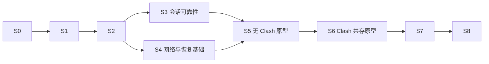

# JustConnect 实施计划与进度

更新日期：2026-10-19。当前仅完成 S0 的仓库、构建与文档准备；校园透明访问及自动共存尚未实现，也未完成真实校园登录验收。

## 使用方式

1. 从阶段总览选择下一项，按任务 ID 实施；ID 保持稳定，调整顺序时修改依赖和说明。
2. 开始任务时更新“当前工作”，记录已有证据和具体缺口；不把计划讨论计作功能开发已开始。
3. 任务完成其明确的交付与验证后才勾选，并在任务行末附提交、测试或实测记录。仅代码完成时保持未勾选，标为“待验收”。
4. 每次实现同时更新相关任务、阶段状态和受影响的验收记录。阶段状态使用：未开始、进行中、待验收、已完成、受阻；受阻须写明缺少的输入、设备或能力及可继续的独立工作。
5. 三平台可分别推进同一依赖链；某个平台通过不能替其他平台勾选。阶段完成须满足本阶段的全部完成条件，构建通过不能替代网络实测。
6. 新改动使已有结论失效时，重新打开相关任务或验收格，记录原因并保留原证据；不能让旧构建的通过状态沿用到未经验证的新核心或新网络路径。

本文件是任务和进度的主要记录。[架构说明](docs/ARCHITECTURE.md)描述当前代码，[开发说明](docs/DEVELOPMENT.md)维护构建操作；来源与历史案例放在文末参考索引。

## 当前工作

| 项目 | 当前记录 |
| --- | --- |
| 下一任务 | S1-01：确认开发环境与测试基线 |
| 状态 | 待验收：本地环境通过，更新后的 CI／预览构建待运行 |
| 已有基础 | `develop` 已配置三平台 CI 和手动六组预览构建，S0 已有通过记录 |
| 已知缺口 | 本地 Qt 6.12.0／WebEngine 6.140.0 候选构建已通过 16 项 CTest 和三项安装器测试；正在验证同版本的三平台 CI 和六组预览，固定核心源码仍待 S1-02 |
| 网络验证 | 暂无真实校园登录、透明转发、Clash 共存或异常恢复的通过记录 |
| 外部条件 | 实机验收需要相应操作系统、校园账户及交互式 MFA；缺少时记录待验收，不降低验收要求 |

## 阶段总览

| 阶段 | 交付目标 | 前置依赖 | 状态 |
| --- | --- | --- | --- |
| [S0](#s0) | 仓库、命名、工作流与文档基线 | 无 | 已完成 |
| [S1](#s1) | 可复现的应用／核心构建和契约样本 | S0 | 进行中 |
| [S2](#s2) | aTrust 配置、认证与基础设施结果可靠 | S1-01；核心交互还需 S1-02—04 | 未开始 |
| [S3](#s3) | 会话、保活、重连和正常关闭可靠 | S1、S2 | 未开始 |
| [S4](#s4) | 策略、平台网络操作和原型恢复基础 | S1、S2，可与 S3 的独立部分并行 | 未开始 |
| [S5](#s5) | Clash 未运行时的三平台透明原型 | 对应平台的 S3、S4 | 未开始 |
| [S6](#s6) | Clash 各开关组合的可行路径 | 对应平台的 S5 | 未开始 |
| [S7](#s7) | 自动发现、一键流程与完整恢复保障 | 对应平台的 S5、S6 | 未开始 |
| [S8](#s8) | 完整实测、安装包和交付文档 | S1—S7 | 未开始 |

主线先证明认证与数据路径可用，再完成自动化。S2 的平台错误传播和凭据存储可在核心构建期间独立实施；较大的配置封装、构建拆层和可选事件协议见“后续改进”，不阻塞透明原型验证。

## 全程保持的目标与约束

| ID | 要求 |
| --- | --- |
| R1 | Windows、macOS、Linux 同等支持网页和终端。PowerShell、zsh、bash 保持原用法，不配置代理环境变量、SSH 配置或 ProxyCommand，不重启已有终端；开启后可直接 SSH 到校园 IP／域名。已有连接不保证跨路径切换保持。 |
| R2 | 校园资源 → JustConnect → aTrust；普通流量沿用本地 Clash 分流，Clash 不可用时直连；局域网、WSL、Tailscale 等受保护目标保持原解析与路由。不能以 HTTP 代理连通推断任意 TCP／UDP 都受支持。 |
| R3 | 覆盖 Clash 未运行，以及运行时系统代理与 TUN 的四种开关组合，包含两者均关闭。两个开关独立，运行中切换不得要求重新配置校园访问，也不得强制切回用户刚修改的状态。另行核对 `rule/global/direct` 模式。 |
| R4 | 保护回环、实际局域网、WSL、Tailscale IPv4／IPv6、MagicDNS、子网路由、出口节点及检测到的其他覆盖网络。冲突默认保护原网络，允许按明确的目标／网段选择校园侧并撤销；不假定同一目标 IP 的两侧可同时访问。Tailscale 能否点对点直连仍受两端网络条件影响。 |
| R5 | 依据校园下发的域名、IP、端口及协议资源分流，不把整个 `10.0.0.0/8` 或整校域名强制送进 VPN。校园失败返回错误，不偷偷改走别的出口；用户明确选择原网络侧的冲突目标按选择处理。 |
| R6 | 产品仅启动 aTrust；提供 Fudan 与 Custom。复旦入口为 `vpn.fudan.edu.cn:443`，认证方式实时获取，优先 Fudan UIS OAuth2，登录域和登录地址不写死。保留其他学校的 aTrust 支持及必要 MFA。 |
| R7 | 修改网络前保存快照与所有权记录；任一步失败撤销本次修改，正常退出先解除接管、再停止核心。恢复不覆盖外部新设置，不猜测旧版本未保存的原始配置，不自动终止官方 VPN 或其他程序。 |
| R8 | 不导入其他应用的数据。自身配置升级保留有效值与用户选择，仅清理废弃字段和确认失效的缓存。认证缓存按学校／服务器／账户隔离并限制当前用户访问；密码和 TOTP 持久保存使用系统凭据服务，不回退到明文或 Base64；不默认关闭 TLS 校验，日志隐藏凭据、令牌、控制接口密钥及回调参数。 |

沿用 Qt Widgets 和轻量分层：`core` 保存规则与状态，`application` 定义端口并组织用例，`infrastructure` 实现进程／存储／系统能力，`presentation` 展示结果并接收操作。应用层可继续使用 Qt Core、QObject 和定时器，不依赖 Widgets、WebEngine 或具体平台实现。状态机决定动作，会话执行动作，不通过模拟按钮点击驱动重连或停止；主窗口与托盘使用同一会话。

## S0 仓库与开发流程基线

- [x] **S0-01**：应用名称、配置路径、更新来源和项目链接使用 JustConnect；采用 `ExternalCoreProcess`、`ConnectionError`、`JustConnect` 配置分组，兼容已有预览配置字段；保留第三方核心来源、许可证和贡献者致谢。证据：[954fc37](https://github.com/wtalioy/JustConnect/commit/954fc37989e7bb40e1cce8445942047d67eaa513)。
- [x] **S0-02**：`origin` 指向自己的独立仓库，保留历史及上游 remote；开发在 `develop`，推送／PR 运行三平台测试，手动预览提供六组产物；推送 `main` 打包，发布 Release 才上传对应附件。权限、预览签名与凭据配置见[开发说明](docs/DEVELOPMENT.md)。证据：仓库中的两份 workflow 及 S0-03 的运行记录。
- [x] **S0-03**：建立一次可用的云端构建基线：Windows、macOS、Linux 各 15 项测试及 x64／ARM64 六组预览包通过。证据：[测试](https://github.com/wtalioy/JustConnect/actions/runs/39243039993)、[预览打包](https://github.com/wtalioy/JustConnect/actions/runs/39243056960)，对应应用提交 `954fc37`。

完成范围仅限上述准备。README 当前留空，Windows／macOS 文件图标暂用系统默认；Apple 开发者签名和公证未验证。旧应用遗留的自启动项与网络设置清理仍由后续恢复工作处理，不能据此认定 S1—S8 已完成。

## S1 固定构建与核心契约

前置：S0。当前核心依赖为 [zju-connect](https://github.com/Mythologyli/zju-connect)。先建立复现和回归入口，后续核心补丁均更新这一阶段建立的清单与验证记录。

- [x] **S1-01**：准备并验证本地 Qt SDK、编译器、CMake 和测试运行方式，记录版本及路径；按开发说明编译当前应用并运行现有测试，无显示服务器时使用所需的 offscreen／虚拟显示环境。与云端结果分开记录。本地环境及复用命令见[开发说明](docs/DEVELOPMENT.md#当前-linuxwsl2-开发环境)，本次 CI 升级结果另记。
- [ ] **S1-02**：选定第三方核心源码提交，记录补丁顺序、校验和、许可证和构建来源；三平台从固定源码编译，替换当前下载浮动 `latest/nightly` 的方式。后续新增补丁必须更新清单，不直接依赖未合并 PR 的分支头。
- [ ] **S1-03**：为应用与核心建立参数／事件能力清单和启动自检，记录核心版本及补丁标识；缺少所需能力时明确报错，不盲传新参数。发布产物可追溯到实际核心构建。
- [ ] **S1-04**：收集固定核心的真实提示、认证结果和退出样本，脱敏后作为命令构造、输出缓冲、解析和会话替身的回归输入。覆盖标准输出／错误、分片、无换行和交互响应，不只修改测试期望值。

完成条件：同一清单能复现三平台核心，应用现有测试通过，打包实际携带所记录的核心；本地与云端环境记录明确。尚未据此宣称校园功能通过。

## S2 aTrust 配置、认证与基础结果

前置：S1-01；涉及核心的任务还需 S1-02—04。平台代理错误传播和凭据服务可独立先做。网关基线可在受控的无 Clash 环境实测，完整共存仍须经过 S5／S6；真实修改代理前先完成 S2-06。

- [ ] **S2-01**：修正 `SystemProxyBackend` 及平台实现的结果契约，检查真实系统 API／子进程状态、超时和必要字段回读；报告失败、权限取消、不支持及部分修改，不能在 `void` 调用后无条件返回成功。同步将平台／自启动实现中的弹窗移至界面层，按平台拆分源文件，由 CMake 选择实现。
- [ ] **S2-02**：限定 aTrust 产品范围，移除 EasyConnect 专用界面、参数、废弃字段及相应测试；增加 Fudan／Custom 配置入口。自身升级保持有效 aTrust 配置，不清空其他应用或所有账户的数据；旧字段清理与认证缓存清理分别处理。
- [ ] **S2-03**：将 `AuthInfoWindow` 的核心调用和结果解析收进适配层，通过应用用例返回认证方式；运行时获取 Fudan UIS／Custom 的登录域、方式与地址，验证认证链和 TLS 错误可被区分。认证成功仍不等于透明访问就绪。
- [ ] **S2-04**：接入系统凭据存储，处理锁定、不可用、拒绝和删除；保存失败可手动登录，不降级保存。需要迁移的自身旧凭据先确认安全写入，再移除旧值；保留有效配置，确保不同学校／服务器／账户不串用缓存。
- [ ] **S2-05**：统一事件识别与等待输入的提示规则，修复 aTrust TOTP、RADIUS、短信、OAuth2 回调及点击式验证码契约；处理大小写、尾空格、无换行和分片。无路径提示使用本次启动的图片路径，重试读取新图；取消或切换后旧认证结果不得提交给新连接。未支持的修改密码等后续步骤明确提示。
- [ ] **S2-06**：先完成当前系统代理的快照与按所有权恢复，确认原有代理／PAC／绕过项可保留；部分失败撤销已应用字段，外部新值不被覆盖。真实后端测试先具备这条恢复路径，正常退出不再直接清空未知设置，为 S3 的关闭验证提供基础。

完成条件：三平台后端与凭据服务均有真实结果验证；固定核心的离线交互回归通过，并取得 Fudan OAuth2 与另一学校／服务器认证样本的实测记录。涉及人工 MFA 的缺口保留待验收。

## S3 会话、保活、重连与正常退出

前置：S1、S2。只改善现有连接的可靠性，不引入透明接管。

- [ ] **S3-01**：区分进程启动、认证成功、续期／恢复、需要重新认证和业务就绪；在主窗口与托盘展示同一会话状态、最后一次保活时间与结果。没有事件时显示未知，不能以进程存活或日志安静推断在线。
- [ ] **S3-02**：审查并适配固定核心的会话续期／票据恢复能力；核心明确要求重新认证时进入终态，停止核心并提供一次登录入口，默认不静默重放密码。重复事件或晚到退出不能覆盖终态，也不能重复弹窗、停止或登录。
- [ ] **S3-03**：实现自动／指定目标／关闭保活，新增配置默认自动，旧配置按实际有效行为迁移并保留关闭选择和生效目标。区分 DNS 探测、应用流量保活与会话续期；仅使用获授权、可重复访问的资源，不向 SSH 等服务发送 HTTP 探测，不把 HTTPS／CONNECT 连通推断为续期成功。能力不足时明确说明。
- [ ] **S3-04**：按具体错误执行有界退避，限定次数与最大间隔并显示进度；错密、限流、证书、权限、核心不兼容和明确失效不进入自动登录循环，不能把所有初始化失败归为网络错误。断开／切换／退出取消计时器，恢复就绪后再重置预算，避免瞬断反复清零。
- [ ] **S3-05**：统一用户退出、系统会话结束和可捕获终止请求的关闭入口；认证／提权模态窗口不阻断，重复请求幂等，信号处理只通知主线程。核心先正常结束、等待有界结果，超时才处理残留；界面不提前退出事件循环，平台操作不长期阻塞主线程。
- [ ] **S3-06**：用现有核心替身覆盖启动失败、停止期间事件、重复完成、重连取消、保持进程存活的会话失效和旧连接回调；检查最终状态及副作用次数。对真实网关做超出其观测空闲时长的有／无保活对照，不套用别校超时结论。

完成条件：状态、重连和退出回归在三平台通过，真实会话与空闲对照有记录；关闭后当前已有代理设置的处理不误报成功。异常强杀和新网络接管的完整恢复仍需 S4／S7。

## S4 策略与网络操作的恢复基础

前置：S1、S2，可与 S3 的独立部分并行。先实现原型所需的最小操作与恢复能力，完整产品守护放在 S7。

- [ ] **S4-01**：读取校园资源、实际接口／路由／DNS、局域网、WSL、Tailscale 和其他覆盖网络，形成可解释的规则模型；保护目标优先，冲突仅按明确范围手动选择。策略同时约束透明入口与核心分流，不把所有受保护目标统一绑定物理网卡。
- [ ] **S4-02**：验证并实现版本化共存策略传递，包含上游代理、保护网段／域名和冲突选择；沿用可选策略文件方案验证原子写入、每秒检查、无效更新保留最后有效版本。格式和更新机制在决策记录中确认，新增核心参数必须经过 S1 的能力核对。
- [ ] **S4-03**：在 S2-06 的代理恢复基础上，为原型需要的路由、DNS、TUN 操作提供读取快照、应用、回读及按所有权恢复的后端；记录原值、实际修改和本次连接标识，失败能撤销部分完成的操作。外部新设置不被恢复覆盖，未知遗留配置只报告，不猜测或清空。
- [ ] **S4-04**：建立按平台授权的最小执行路径，拒绝授权时可取消且不留下修改；验证 AppImage 挂载／临时路径下核心可执行，提权文件的来源和目录权限可验证。检测到官方 VPN 运行时提示冲突，不自动终止它。
- [ ] **S4-05**：统一认证方式查询、登录、网关解析和重连的出口策略，避开 Clash Fake-IP 与 TUN 回环；分别处理控制连接、校园 DNS、业务和受保护网络出口。VPN 网关地址落在校园资源前缀内时仍可达，校园 DNS 必须经允许的资源路径到达，不靠任意换公共 DNS 掩盖错误。
- [ ] **S4-06**：在受控环境验证应用失败、部分成功、取消和外部改写时的恢复。原型变更前先有可验证的回滚及独立测试进程清理保障，不能依靠主窗口仍存活；未经这一项验证，不在日常网络环境应用透明接管。

完成条件：三平台具备原型需要的操作与恢复路径，故障注入证明只撤销自身修改；资源、出口和 DNS 规则可解释。记录原型环境与尚未覆盖的系统网络管理方式。

## S5 无 Clash 的透明原型

前置：对应平台 S3、S4。先证明应用代理之外的系统流量可以正确进入校园路径，再决定完整透明机制。

- [ ] **S5-01**：复用现有 SOCKS5／HTTP、`dial-direct-proxy` 等能力验证数据路径基线，分别验证校园入口、非校园出口和 UDP。默认仅回环监听，检查实际端口及中继地址；确需非回环监听时限定地址与访问范围，不把 `udp: true` 当作端到端证明。
- [ ] **S5-02**：实现最小透明入口，使未设置代理的已打开终端可直接 SSH 到校园 IP；同时验证非校园 TCP／UDP、局域网和受保护网络行为，不强制使用系统代理覆盖终端。
- [ ] **S5-03**：补系统 DNS 与核心内部 DNS 路径，验证校园域名 SSH、网页、公共域名和 MagicDNS；覆盖 A／AAAA、CNAME、缓存和断开重连。Fake-IP 过滤、选择解析服务器和解析请求的转发分别验证，不清空用户整套 DNS 配置。
- [ ] **S5-04**：验证地址重叠的默认保护、选择校园侧、切回原网络及撤销；明确不能同时访问的相同 IP。保护范围不得扩大成所有私网，校园失败不得偷走直连。
- [ ] **S5-05**：填写 V1 三平台结果、实际入口／DNS／出口和关闭后的恢复证据，确认所选方案具备 TCP、UDP 与相应 IPv6 能力。某平台缺少入口时先解决，不以其他平台的结果代替。

完成条件：V1 在三平台通过；实现路径和限制已有决策记录，校园访问、普通网络与受保护目标均能在开启／关闭后保持预期。

## S6 Clash 共存原型

前置：对应平台 S5。原型允许手工提供端口或临时规则来定位问题，最终用户流程仍须由 S7 自动完成。

- [ ] **S6-01**：验证 JustConnect → Clash 的非校园出口和 Clash → JustConnect 的校园入口，两侧使用一致的校园资源策略。从 Clash 转入的校园请求若不匹配核心资源则返回错误，不能经上游送回 Clash；本地代理、认证端点和网关不递归进入校园链。
- [ ] **S6-02**：逐项填写 V2—V5，覆盖网页先进入 Clash、终端直接连接以及两个开关运行中分别／同时切换。另测 `rule/global/direct`，不得通过强制切换用户模式或固定开关组合通过验收。
- [ ] **S6-03**：核对目标 Clash／Mihomo 控制接口能读取和修改的实际字段及重载方式；确定无需永久改写订阅的联动路径。需要临时规则时只增量处理本软件拥有的项，保留用户 DNS、过滤模式、代理组选择与其他规则；读取配置不等于能安全修改任意字段。
- [ ] **S6-04**：验证核心出站如何避开自身和 Clash 的再次捕获，排除先于校园分流；覆盖多网卡、网络切换、提权、AppImage 路径和进程匹配不可用的情况。自动检测网口或存在进程规则均不能单独作为通过证据，放行范围只覆盖所需连接或进程。
- [ ] **S6-05**：覆盖不同 Fake-IP 过滤模式、校园解析与现有缓存，以及用户已有的 `route-exclude-address`。若从 Clash TUN 排除校园目标，必须已有另一条验证过的接管路径；不能排除整段校园地址，`no-resolve` 也不代替校园 DNS。
- [ ] **S6-06**：在三平台复测 IPv4／IPv6、TCP／UDP、校园 SSH／网页与 Tailscale／局域网，记录两端规则命中和实际出口，确认无代理回环且普通流量保持 Clash 分流。

完成条件：V2—V5 全部通过，三平台均有可行的接管、DNS 和回环排除方案。不能将手工配置原型写成已交付的自动共存。

## S7 自动化、一键流程与完整恢复

前置：对应平台 S5、S6。根据已证明的路径实现产品流程，保持 R1—R8。

- [ ] **S7-01**：自动发现 Clash／Mihomo 实例、控制接口和实际代理端口，不固定假设为 `7890/11080`；Windows 覆盖 Clash Verge 命名管道，macOS／Linux 使用可用的本地接口。进程／端口／接口共同判断可用性，系统代理或 TUN 关闭不等于 Clash 未运行；多实例首次选择，失败允许手工填写，不记录控制密钥。
- [ ] **S7-02**：由应用层共存会话串联认证、核心启动、转发／DNS 就绪、应用接管和关闭；任何失败逆向撤销已完成操作。重连、会话失效和授权取消共用此生命周期，主窗口与托盘不维护第二套业务状态。
- [ ] **S7-03**：完成独立恢复守护及子进程退出约束，Windows 核心使用 Job Object，macOS／Linux 提供等效保障。覆盖主程序崩溃／强杀、核心崩溃、系统会话结束和恢复进程重启，只恢复仍属于本软件的设置，不终止其他软件的核心实例。
- [ ] **S7-04**：自动响应 Clash 启停、端口变化、订阅刷新、核心重启、出口和系统代理／TUN 切换，幂等更新有效策略，必要时重连校园隧道。普通用户切换 Clash 不导致争抢设置或关闭校园访问；其他外部修改只停止争抢受影响的项并提示，恢复不覆盖对方的新值。
- [ ] **S7-05**：接入已验证的临时联动与按所有权撤销；重复开启／关闭不积累代理、规则或 DNS 项，订阅刷新后重新核对，退出保留用户期间的新选择。清理确认属于旧版本的网络／自启动遗留，无法判定的项目明确提示。
- [ ] **S7-06**：主窗口和托盘统一“开启／关闭校园访问”，显示认证、就绪、重试与失败原因，提供必要的地址冲突选择；按实际修改收拢主窗口配置工作流、托盘展示和通知，组合入口保持装配职责，不为每个操作新增 Coordinator。
- [ ] **S7-07**：提供可解释的诊断结果，区分监听、认证入口、DNS、规则、回环和恢复失败；包含入口、解析来源、命中规则和出口并脱敏，不要求用户直接阅读完整抓包。操作异步且可取消，旧连接回调不得修改新状态。

完成条件：无需手工维护原型配置即可完成连接与共存，V6 的动态切换和异常恢复通过；完整恢复保障验证前不交付自动修改日常网络的版本。

## S8 实测与交付

前置：S1—S7。按实际构建的应用／核心组合验收，任务和记录注明提交、平台、架构与网络环境。

- [ ] **S8-01**：完成 V1—V5 三平台矩阵，覆盖 IPv4／IPv6、TCP／UDP、校园 IP／域名 SSH、网页、普通流量、Tailscale／MagicDNS／子网／出口节点、局域网、WSL 及地址冲突；比较关闭、开启、再次关闭的行为。
- [ ] **S8-02**：完成 V6 故障矩阵，包括端口占用、认证取消、权限拒绝、固定代理／PAC／自定义 DNS 和路由、睡眠唤醒、网络切换、长期离线、外部设置改写、核心与主程序崩溃／强杀、带模态窗口退出。无静默重复登录、无限重试或遗留网络设置。
- [ ] **S8-03**：完成 V7 桌面与产物检查：标准菜单／快捷键、键盘焦点、主题／字体／高 DPI、Dock／主窗口恢复及无托盘入口；目标 KDE／GNOME、X11／Wayland 行为可用。实际包验证 WebEngine 认证、AppImage 提权及 Windows ARM64 应用／核心／TUN 架构与运行。
- [ ] **S8-04**：运行与改动相符的自动测试和三平台 CI；手动生成同一提交的六组开发预览包，核对核心清单、动态依赖与可启动性。新增库或补丁同时检查许可证，打包成功不代替 V1—V7。
- [ ] **S8-05**：更新安装、认证、Clash 共存、冲突选择、恢复和诊断文档，明确已验证范围与限制；README 在使用流程稳定后补写真实内容。按开发说明执行 main／Release 工作流；未配置 Apple 凭据时仅标注临时签名预览，开发者签名与公证必须另有真实通过记录。

完成条件：V1—V7 全部通过，当前安装包可追溯且文档匹配实际行为；尚未覆盖的系统／学校明确记录，不能以默认值或宣传文字替代验证。发布签名的配置与验证状态独立记录，不冒充已公证。

## 验收记录

每格填写“未测／通过／失败／不适用（说明原因）”及证据链接。仅确实不存在的环境项可记不适用，不能用它跳过所承诺的平台或 Clash 组合；具体测试记录同时注明应用／核心提交、系统、架构、配置与结果。

| ID | 场景 | Windows | macOS | Linux |
| --- | --- | --- | --- | --- |
| V1 | Clash 未运行：校园 SSH／网页、普通网络、受保护网络及恢复 | 未测 | 未测 | 未测 |
| V2 | Clash 运行：系统代理关／TUN 关 | 未测 | 未测 | 未测 |
| V3 | Clash 运行：系统代理开／TUN 关 | 未测 | 未测 | 未测 |
| V4 | Clash 运行：系统代理关／TUN 开 | 未测 | 未测 | 未测 |
| V5 | Clash 运行：系统代理开／TUN 开 | 未测 | 未测 | 未测 |
| V6 | 动态切换、会话失效、崩溃、权限及按所有权恢复 | 未测 | 未测 | 未测 |
| V7 | 安装包、桌面交互、平台凭据服务及提权路径 | 未测 | 未测 | 未测 |

V2—V5 每项都要验证网页先入 Clash 与终端直连两条路径、校园 IP／域名、普通 TCP／UDP 和受保护目标，并记录 Clash 模式、Fake-IP、现有排除规则与开关变化。不同架构、桌面和学校的明细可链接独立记录；未通过的必测子项会使对应格保持未通过。

## 待定决策

| ID | 决策与收敛位置 | 当前状态 |
| --- | --- | --- |
| D1 | 固定核心提交与会话／保活补丁组合：S1-02、S3-02／03 | 待验证；不等待 PR 自动合并来替代审查 |
| D2 | 三平台透明入口、路由优先级、系统 DNS 与回环排除：S5、S6 | 待原型证明；各平台可采用不同实现 |
| D3 | Clash 可安全增量修改的字段、接口及重载路径：S6-03 | 待目标版本实测，不能预设任意字段均可通过 API 修改 |
| D4 | 共存策略文件格式、核心参数及更新机制：S4-02 | 以版本化策略文件方案开始验证；变更需保留更新、校验与恢复约束 |

确认决策时写明结论、依据、应用范围和对应任务／提交；失败的原型也保留结论，避免下一轮重复尝试。实测需要用户输入时记录具体所需账户／MFA／设备，其他独立任务继续推进。

## 后续改进

这些工作按实际需要安排，不要求在原型前一次性完成。状态不得与已交付功能混淆；若不纳入当前版本，记录理由和后续触发条件。

| ID | 工作与触发条件 | 当前状态 |
| --- | --- | --- |
| A1 | 完整配置用例边界：在 S2／S7 已修改字段的基础上，逐步收回 `ProfileService::settings()` 暴露的 `QSettings*`，统一读取、编辑、校验、保存与迁移，保存失败保留原有效配置，界面不持有切换后失效的存储指针；仍可使用 QSettings 后端 | 未开始 |
| A2 | 构建约束：按实际依赖拆出领域／应用库，测试链接同一实现；再视需要拆基础设施／界面。明确 PUBLIC／PRIVATE 依赖、收敛全局 include，并由 CI 检查禁止的反向引用；仅增加 Library Target 不算完成，领域／应用不得引入 Widgets／WebEngine | 未开始 |
| A3 | 结构化事件：文本契约稳定后，在选用核心中评估可选的版本化机器事件、事件类型与认证请求标识；诊断日志与会话事件分开，适配层验证能力和输入，未知事件不改变状态，保留的文本适配仍集中处理 | 待评估 |
| A4 | SSO 自动填充：确有需求时再做，按配置、VPN 来源、HTTPS 页面来源隔离，用户选择保存／删除，不覆盖已有输入，不替代手动登录和 MFA；与 Qt 托盘兼容分别处理 | 待评估 |
| A5 | 新核心或协议：出现真实差异后再提取参数、认证与事件适配，不把 CoreProcess 等同于协议插件；不预建动态加载、工厂体系、多套前端或 C ABI。当前仍使用部分 Qt Core 类型和事件机制 | 按需 |

## 进度与验证日志

这里只记录任务交付、验收结果或关键决策；一般文字修订通过 Git 历史查看，不增加功能完成度。

| 日期 | 任务／范围 | 证据与结论 | 仍未覆盖 |
| --- | --- | --- | --- |
| 2026-10-19 | S0-01—03 | 应用提交 `954fc37` 的三平台测试与六组预览构建通过，链接见 S0；仓库及工作流准备完成 | 本地 Qt、固定源码核心、校园功能、Apple 开发者签名／公证 |
| 2026-10-19 | S1-01，本地环境 | Arch Linux／WSL2 x86_64；Qt 6.12.0 + WebEngine 6.11.2，GCC 16.2.1、CMake 4.4.4、Ninja 1.13.2；应用编译成功，`ctest --preset local` 16/16 通过，含新增 HTML／JavaScript 运行测试；SDK 约 874 MiB、补充依赖约 6 MiB | 同次更新的云端 CI／六组预览待验证；WSLg 视觉、校园登录和共存未测 |
| 2026-10-19 | S1-01，SDK 兼容性 | Qt 6.12／WebEngine 6.11.2 在 Windows 实测 DLL 加载失败（错误 127），不采用；按已确认的版本选择，统一 Qt 6.12.0 + WebEngine 6.140.0 候选构建 `6.12.0-0-202609281005`。本地重新编译及 16 项 CTest、三项安装器测试通过，移除旧组件后 SDK 约 875 MiB | 候选组合的三平台 CI／六组预览待验证；WSLg 视觉、校园登录和共存未测 |

## 参考索引

以下为 2026-10-19 已核对的来源与采用范围，实施清单为进度依据。上游 issue 的单网关观察、PR 自述测试与历史修复均不等于本项目已经复现或通过。

| 来源 | 采用范围与对应任务 |
| --- | --- |
| [上游高级使用文档](https://github.com/chenx-dust/EZ4Connect/blob/c56e1673efa1c3c41f18c51092a05d9e7d8298a0/docs/ADVANCED_USAGE.md) | 两个方向的代理链、TUN 再次捕获、Fake-IP、UDP 与路由排除：S4-05、S5、S6；旧手工示例不作为自动共存的使用前提 |
| [Mihomo 路由规则](https://wiki.metacubex.one/config/rules/)、[DNS](https://wiki.metacubex.one/config/dns/)、[TUN](https://wiki.metacubex.one/config/inbound/tun/)、[API](https://wiki.metacubex.one/api/) | 匹配、解析、路由排除和控制接口分别核对，落实 S5-03、S6-03—05，不能互相替代 |
| [#57](https://github.com/chenx-dust/EZ4Connect/issues/57)、[PR #58](https://github.com/chenx-dust/EZ4Connect/pull/58) | aTrust 提示与验证码图片路径：S1-04、S2-05 |
| [#51](https://github.com/chenx-dust/EZ4Connect/issues/51)、[#26](https://github.com/chenx-dust/EZ4Connect/issues/26)、[PR #62](https://github.com/chenx-dust/EZ4Connect/pull/62)、[PR #65](https://github.com/chenx-dust/EZ4Connect/pull/65) | 会话失效、恢复与状态展示：S3-01／02／06、S7-02 |
| [#59](https://github.com/chenx-dust/EZ4Connect/issues/59)、[PR #61](https://github.com/chenx-dust/EZ4Connect/pull/61) | 保活语义、参数和迁移：S3-03，保留用户选择，不直接采用其把旧 false 一律转自动的迁移 |
| [PR #63](https://github.com/chenx-dust/EZ4Connect/pull/63) | 有界退避与进度：S3-04／06，不照搬全部初始化失败可重试的分类 |
| [PR #64](https://github.com/chenx-dust/EZ4Connect/pull/64)、已关闭的 [PR #22](https://github.com/chenx-dust/EZ4Connect/pull/22) | 有序关闭与子进程清理：S3-05、S4-06、S7-03；当前已有 terminate，不重复套用无条件 kill 的旧补丁 |
| [PR #55](https://github.com/chenx-dust/EZ4Connect/pull/55)、[#46](https://github.com/chenx-dust/EZ4Connect/issues/46) | 凭据隔离、异步生命周期与证书错误：S2-03／04、A4；不将完整自动填充或重建 Qt 作为共存前置 |
| [#53](https://github.com/chenx-dust/EZ4Connect/issues/53)、[#49](https://github.com/chenx-dust/EZ4Connect/issues/49)、[Qt 托盘修复](https://github.com/qt/qtbase/commit/6192d9edd00caa14ed6b67c32c0cd8cfe95cf815) | Dock／托盘／无托盘入口：S8-03、V7；优先满足最低系统版本的修复 SDK，确需回补才核对同版插件 ABI、签名与包内行为 |
| [Qt macOS](https://doc.qt.io/qt-6/macos-issues.html)、[Qt 托盘文档](https://doc.qt.io/qt-6/qsystemtrayicon.html) | 标准菜单／快捷键、关闭与退出、主题／字体／高 DPI 和目标 KDE／GNOME、X11／Wayland 桌面验证：S7-06、S8-03；QSS 保留系统焦点和可操作入口 |
| [#34](https://github.com/chenx-dust/EZ4Connect/issues/34)、[#36](https://github.com/chenx-dust/EZ4Connect/issues/36)、[#32](https://github.com/chenx-dust/EZ4Connect/issues/32) | 配置切换、重复绑定、缓存恢复与未支持的认证后续步骤：S2-02／05、S3-06；EOF 不自动等于缓存损坏，不清理所有配置，复用当前缓存清理入口 |
| [#30](https://github.com/chenx-dust/EZ4Connect/issues/30)、[#29](https://github.com/chenx-dust/EZ4Connect/issues/29)、[#4](https://github.com/chenx-dust/EZ4Connect/issues/4) | 静默启动的授权交互、AppImage 提权与 ARM64 运行：S4-04、S8-03；编译／签名成功不替代实测 |
| [#6](https://github.com/chenx-dust/EZ4Connect/issues/6)、[#28](https://github.com/chenx-dust/EZ4Connect/issues/28)、[#43](https://github.com/chenx-dust/EZ4Connect/issues/43) | 订阅覆盖、校园 DNS 可达与网关落在资源前缀内：S4-05、S6-03／05、S7-04／05；#43 仅复用冲突场景，不增加 EasyConnect 范围 |

本次筛查覆盖 45 条 issue 和 7 条开放 PR。核对时核心 [PR #157](https://github.com/Mythologyli/zju-connect/pull/157)、[#159](https://github.com/Mythologyli/zju-connect/pull/159)、[#162](https://github.com/Mythologyli/zju-connect/pull/162) 均未合并：#159 的会话恢复、#162 的应用流量保活以 #157 为前置，界面 #62／#65 又依赖对应事件。S1／S3 必须先审查选定组合、更新固定清单，再验证参数和事件；不能仅移植界面部分就勾选完成。界面 #63／#65 含 #62 的前置差异，移植时去重；已关闭的 #60 被 #61 替代，不重复纳入。
