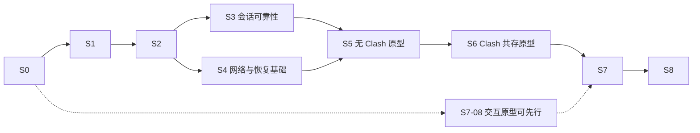

# JustConnect 实施计划与进度

更新日期：2026-10-21。当前已完成同仓 aTrust 核心库、C ABI／Qt 接入及 S2-09 的清理瘦身；Fudan 实测、设备权限、透明访问与自动共存仍按对应任务验收。

## 使用方式

1. 从阶段总览选择下一项，按任务 ID 实施；ID 保持稳定，调整顺序时修改依赖和说明。
2. 开始任务时更新“当前工作”，记录状态、依赖、验收证据和具体缺口。
3. 每个任务 ID（如 S1-10）完成其明确的交付、验证及全仓收尾复查后才勾选，并附清理／保留结论、提交、测试或实测记录；不等到整个 S1 结束才收尾。仅代码完成或尚未完成收尾时保持未勾选，标为“待验收”。
4. 每次实现同时更新相关任务、阶段状态和受影响的验收记录。阶段状态使用：未开始、进行中、待验收、已完成、受阻；受阻须写明缺少的输入、设备或能力及可继续的独立工作。
5. 三平台可分别推进同一依赖链；某个平台通过不能替其他平台勾选。阶段完成须满足本阶段的全部完成条件，构建通过不能替代网络实测。
6. 新改动使已有结论失效时，重新打开相关任务或验收格，记录原因并保留原证据；不能让旧构建的通过状态沿用到未经验证的新核心或新网络路径。

本文件只保留任务状态、最终结论、关键证据和未验收项；逐次实施流水由 Git 追溯，不再重复累计。[架构说明](docs/ARCHITECTURE.md)描述当前代码，[开发说明](docs/DEVELOPMENT.md)维护构建操作；来源与历史案例放在文末参考索引。

## 当前工作

| 项目 | 当前记录 |
| --- | --- |
| 当前任务 | S2-09 已完成；S2-08 等待 Windows Fudan 复测，系统浏览器方向由 S7-13 先验证自动交接 |
| 实测状态 | 用户已启用记住认证，Fudan 认证交互成功；核心在节点探测报 `tls_unknown_authority`，隧道尚未就绪。另一设备看到的在线 endpoint 不证明本地隧道可用；继承的 Ubuntu x64 标识不代表 Windows 宿主类型 |
| 验收范围 | 仅要求 Fudan 实测；按用户决定取消另一台 aTrust 服务器的硬性要求，保留 Custom 实现与服务器／账户隔离回归 |
| 剩余缺口 | S1-04 真实样本、S1-06 其余设备权限、Fudan TLS／认证恢复、透明访问、Clash 共存、真实桌面／旧系统、正式签名／公证仍未验收；D2 尚未选型 |
| 最新交付 | TLS 诊断包 `3586103`：[Windows x64](https://github.com/wtalioy/JustConnect/actions/runs/39574068891/artifacts/12334092282)／[ARM64](https://github.com/wtalioy/JustConnect/actions/runs/39574068891/artifacts/12333322993)；证书原因仍待实测，完整验证见[验证与收尾](#implementation-history) |

## 阶段总览

| 阶段 | 交付目标 | 前置依赖 | 状态 |
| --- | --- | --- | --- |
| [S0](#s0) | 仓库、命名、工作流与文档基线 | 无 | 已完成 |
| [S1](#s1) | 同仓库 aTrust 核心库、C ABI、Qt 适配与六组构建 | S0、已有 S1-01；先做 S1-06 | 进行中 |
| [S2](#s2) | aTrust 配置、认证复用与基础设施结果可靠 | S1-01；核心交互需 S1 库化契约与 Qt 适配 | 待验收（实现与收尾完成，待 Fudan 反馈） |
| [S3](#s3) | 会话、保活、重连和正常关闭可靠 | S1、S2 | 未开始 |
| [S4](#s4) | 策略、平台网络操作和原型恢复基础 | S1、S2，可与 S3 的独立部分并行 | 未开始 |
| [S5](#s5) | Clash 未运行时的三平台透明原型 | 对应平台的 S3、S4 | 未开始 |
| [S6](#s6) | Clash 各开关组合的可行路径 | 对应平台的 S5 | 未开始 |
| [S7](#s7) | 自动发现、一键流程、托盘、双语 UI 与完整恢复 | 网络实装依赖对应平台 S5／S6；UI 原型可先行 | 未开始 |
| [S8](#s8) | 完整实测、安装包和交付文档 | S1—S7 | 未开始 |

主线先完成库化的工具链／权限验证和会话边界，再证明认证与数据路径，最后完成自动化。S2 的平台错误传播、凭据存储可独立实施；结构化事件和 Go／C++ 构建边界已成为 S1 的必需交付，不再推迟到可选改进。各工作单元仍须先验证、提交，再继续依赖该单元的开发。针对性重构随受影响功能一同推进；UI 信息结构和原型可提前验证，再分步接入已证明的能力，避免所有界面改动积压到网络实现结束。

## 全程保持的目标与约束

| ID | 要求 |
| --- | --- |
| R1 | Windows、macOS、Linux 同等支持网页和终端。PowerShell、zsh、bash 保持原用法，不配置代理环境变量、SSH 配置或 ProxyCommand，不重启已有终端；开启后可直接 SSH 到校园 IP／域名。已有连接不保证跨路径切换保持。 |
| R2 | 校园资源 → JustConnect → aTrust；普通流量沿用本地 Clash 分流，Clash 不可用时直连；局域网、WSL、Tailscale 等受保护目标保持原解析与路由。不能以 HTTP 代理连通推断任意 TCP／UDP 都受支持。 |
| R3 | 覆盖 Clash 未运行，以及运行时系统代理与 TUN 的四种开关组合，包含两者均关闭。两个开关独立，运行中切换不得要求重新配置校园访问，也不得强制切回用户刚修改的状态。另行核对 `rule/global/direct` 模式。 |
| R4 | 保护回环、实际局域网、WSL、Tailscale IPv4／IPv6、MagicDNS、子网路由、出口节点及检测到的其他覆盖网络。冲突默认保护原网络，允许按明确的目标／网段选择校园侧并撤销；不假定同一目标 IP 的两侧可同时访问。Tailscale 能否点对点直连仍受两端网络条件影响。 |
| R5 | 依据校园下发的域名、IP、端口及协议资源分流，不把整个 `10.0.0.0/8` 或整校域名强制送进 VPN。校园失败返回错误，不偷偷改走别的出口；用户明确选择原网络侧的冲突目标按选择处理。 |
| R6 | 产品仅启动 aTrust；提供 Fudan 与 Custom。复旦入口为 `vpn.fudan.edu.cn:443`，认证方式实时获取，优先 Fudan UIS OAuth2，登录域和登录地址不写死。保留其他学校的 aTrust 支持及必要 MFA。 |
| R7 | 修改网络前保存快照与所有权记录；任一步失败撤销本次修改，正常退出先解除接管、再停止核心。恢复不覆盖外部新设置，不猜测旧版本未保存的原始配置，不自动终止官方 VPN 或其他程序。 |
| R8 | 不导入其他应用的数据。自身配置升级保留有效值与用户选择，仅清理废弃字段和确认失效的缓存。认证缓存按学校／服务器／账户隔离并限制当前用户访问；密码和 TOTP 持久保存使用系统凭据服务，不回退到明文或 Base64；不默认关闭 TLS 校验，日志隐藏凭据、令牌、控制接口密钥及回调参数。 |
| R9 | VPN 核心在 Qt 宿主进程内运行，通过内部 C ABI 调用；不以外部核心程序、本地控制 HTTP 服务或插件系统作为最终架构。必要的最小权限助手、恢复守护和 Qt WebEngine 子进程各有职责，不承载另一份 VPN 核心。同进程取消不能依赖杀子进程，宿主崩溃的网络恢复必须有独立保障。 |
| R10 | 围绕 JustConnect 的校园访问、共存和恢复需求主动优化、重构、精简代码及 UI，允许重新设计布局与操作流程；每次改动有明确改善目标、行为或性能验证和独立提交，不以改名、增加抽象层或堆砌选项代替改进。 |
| R11 | 日常流程遵守日常使用要求：打开后确认学校／服务器并连接，窗口和托盘都可连接／断开，关闭窗口默认后台保留，可在设置中改为关闭即退出；断开与注销认证分开。 |
| R12 | 应用界面与文案默认英文，可显式切换简体中文并保存选择；主窗口、托盘、设置、认证交互和应用生成的错误／通知使用同一语言。按钮文字由最终设计确定，不把本计划的示例当作固定文案。 |
| R13 | 提供可发现的设置页面，至少包含语言与主窗口关闭行为；应用偏好与学校配置分开管理，保存后按约定生效并跨重启保留。本节需求是基本目标，允许继续完善信息结构、视觉与交互设计，扩展须有实际用途并保持日常操作简洁。 |

沿用 Qt Widgets 和轻量分层：`core/` 保存 C++ 规则与状态，`application/` 定义 `CoreEngine` 端口并组织用例，`infrastructure/` 的 `EmbeddedCoreEngine` 实现 C ABI／存储／系统能力，`presentation/` 展示结果并接收操作。`corelib/` 统一放 JustConnect 的 Go 会话、C ABI 入口及整合后的协议源码，使用单一 Go 模块，不保留独立上游模块或 `third_party/zju-connect/`。来源和许可证就地记录，源码可直接优化、重构与精简；模块路径迁移服务于一体化构建，包名和协议实现不做批量改名。Go 协议细节不混入 C++ 领域模型。应用层可继续使用 Qt Core、QObject 和定时器，不依赖 Widgets、WebEngine 或 Go 实现细节。状态机决定动作，会话执行动作；主窗口与托盘使用同一会话。上述名称和目录是迁移目标，当前实现仍见架构说明。

## 日常使用要求

以下为基本要求，设计可进一步扩展，保持操作简洁；页面布局、控件和视觉风格由原型确定。`Connect`、`Disconnect`、`Open JustConnect`、`Exit` 仅为英文示例，最终文案以清晰、简洁及平台习惯为准。

| 场景 | 预期行为 | 实现与验收落点 |
| --- | --- | --- |
| 启动与确认服务器 | 正常启动显示主窗口及当前学校／服务器；首次未配置时可选择学校或填写 Custom。保留上次有效选择，日常确认后点击一个主操作即可连接，不必每次进入设置或重新输入服务器。默认不因启动或打开窗口自行发起连接，已有用户明确选择的自动连接设置单独保留 | S2-02／07、S7-06／08 |
| 主窗口连接／断开 | 未连接可连接，真正就绪后可断开；连接、认证、恢复和断开过程中显示实际状态并提供适当取消，阻止重复启动。断开结束校园隧道及接管、取消重连并恢复自身网络修改，程序保持运行；不把隐藏窗口或保留认证等同于连接仍在后台继续 | S3-01／04、S7-02／06 |
| 关闭窗口与后台驻留 | 托盘可用且未选择其他关闭行为时，点击主窗口关闭键默认隐藏到托盘，无论当前是否连接；保持既有连接与认证流程。设置可改为关闭即有序退出，保存偏好本身不执行关闭，下次关闭按选择生效。窗口最小化与关闭是不同动作，不额外要求把普通最小化改为隐藏。Windows 使用通知区域，macOS 使用菜单栏，Linux 使用桌面提供的托盘入口；选择隐藏但无托盘或入口不可用时保留可访问窗口及退出入口，不把唯一窗口隐藏到无法找回的位置 | S3-05、S7-06／08／12、S8-03 |
| 托盘操作 | 左键默认打开／恢复并激活主窗口；右键菜单未连接时可连接、已连接时可断开，并始终提供打开窗口与明确退出；处理中按同一会话状态禁用重复操作并提供适当取消。连接使用当前已确认配置，需要学号／密码、SSO 或 MFA 时才展示并激活相应交互，取消后回到一致状态，不重复弹窗。平台托盘点击／菜单事件差异须实测，保留等效且可发现的打开、连接／断开和退出路径 | S2-05、S7-06／10、S8-03 |
| 托盘状态 | 图标至少清楚区分已连接与未连接，提示文字／菜单与主窗口同步；连接中、需要认证、断开中或失败不能伪装为已连接。不仅依赖颜色，兼顾深浅主题、macOS 菜单栏图标和高 DPI。只由同一会话状态派生显示，不另维护托盘连接标志 | S3-01、S7-06／09 |
| 尽量免重复认证 | 将校园连接寿命与可复用认证状态分开：窗口隐藏、主窗口或托盘断开不主动清除仍有效的认证；再次连接先按服务器支持的方式恢复有效票据／会话，确需重新认证才弹窗。正常退出也不默认清除允许安全持久化的有效认证，重启后能否恢复按实测能力说明。明确“清除登录状态／登录数据”才删除对应缓存；服务器已失效、撤销或要求 MFA 时如实重新认证，不承诺永久免登录，也不靠静默重放密码或后台维持已断开的隧道实现 | S2-04／08、S3-02、S7-10 |
| 明确退出 | 托盘或应用菜单的 Exit 始终执行有序退出，不受关闭行为设置影响；选择“关闭即退出”后的主窗口关闭也进入同一退出流程。即使窗口已隐藏或认证弹窗打开，也须取消交互及重连、撤销自身网络修改、停止核心并结束程序。清理失败／超时走已有恢复约束，退出与普通断开均不顺带清空有效配置或认证缓存 | S3-05、S7-03／06、S8-02 |
| 设置页面 | 主窗口提供清楚的设置入口，至少可更改语言和主窗口关闭行为。语言默认 English、可选简体中文；关闭行为默认隐藏到托盘、可选退出应用，并说明连接与后台运行的影响。两项均为应用偏好，不随学校／账户切换，不要求断开连接才能修改；保存失败保留原有效值并明确反馈，不显示虚假的保存成功。无托盘时提示后台隐藏不可用并保留可访问窗口及明确退出入口，不静默变更或覆盖用户偏好；已选择的关闭即退出不依赖托盘可用性 | S7-08／11／12、S7-10、S8-03 |
| 默认英文与中文切换 | 未选择语言时使用英文，不随系统中文环境自动改成中文；设置可切换简体中文，选择属于应用而非学校配置，重启后保留。切换更新已有窗口、托盘及随后出现的交互，不重连、不清认证；应用可控制的文案完整翻译，学校自身 SSO 网页和系统授权界面的语言遵循各自设置 | S7-11、S7-10、S8-03 |

## JustConnect 的产品取向与持续收敛

自己的特色落实在日常使用和实现质量上：一键进入校园网络，日常终端与网页照常使用，Clash／Tailscale／局域网保持原有行为；状态与失败原因可理解，改动范围可解释且能够恢复。核心实现可围绕这些目标直接调整，保留有价值的协议和平台能力，不受上游 CLI 的配置粒度、类划分与窗口布局限制。

| 方向 | 具体做法与验收落点 |
| --- | --- |
| 一致的校园策略 | 校园资源、保护目标、地址冲突选择形成同一份策略，由核心、Clash 联动和诊断共同使用；同一目标不能在不同入口产生互相矛盾的解释。S4、S6、S7-07 |
| 简洁的操作流程 | 首次选择 Fudan／Custom 并完成必要认证；日常确认当前学校／服务器后连接，主窗口与托盘均可断开／重连，窗口默认关闭到托盘。有效认证尽量复用，MFA、权限和冲突只在需要时出现；高级参数归入设置，日志按需展开。具体行为按上方交互要求验收。S2、S3、S7-06／08／10 |
| 清楚的运行状态 | 首页说明当前学校／配置、是否真正就绪、正在等待什么，以及可执行的下一步；校园、Clash 共存与原网络保护按实际观测展示，未知明确标注。状态不依赖用户阅读日志，也不以进程存在代替连通。S3-01、S7-06／07 |
| 针对性的代码收敛 | 优先收回分散的配置读写／校验、重复状态映射、主窗口与托盘的平行流程、旧核心兼容分支和重复平台逻辑。复用已有会话、配置服务和端口，按实际变化原因拆分职责；每次重构说明删减了哪些重复和保持了哪些行为。S1-10／11、S2-01／07、S7-06 |
| 有证据的性能优化 | 按真实场景测启动、连接／取消、重连、CPU／内存、日志积压和吞吐；优先处理重复资源解析、无界日志／缓存、忙轮询、同步阻塞和不必要跨 FFI 拷贝等实测热点。记录前后数据及网络行为回归，不承诺仅凭库化或代码减少就提高性能。S1-04／11、S7-09／10、S8 |
| 舒服且统一的视觉 | 以重新设计并美化整套 UI 为明确目标，按日常连接流程重做页面布局、信息层级和视觉风格；沿用 Qt Widgets 实现，默认英文、可切简体中文，统一字号层级、留白、间距、图标、色彩和状态文案；支持浅／深色、高 DPI、键盘与屏幕阅读器，保留三平台菜单和窗口习惯。视觉强调当前状态与主操作，默认展示的信息量与用户当前任务相称。S7-08／09／11、S8-03 |

实施时以用户场景确定边界；每次只改一个可验证的功能或重构单元，及时删除被替代的分支、样式和配置项，同时维护有效配置迁移与测试。设计和代码优化是持续工作，不另起一次全面重写，也不要求先建通用插件或设计框架。界面只展示已实现的能力，静态原型与真实联网验收分别记录。

## S0 仓库与开发流程基线

- [x] **S0-01**：完成 JustConnect 命名、配置路径、来源与许可证基线（`954fc37`）；旧进程命名已由 S1 的正式库替代。
- [x] **S0-02**：独立仓库保留上游 remote，在 develop 开发；测试／预览／main 打包与 Release 规则见[开发说明](docs/DEVELOPMENT.md#分支与-actions)。
- [x] **S0-03**：建立三平台测试与六组预览基线：[测试](https://github.com/wtalioy/JustConnect/actions/runs/39243039993)、[打包](https://github.com/wtalioy/JustConnect/actions/runs/39243056960)。

README 暂留空，文件图标暂用系统默认；正式签名／公证及用户旧网络设置恢复仍按后续任务验收。

## S1 核心库化与同进程集成

前置：S0。应用、测试与打包已统一使用本仓库核心；S1 整体仍因真实样本和设备权限保留待验收。

- [x] **S1-01**：本地 SDK、编译与应用测试通过；当前版本／路径见[本地环境](docs/DEVELOPMENT.md#当前-linuxwsl2-开发环境)。
- [x] **S1-02**（历史基线）：完成固定上游核心的独立程序构建；已被 S1-05／09／10 替代，旧清单／下载／补丁链路已删除，来源留在 [UPSTREAM.md](corelib/UPSTREAM.md)。
- [x] **S1-03**：ABI v1 采用不透明句柄、有界 JSON 事件、调用者缓冲区和能力查询；支持一个活动会话、会话／请求标识、认证回应、取消及安全释放。契约与边界回归见 [CORE-ABI.md](docs/CORE-ABI.md)。
- [ ] **S1-04**：建立 Go 单元测试、真实 C ABI 宿主集成测试及 Qt 适配回归，使用受控 HTTP／TLS 网关与脱敏的真实资源／认证样本。覆盖错误输入、内存所有权、认证取消／超时／重复或过期回应、监听端口冲突、半途失败、终态事件、事件积压与旧会话结果。验证重复启停后监听端口、会话 goroutine、TUN／路由所有权和句柄释放；压力与竞态检查按工具链实际支持执行，不通过关掉 cgo 指针检查来过关。真实校园样本缺少时保留待验收，不将模拟网关写成 Fudan 实测。
  - Go、C11／C++、Qt／真实受控网关、事件积压、错误／取消／重启及支持环境的 race 已通过；真实校园样本与设备所有权尚未补齐。
- [x] **S1-05**：协议源码整合为 `corelib/` 单一 Go 模块，固定工具链／依赖锁、来源与许可证；无独立上游模块、运行时下载或补丁队列（`1611e9c`）。
- [ ] **S1-06**：用最小 C ABI 库链接当前 Qt 的 Windows／macOS／Linux x64 与 ARM64 宿主，验证初始化、调用、工作线程、缓冲区及重复创建／销毁。优先 `c-archive` 静态链接；必须实测 Windows cgo 编译器、Qt MSVC、COFF／CRT／链接器组合，不能由 Go 宣称支持某 buildmode 推断 MSVC 已兼容。静态路径确有阻碍时验证随包固定的 `c-shared` 库，仍同进程调用；选择和证据写入 D5，不退回外部核心，不为库化整体更换 Qt。提前核对 TUN 创建、设备权限、句柄／fd 生命周期及 GUI／WebEngine 权限边界；不能假定 Windows Wintun 句柄可像 Unix fd 一样跨进程交付。必要助手只做最小网络操作；若某平台尚无法让非提权宿主持有数据路径，明确记录阻塞，不能默认将整个 GUI 提权或把核心移入助手。CI 链接通过与真实设备权限验收分别记录。
  - 六组实际调用已通过，Unix 选 c-archive，Windows 选固定 c-shared DLL；Windows 静态路径首次 Go 调用超时，不再重复试探。WSL2／Linux x64／ARM64 的隔离 TUN fd 交付、普通用户双向收发及正常／强杀清理通过；Go／Qt 设备接入、真实授权和 macOS／Windows 非提权设备交付仍待验收。证据与复现见 [CORELINK-PROBE.md](docs/CORELINK-PROBE.md)。
- [x] **S1-07**：会话拥有认证／隧道、gVisor、解析与监听；消除进程退出／stdin／全局日志接管，完成 setup 与长期会话的取消、幂等释放及部分失败清理（`00fcf5d`）。
- [x] **S1-08**：CoreEngine／EmbeddedCoreEngine 替代旧进程、命令／文本解析和 CLI 查询；专属 Qt 线程驱动 C ABI，排队交付事件，验证晚到回应与销毁竞态（`29932b3`、`8c9c23c`）。
- [x] **S1-09**：共享 CMake 构建 Go／C ABI，三平台测试和六组实际包统一验证来源、ABI、架构、依赖、系统下限及签名；维护源码归档可无 Git 重建。操作与约束见[开发说明](docs/DEVELOPMENT.md)。

- [x] **S1-10**：删除旧核心下载／补丁／EXE 校验、Wintun 分发、无用 action／依赖与专属测试，保留系统操作所需 QProcess（`8d79d47`）。全仓调用／测试／构建复查及三平台／六组包验证通过。

- [x] **S1-11**：删除无调用的 CLI／EasyConnect／移动端专用分支、旧策略及包装，合并无独有契约的测试；保留协议、失败／取消／平台回归、许可证及实际数据栈依赖。全仓收尾与六组验证通过（`6db2c06`）；包体积、CPU／RSS、TCP／UDP、20 次重连和慢节点原始基线统一见[性能基线](docs/DEVELOPMENT.md#s1-11-历史测量基线)。

完成条件：正式会话与六组包已验收；真实样本及设备权限仍须完成 S1-04／06。透明入口不由库化决定，继续按 D2／S5／S6 选型。

## S2 aTrust 配置、认证与基础结果

前置：基础设施和纯配置可独立推进，核心交互使用已验收的 S1 契约；本阶段整体待 Fudan 人工反馈。

- [x] **S2-01**：SystemProxyBackend 返回经 API／子进程及必要回读验证的结果，区分失败、权限、取消、不支持与部分修改；弹窗归界面，平台／自启动按系统拆分，由共享 CMake 选择。

- [x] **S2-02**：仅提供 aTrust 的 Fudan／Custom 配置；真实 C ABI 纯校验替代任意 CLI 参数，删除旧高级／EasyConnect 控件和运行字段。升级保留有效值、未知键与其他账户；导入／重置先改草稿，导出原子提交（`06c23a0`、`2ec3237`、`4c27335`）。

- [x] **S2-03**：AuthMethodsQuery 异步查询并等待清理终态，交付完整认证身份及运行时登录 URL；统一 TLS 拨号与信任／协议／网络分类，默认严格校验。学校 CA 仅作用于本会话，不改全局信任；清理过期查询和重复握手包装。

- [x] **S2-04**：密码／TOTP、账户级认证材料使用系统安全存储，失败可手动登录且不写明文；迁移先验证安全写入再清旧值。串行 CredentialAccess 校验来源、账户及修订，覆盖锁定、失败保值、取消和晚到结果。

- [x] **S2-05**：结构化 Handler／ABI 交付短信、TOTP、RADIUS、CAS／OAuth2、文字／点击验证码及可信设备；支持取消、超时和过期回应拒绝。回调验证网关来源／路径／唯一票据，SSO 使用独立内存 Profile 与会话 TLS 策略，日志不含票据；不支持的后续步骤明确失败。

- [x] **S2-06**：系统代理按快照和所有权恢复，部分写入失败回滚自身修改，外部新值不覆盖；异常／强杀由独立恢复任务继续处理。三平台真实后端隔离回归通过，不据此宣称用户桌面／校园恢复已验收。

- [x] **S2-07**：ProfileService 统一公开配置映射、校验、编辑／保存／切换；窗口持来源快照，异步凭据与独立密码／TOTP 清除复用串行入口。覆盖保存失败、取消、切换、晚到窗口结果及重启迁移；删除重复读写，保留当前仍需的 QSettings 后端。

- [ ] **S2-08**（实现与任务收尾完成，待 Fudan 人工验收）：建立与活动隧道分离的认证缓存生命周期，复用实际核心支持的票据／Cookie／设备身份恢复路径；若 C ABI 缺少必要输入／输出，按现有版本化契约补齐并验证真实 Qt／Go 调用，不另起登录后端。按学校／服务器／账户隔离，窗口隐藏、普通断开或退出不主动注销／清除仍有效且允许保存的材料；切换账户只使用该账户的缓存，显式清除或服务器明确失效时按作用域处理，不误删其他账户。有效期及恢复结果遵循协议与服务器，不硬编码免登录时长；不可恢复时进入一次必要认证，瞬时网络失败不直接抹掉有效缓存。覆盖安全存储失败、缓存损坏／过期、同账户断开重连、账户隔离、显式清除及重启恢复，记录目标学校的实际支持范围。
  - **实现与回归已完成**：ABI／Qt 支持有界认证缓存输入／更新／明确失效；授权保存的认证在普通停止及重启时按账户恢复，明确清除推进代次，旧回调不能重建。首次 SSO 先绑定服务器确认账户，正常退出等待核心／后台存储／绑定续接。
  - **Fudan 待复测**：Windows 认证后在节点探测报 `tls_unknown_authority`，隧道未就绪；具体证书链与可信来源仍待核对。本轮修复多节点超时掩盖证书错误，并补充叶证书／自签名固定诊断；保持严格校验，资源／隧道失败保留已授权保存的有效认证。本地 19 包检查、bridge race、应用 26 项／原生 13 项通过；[三平台 Tests](https://github.com/wtalioy/JustConnect/actions/runs/39573777873)、[六组 Core ABI](https://github.com/wtalioy/JustConnect/actions/runs/39573777990)及[六组诊断包](https://github.com/wtalioy/JustConnect/actions/runs/39574068891)通过（`3586103`）。
  - **剩余验收**：用户 Windows Fudan 首次 OAuth2、普通断开重连、退出重启恢复、明确清除后重新认证及过期／MFA 行为；记录实际认证次数和学校策略。另一台 aTrust 实测已取消，不据此提前勾选本项。

- [x] **S2-09**：复测前完成职责收拢、旧路径清理和包瘦身（`c72c68b`、`7cbb82a`、`0c4cd2a`、`e1853a4`）。AuthenticationCacheCoordinator 维护保存／失效／SSO 绑定，UI 处理意图与提示；删除 ResourceData／canResume／直接 Restore 旁路及专属测试，生命周期夹具改走正式恢复。Release 省略 Go DWARF、按配置隔离产物；Windows 移除非英语／简中语言包及 QML 调试插件，并验证实际安装和包内双语言页面／JavaScript。全仓收尾与最终六组包通过，保留条件和证据见[验证与收尾](#implementation-history)。

| Windows 包 | 旧 ZIP MiB | 当前 ZIP MiB | 减少 | 当前安装字节 |
| --- | ---: | ---: | ---: | ---: |
| x64 | 143.63 | 126.34 | 12.03% | 293,201,230 |
| ARM64 | 126.11 | 109.19 | 13.42% | 270,432,918 |

Linux x64／ARM64 AppImage 分别减少约 2.07%／1.90%；macOS 安装体积基本不变，不把压缩波动计为运行时收益。Windows 原生文件由各 47 减至 35；WebEngine 主库及必需资源仍保留，替代方案由 S7-13 验证。

完成条件：三平台后端／凭据与真实 FFI 自动回归已通过；S2-08 的 Fudan OAuth2、TLS 和认证保留仍待人工结果。保留 Custom 与服务器／账户隔离，不再要求另一台 aTrust 实测。

## S3 会话、保活、重连与正常退出

前置：S1、S2。只改善现有连接的可靠性，不引入透明接管。

- [ ] **S3-01**：区分库初始化、会话启动、认证成功、续期／恢复、需要重新认证和业务就绪；在主窗口与托盘展示同一会话状态、最后一次保活时间与结果。没有事件时显示未知，不能以宿主存活、库调用返回成功或日志安静推断在线。
- [ ] **S3-02**：审查并适配固定核心的会话续期／票据恢复能力；复用 S2-09 的认证缓存协调器及现有 ConnectionSession，不在重连／界面中再建一套缓存代次与保存状态。核心明确要求重新认证时进入终态，停止核心并提供一次登录入口，默认不静默重放密码。重复事件或旧会话完成不能覆盖终态，也不能重复弹窗、停止或登录。优先使用 S2-08 的有效认证恢复，区分网络暂时失败与服务器明确失效；普通断开不等于注销，不为维持认证继续转发流量。
- [ ] **S3-03**：实现自动／指定目标／关闭保活，新增配置默认自动，旧配置按实际有效行为迁移并保留关闭选择和生效目标。区分 DNS 探测、应用流量保活与会话续期；仅使用获授权、可重复访问的资源，不向 SSH 等服务发送 HTTP 探测，不把 HTTPS／CONNECT 连通推断为续期成功。能力不足时明确说明。
- [ ] **S3-04**：按具体错误执行有界退避，限定次数与最大间隔并显示进度；错密、限流、证书、权限、核心不兼容和明确失效不进入自动登录循环，不能把所有初始化失败归为网络错误。断开／切换／退出取消计时器，恢复就绪后再重置预算，避免瞬断反复清零。
- [ ] **S3-05**：统一用户退出、系统会话结束和可捕获终止请求的关闭入口；认证／提权模态窗口不阻断，重复请求幂等，由 Qt 宿主管理进程级信号。先解除网络接管，再取消库会话并等待有界清理，最后停止事件泵／销毁句柄；不通过 kill 子进程或强杀 Go／Qt 工作线程模拟关闭。超时停止重连和新会话启动，记录残留、执行独立恢复并提示重启；不卸载仍有执行线程的库。界面在有序关闭前保留事件循环，平台操作不长期阻塞主线程。主窗口关闭由 S7-12 的应用偏好决定，默认隐藏到可用托盘；选择关闭即退出、明确 Exit 或系统结束均进入同一有序关闭入口，无托盘时不得隐藏唯一可操作窗口。设置页和认证对话框的关闭／取消按各自语义处理，不套用主窗口退出偏好。
- [ ] **S3-06**：用现有核心替身覆盖启动失败、停止期间事件、重复完成、重连取消、宿主仍存活时的会话失效和旧连接事件；检查最终状态及副作用次数。对真实网关做超出其观测空闲时长的有／无保活对照，不套用别校超时结论。补充有效认证恢复、过期后只出现一次认证交互、主动断开不重连、断开不清票据以及明确清除后不再复用的回归。

完成条件：状态、重连和退出回归在三平台通过，真实会话与空闲对照有记录；关闭后当前已有代理设置的处理不误报成功。异常强杀和新网络接管的完整恢复仍需 S4／S7。

## S4 策略与网络操作的恢复基础

前置：S1、S2，可与 S3 的独立部分并行。先实现原型所需的最小操作与恢复能力，完整产品守护放在 S7。

- [ ] **S4-01**：读取校园资源、实际接口／路由／DNS、局域网、WSL、Tailscale 和其他覆盖网络，形成可解释的规则模型；保护目标优先，冲突仅按明确范围手动选择。策略同时约束透明入口与核心分流，不把所有受保护目标统一绑定物理网卡。
- [ ] **S4-02**：通过核心库 API 传入带版本与会话代次的共存策略，包含上游代理、保护网段／域名和冲突选择；先校验完整快照，再原子替换并回报生效代次，无效更新保留最后有效版本。取消原跨进程策略文件轮询作为主路径的设计；文件仅按实际需要用于诊断导出。更新与关闭竞态、旧代次拒绝和错误分类须有回归，能力通过 S1 的 ABI／能力查询核对。
- [ ] **S4-03**：在 S2-06 的代理恢复基础上，为原型需要的路由、DNS、TUN 操作提供读取快照、应用、回读及按所有权恢复的后端；记录原值、实际修改和本次连接标识，失败能撤销部分完成的操作。外部新设置不被恢复覆盖，未知遗留配置只报告，不猜测或清空。
- [ ] **S4-04**：按 S1-06 的实际设备权限结论实现最小授权路径：核心仍在 Qt 进程，助手只执行经验证的设备／路由／DNS 操作，验证调用者、会话所有权、参数和授权结果；拒绝或取消不留修改，不交付可任意执行命令的高权限接口。验证 AppImage 挂载路径、只读包、助手可信来源与句柄／fd 归属，不默认给 GUI／WebEngine 整体提权。检测到官方 VPN 运行时提示冲突，不自动终止它。
- [ ] **S4-05**：统一认证方式查询、登录、网关解析和重连的出口策略，避开 Clash Fake-IP 与 TUN 回环；分别处理控制连接、校园 DNS、业务和受保护网络出口。VPN 网关地址落在校园资源前缀内时仍可达，校园 DNS 必须经允许的资源路径到达，不靠任意换公共 DNS 掩盖错误。
- [ ] **S4-06**：在受控环境验证应用失败、部分成功、取消和外部改写时的恢复。原型变更前先有可验证的回滚及独立测试进程清理保障，不能依靠主窗口仍存活；未经这一项验证，不在日常网络环境应用透明接管。

完成条件：三平台具备原型需要的操作与恢复路径，故障注入证明只撤销自身修改；资源、出口和 DNS 规则可解释。记录原型环境与尚未覆盖的系统网络管理方式。

## S5 无 Clash 的透明原型

前置：对应平台 S3、S4。先证明应用代理之外的系统流量可以正确进入校园路径，再决定完整透明机制。

- [ ] **S5-01**：复用库内 SOCKS5／HTTP、显式上游 dialer 等能力验证数据路径基线，分别验证校园入口、非校园出口和 UDP。默认仅回环监听，检查实际端口及中继地址；确需非回环监听时限定地址与访问范围，不把 `udp: true` 当作端到端证明。
- [ ] **S5-02**：实现最小透明入口，使未设置代理的已打开终端可直接 SSH 到校园 IP；同时验证非校园 TCP／UDP、局域网和受保护网络行为，不强制使用系统代理覆盖终端。
- [ ] **S5-03**：补系统 DNS 与核心内部 DNS 路径，验证校园域名 SSH、网页、公共域名和 MagicDNS；覆盖 A／AAAA、CNAME、缓存和断开重连。Fake-IP 过滤、选择解析服务器和解析请求的转发分别验证，不清空用户整套 DNS 配置。
- [ ] **S5-04**：验证地址重叠的默认保护、选择校园侧、切回原网络及撤销；明确不能同时访问的相同 IP。保护范围不得扩大成所有私网，校园失败不得偷走直连。
- [ ] **S5-05**：填写 V1 三平台结果、实际入口／DNS／出口和关闭后的恢复证据，确认所选方案具备 TCP、UDP 与相应 IPv6 能力。某平台缺少入口时先解决，不以其他平台的结果代替。

完成条件：V1 在三平台通过；实现路径和限制已有决策记录，校园访问、普通网络与受保护目标均能在开启／关闭后保持预期。

## S6 Clash 共存原型

前置：对应平台 S5。原型允许手工提供端口或临时规则来定位问题，最终用户流程仍须由 S7 自动完成。

- [ ] **S6-01**：验证 JustConnect → Clash 的非校园出口和 Clash → JustConnect 的校园入口，两侧使用一致的校园资源策略。从 Clash 转入的校园请求若不匹配核心资源则返回错误，不能经上游送回 Clash；本地代理、认证端点和网关不递归进入校园链。
- [ ] **S6-02**：逐项填写 V2—V5，覆盖网页先进入 Clash、终端直接连接以及两个开关运行中分别／同时切换。另测 `rule/global/direct`，不得通过强制切换用户模式或固定开关组合通过验收。
- [ ] **S6-03**：核对目标 Clash／Mihomo 控制接口能读取和修改的实际字段及重载方式；确定无需永久改写订阅的联动路径。需要临时规则时只增量处理本软件拥有的项，保留用户 DNS、过滤模式、代理组选择与其他规则；读取配置不等于能安全修改任意字段。
- [ ] **S6-04**：验证同进程核心出站如何避开自身和 Clash 的再次捕获，排除先于校园分流；覆盖多网卡、网络切换、提权和 AppImage 路径。原 `zju-connect` 进程排除规则不再适用，也不能仅把它改成整个 JustConnect 进程直连：同一进程的控制连接、校园转发、普通上游流量和网页／更新访问必须分别遵守 R2。以实际 socket／接口／路由等机制证明出口，自动网口检测或进程规则存在均不能单独计为通过。
- [ ] **S6-05**：覆盖不同 Fake-IP 过滤模式、校园解析与现有缓存，以及用户已有的 `route-exclude-address`。若从 Clash TUN 排除校园目标，必须已有另一条验证过的接管路径；不能排除整段校园地址，`no-resolve` 也不代替校园 DNS。
- [ ] **S6-06**：在三平台复测 IPv4／IPv6、TCP／UDP、校园 SSH／网页与 Tailscale／局域网，记录两端规则命中和实际出口，确认无代理回环且普通流量保持 Clash 分流。

完成条件：V2—V5 全部通过，三平台均有可行的接管、DNS 和回环排除方案。不能将手工配置原型写成已交付的自动共存。

## S7 自动化、UI 重设计与完整恢复

前置：网络联动和真实就绪依赖对应平台 S5、S6；S7-08 的交互原型可在库化期间独立先做，S7-09 可在原型与状态契约明确后逐步实施。根据已证明的路径接入产品流程，保持 R1—R13。UI 顺序为 S7-08 → S7-12／S7-11／S7-09／S7-06 → S7-10，其中认证浏览器部分以 S7-13 的方案验证为前置，业务自动化按各项依赖推进；不把新 UI 当成网络能力已完成。

- [ ] **S7-01**：自动发现 Clash／Mihomo 实例、控制接口和实际代理端口，不固定假设为 `7890/11080`；Windows 覆盖 Clash Verge 命名管道，macOS／Linux 使用可用的本地接口。进程／端口／接口共同判断可用性，系统代理或 TUN 关闭不等于 Clash 未运行；多实例首次选择，失败允许手工填写，不记录控制密钥。
- [ ] **S7-02**：由应用层共存会话串联认证、核心启动、转发／DNS 就绪、应用接管和关闭；任何失败逆向撤销已完成操作。重连、会话失效和授权取消共用此生命周期，主窗口与托盘不维护第二套业务状态。
- [ ] **S7-03**：完成独立于 Qt／Go 宿主的恢复守护，覆盖宿主崩溃／强杀、库不可恢复故障、系统会话结束、超时关闭及恢复进程重启；同进程核心不再配置独立 Job Object。必要权限助手的生命周期另行约束，不能把“核心不再是子进程”视为不需恢复。只恢复仍属于本软件的设置，不终止其他软件或其核心实例。
- [ ] **S7-04**：自动响应 Clash 启停、端口变化、订阅刷新、核心重启、出口和系统代理／TUN 切换，幂等更新有效策略，必要时重连校园隧道。普通用户切换 Clash 不导致争抢设置或关闭校园访问；其他外部修改只停止争抢受影响的项并提示，恢复不覆盖对方的新值。
- [ ] **S7-05**：接入已验证的临时联动与按所有权撤销；重复开启／关闭不积累代理、规则或 DNS 项，订阅刷新后重新核对，退出保留用户期间的新选择。清理确认属于旧版本的网络／自启动遗留，无法判定的项目明确提示。
- [ ] **S7-06**：按新信息结构实现主窗口与托盘共用的“开启／关闭校园访问”，由同一会话状态导出主操作、进度、取消／重试和通知；失败提供明确原因与下一步，地址冲突提供可撤销选择。默认流程由会话完成必要的连接和接管，不要求用户先连接再手动设系统代理。收回主窗口中的配置业务和重复状态分支，已有 controller／coordinator 按实际职责复用或合并，组合入口负责装配；操作过程中配置切换和关闭均有一致规则。按日常使用要求及 S7-12 的关闭偏好落实默认关闭到托盘／可选退出、左键恢复／右键菜单、按状态连接／断开和 Exit；由同一会话驱动图标、提示、菜单及按钮，不通过模拟点击隐藏按钮组织业务。托盘发起认证时只恢复必要交互，普通后台连接成功不强制弹出主窗口。
- [ ] **S7-07**：提供可解释的诊断结果，区分监听、认证入口、DNS、规则、回环和恢复失败；包含入口、解析来源、命中规则和出口并脱敏，不要求用户直接阅读完整抓包。操作异步且可取消，旧连接回调不得修改新状态。
- [ ] **S7-08**：重新梳理首次设置、日常连接、MFA、失败重试、配置切换、冲突选择和退出恢复的用户路径，制作体现新布局与视觉方向的可点击原型和关键状态稿。优先从用户任务重新设计，现有窗口布局、控件排列和样式不作为必须保留的约束；先明确排版、配色、图标与交互反馈的整体方向。首页以学校／配置、真实状态和一个主操作为核心，设置页至少包含语言／关闭行为，与学校配置及诊断分层进入；可围绕主题、启动、通知等实际需求继续设计，以清晰用途和操作收益决定是否纳入，避免把协议内部开关全部暴露给用户。保留必要高级能力并提供合理默认值，减少重复按钮、术语和无关选项。先用模拟状态走通流程并收集反馈，记录操作步骤与问题，再分步替换现有窗口；原型不修改系统网络。原型同时覆盖设置页与语言／关闭选项、窗口已隐藏、托盘重连需认证、断开保留登录状态、明确退出和无托盘回退，以及英文／中文关键状态；按钮最终文案在原型中确定。
  - **实现约束（S2-09）**：后续原型落地复用认证缓存协调器的准备／清除与退出等待入口，UI 重排不迁入票据保存／失效规则。语言资源随产品 English／简体中文范围打包，新增语言时同步部署规则、包内浏览器验证及体积基线。
  - **Windows Fudan 实测反馈（2026-10-21）**：现有配置引导、手动获取认证方式及多次操作提示较繁琐，配置完成后还须另点连接。重设计时把首次连接意图贯穿配置、认证方式获取／选择、保存与连接，用一个明确主操作继续连接；查询进度与普通成功结果使用就地反馈，保留必要选择、MFA、取消及可恢复错误。配置中途取消或保存失败不启动连接，必要认证交互不计为可删除的多余步骤。由 S7-10 对照原有流程验证操作减少及取消／失败行为，本次仅记录需求，不视为 UI 已改进。
- [ ] **S7-09**：按新原型实现完整的界面重设计与美化，形成 JustConnect 自身统一的视觉与交互风格；更新 `.ui`、`mainwindow*.qss`、图标和状态文案，统一构图、字体层级、留白、间距、控件大小、图标风格、交互反馈和浅／深色表现；只提取实际复用的样式／组件。先改主界面，再统一设置与认证窗口；认证浏览器部分先完成 S7-13 的方案验证，避免美化随后替换的内置浏览器。移除被替代的样式和重复状态逻辑。验证窗口缩放、长学校名／错误文案、高 DPI、键盘焦点、可访问名称、对比度和减少动画设置；日志默认折叠且有容量边界，后台高频事件不导致 UI 卡顿或跳动。托盘图标按同一状态映射区分连接／未连接及必要过渡状态，验证深浅桌面背景和非颜色识别；文案接入 S7-11 的统一翻译入口。
- [ ] **S7-10**：实际操作验证首配后日常一键连接／关闭、MFA 取消、认证过期重试、配置切换、地址冲突撤销、无 Clash 及不同 Clash 开关、托盘／无托盘和退出恢复。记录原有与新流程的步骤、容易误解的状态和需要手动维护的项目，确认操作减少且错误可处理；新视觉在三平台实机检查并保留关键状态截图，必要交互补针对性自动回归。只完成静态稿、换色或编译不算 UI 重设计验收。逐项验收上方日常流程：已连接／未连接时两种关闭偏好、设置保存失败及跨重启／配置切换保留、托盘打开／连接／断开／退出、隐藏时需要认证及取消、票据有效的重复连接与重启恢复、失效后的认证入口、明确清除登录状态，以及英文／中文切换后各窗口与托盘一致且连接不受影响。记录实际认证次数与服务器要求，不能仅凭缓存文件存在宣称免重复认证。
- [ ] **S7-11**：落实默认英文与可切简体中文。使用 Qt 现有翻译机制管理应用文案及对应 Qt 标准对话框翻译，替换固定中文 locale、直写用户文案和依赖中文字体的全局默认；保留结构化错误码，在展示处翻译，不靠匹配日志文本。无语言选择时默认英文，显式选择通过 S7-12 的应用偏好统一持久保存，不随学校切换。切换时更新已打开的主窗口、菜单／托盘、设置、应用认证窗口、状态／通知、用户可见诊断说明及后续错误，不重启连接或清除认证；学校网页和系统界面不冒充应用可控翻译。构建／打包包含相同翻译资源，缺失条目回退英文；沿用 S2-09 的 Windows 两种语言资源范围及包内浏览器检查，语言扩展同步调整部署与验证。回归覆盖首次英文、中文系统环境下默认英文、切换与重启、活动连接中切换、认证弹窗和长文案布局，合并现有重复文案与状态映射，不新建翻译框架。
- [ ] **S7-12**：设计并实现统一设置页，至少提供语言和主窗口关闭行为，复用现有设置与存储能力，收拢全局偏好的读取、校验、保存及变更通知，不与学校 Profile 混存、不新增并行配置框架。语言按 S7-11 生效；关闭行为默认隐藏到托盘，可选关闭即退出，保存成功后用于下一次主窗口关闭，修改本身不停止活动连接。显式 Exit 或已选择的关闭即退出始终进入有序退出；选择隐藏但无可用托盘时说明原因并保留窗口／退出路径，不擅自改为退出或隐藏到不可访问状态，也不覆盖已保存偏好。已有明确用户选择须迁移保留；缺省使用产品默认值，无效值有明确回退，写入失败保持原有效值并反馈。设置页可进一步按实际需求扩展并合理分组，额外选项须说明作用、默认值与生效时机，不让基本连接依赖高级设置。验收覆盖首次默认值、保存／失败／取消、两种关闭行为、连接／认证过程中的关闭、无托盘、跨学校切换及重启保留；窗口与托盘复用同一偏好和关闭入口。

- [ ] **S7-13**：验证系统浏览器认证能否替代内置 WebEngine，先于认证浏览器的视觉重做作出选择。当前 Fudan／aTrust 由内置页面在请求到达网关前截获一次性 code／ticket，再由核心用自己的会话完成交换；打开外部网页不能直接代替这一交接。优先核对服务端是否支持安全、自动返回应用的原生回调或会话交接，不能默认允许修改 redirect URI，不能把浏览器已有 Cookie 当成核心会话，也不以手动复制 Cookie／票据作为日常流程。复用现有 authchallenge 结构化端口、代次与取消语义，不新增登录后端或插件框架；若采用回环监听，只用于短时单次认证回调，绑定当前请求并验证来源／状态，不提供核心控制服务。覆盖成功、取消、超时、旧／重放／错账户结果、学校 CA 与系统信任差异，以及窗口隐藏后的返回；外部浏览器登录状态不承诺学校／账户隔离，必须核对最终账户。取得 Fudan Windows 的完整交接实测后才替换；若服务端不支持，记录限制，再评估系统 WebView 或保留内置实现。移除 WebEngine 时同步删除所属库／资源／专属测试与 CI 安装、更新 S7-11 和 S8-03／04 的浏览器验证及体积基线；仍保留认证回调、账户、TLS、取消与失败回归。规范依据：[RFC 8252](https://www.rfc-editor.org/rfc/rfc8252) 推荐原生 OAuth 使用外部浏览器，但不构成当前 aTrust 服务端支持该交接的证据。

完成条件：无需手工维护原型配置即可完成连接与共存，V6 的动态切换和异常恢复通过；新 UI 的关键状态、精简操作流程及三平台视觉／交互通过 S7-08—12 与 V7 验收，认证浏览器按 S7-13 的可行性结论选择并验证。完整恢复保障验证前不交付自动修改日常网络的版本。

## S8 实测与交付

前置：S1—S7。按实际构建的应用／核心组合验收，任务和记录注明提交、平台、架构与网络环境。

- [ ] **S8-01**：完成 V1—V5 三平台矩阵，覆盖 IPv4／IPv6、TCP／UDP、校园 IP／域名 SSH、网页、普通流量、Tailscale／MagicDNS／子网／出口节点、局域网、WSL 及地址冲突；比较关闭、开启、再次关闭的行为。
- [ ] **S8-02**：完成 V6 故障矩阵，包括端口占用、认证取消、权限拒绝、固定代理／PAC／自定义 DNS 和路由、睡眠唤醒、网络切换、长期离线、外部设置改写、同进程宿主崩溃／强杀、库停止超时、带模态窗口退出。无静默重复登录、无限重试或遗留网络设置。
- [ ] **S8-03**：完成 V7 桌面与产物检查：标准菜单／快捷键、键盘焦点、主题／字体／高 DPI、Dock／主窗口恢复及无托盘入口；目标 KDE／GNOME、X11／Wayland 行为可用。实际包按 S7-13 选定的浏览器入口验证认证（现为 WebEngine）、AppImage 最小权限路径及 Windows ARM64 宿主／核心库／TUN 的架构与运行；覆盖同进程权限边界。按 V7 实测托盘可用／缺失的桌面、单击恢复和上下文菜单、隐藏后的认证窗口激活及连接状态图标；覆盖默认英文、切换中文及重启后的语言选择。
- [ ] **S8-04**：运行与改动相符的自动测试和三平台 CI；复用 S2-09 的实际包体积基线及采用 WebEngine 期间的 Windows 包内双语言页面／JavaScript 检查，新增运行库或资源时记录体积变化与必要性。手动生成同一提交的六组开发预览包，核对源码来源、库 ABI、实际宿主自检、动态依赖与可启动性。新增库或合入上游修改同时检查许可证，打包成功不代替 V1—V7。
- [ ] **S8-05**：更新安装、认证、Clash 共存、冲突选择、恢复和诊断文档，明确已验证范围与限制；README 在使用流程稳定后补写真实内容。按开发说明执行 main／Release 工作流；未配置 Apple 凭据时仅标注临时签名预览，开发者签名与公证必须另有真实通过记录。

完成条件：V1—V7 全部通过，当前安装包可追溯且文档匹配实际行为；尚未覆盖的系统／学校明确记录，不能以默认值或宣传文字替代验证。发布签名的配置与验证状态独立记录，不冒充已公证。

## 验收记录

每格填写“未测／通过／失败／不适用（说明原因）”及证据链接。仅确实不存在的环境项可记不适用，不能用它跳过所承诺的平台或 Clash 组合；具体测试记录同时注明应用／核心提交、系统、架构、配置与结果。

| ID | 场景 | Windows | macOS | Linux |
| --- | --- | --- | --- | --- |
| V1 | Clash 未运行：校园 SSH／网页、普通网络、受保护网络及恢复 | 未测 | 未测 | 未测 |
| V2 | Clash 运行：系统代理关／TUN 关 | 未测 | 未测 | 未测 |
| V3 | Clash 运行：系统代理开／TUN 关 | 未测 | 未测 | 未测 |
| V4 | Clash 运行：系统代理关／TUN 开 | 未测 | 未测 | 未测 |
| V5 | Clash 运行：系统代理开／TUN 开 | 未测 | 未测 | 未测 |
| V6 | 动态切换、会话失效、崩溃、权限及按所有权恢复 | 未测 | 未测 | 未测 |
| V7 | 安装包、双语 UI、主窗口／托盘连接与退出、认证保留、视觉／可访问性及提权路径 | 未测 | 未测 | 未测 |

V2—V5 每项都要验证网页先入 Clash 与终端直连两条路径、校园 IP／域名、普通 TCP／UDP 和受保护目标，并记录 Clash 模式、Fake-IP、现有排除规则与开关变化。不同架构、桌面和学校的明细可链接独立记录；未通过的必测子项会使对应格保持未通过。

V7 逐项记录日常使用要求，包含首次确认服务器、窗口／托盘共用连接与断开、两种连接状态下关闭到托盘／按偏好有序退出、设置页的语言／关闭偏好保存与失败、跨重启／学校切换保留、左键恢复／右键菜单、隐藏时认证及取消、Exit 与无托盘回退的操作结果及关键截图；另测重试、配置切换和冲突撤销。认证保留分别记录有效票据重复连接、安全保存后的重启恢复、过期／撤销后重新认证与明确清除，注明实际登录／MFA 次数和服务器限制。语言验证覆盖首次默认英文、切换简体中文、重启保留及活动连接不受切换影响；两种语言均覆盖主窗口、托盘、设置、认证／错误、浅／深色、高 DPI、键盘与长文案。截图用于视觉验证，不能代替操作结果或网络验收。

## 待定决策

| ID | 决策与收敛位置 | 当前状态 |
| --- | --- | --- |
| D1 | 源码维护与上游跟进：S1-05／07、S3-02／03 | 同仓库直接维护，源码整合进 `corelib/` 单一 JustConnect Go 模块，不设独立上游源码模块；固定基线并选择性合入，保留来源与许可证，不维护外部补丁队列。具体修复仍须审查与验证 |
| D2 | 三平台透明入口、路由优先级、系统 DNS 与回环排除：S5、S6 | 待原型证明；各平台可采用不同实现，TUN 仅是候选。Clash 的 TUN／系统代理开关不决定 JustConnect 自身入口，也不作为校园访问的前提 |
| D3 | Clash 可安全增量修改的字段、接口及重载路径：S6-03 | 待目标版本实测，不能预设任意字段均可通过 API 修改 |
| D4 | 同进程共存策略 API 与生效确认：S4-02 | 已调整为版本化、原子替换的库 API；原每秒轮询策略文件方案不再作为实施前置 |
| D5 | Go 库链接与设备权限：S1-06 | Unix c-archive、Windows 固定 c-shared DLL 已由六组宿主／包验证；Windows 静态首次调用超时的结论保留。Linux 隔离 fd 原型通过，真实授权与其余平台设备交付待验收；透明入口仍由 D2 决定。详见[原型记录](docs/CORELINK-PROBE.md) |

确认决策时写明结论、依据、应用范围和对应任务／提交；失败的原型也保留结论，避免下一轮重复尝试。实测需要用户输入时记录具体所需账户／MFA／设备，其他独立任务继续推进。

## 后续改进

这些工作按实际需要安排，不要求在原型前一次性完成。状态不得与已交付功能混淆；若不纳入当前版本，记录理由和后续触发条件。

| ID | 工作与触发条件 | 当前状态 |
| --- | --- | --- |
| A1 | 配置用例、统一校验与有效配置切换 | 已由 S2-07 完成；保留实际所需的 QSettings 后端，不另造配置框架 |
| A2 | 剩余构建约束：Go／C ABI 库 target、头文件与链接依赖已纳入 S1-09；C++ 领域／应用库再按实际依赖拆分，测试链接同一实现，明确 PUBLIC／PRIVATE 边界，领域／应用不得引入 Widgets／WebEngine | 部分需求前移 S1，其余未开始 |
| A3 | 结构化事件、会话／认证请求标识及能力验证 | 已前移为 S1-03／04／08 必需交付；取消先稳定文本协议再考虑事件的旧顺序 |
| A4 | SSO 自动填充：确有需求时再做，按配置、VPN 来源、HTTPS 页面来源隔离，用户选择保存／删除，不覆盖已有输入，不替代手动登录和 MFA；与 Qt 托盘兼容分别处理 | 待评估 |
| A5 | 新核心或协议：当前只维护 aTrust 的内部库端口和必要 C ABI，不预建动态插件、通用多协议框架或多套前端。未来出现真实第二种核心时再适配，保留 Qt／Go 边界 | C ABI 已纳入 S1，其余按需 |

## 上游问题转化为库化验收

上游 issue 和 PR 提供回归场景与实现参考，不代表当前基线仍存在同一缺陷。已合入的修复先核对源码，未合并改动先去掉堆叠前置再审查。库化不需要保留其 CLI 参数和文本日志形式。

| 来源与核对结果 | 在 JustConnect 中采用的改进与验收位置 |
| --- | --- |
| [#137](https://github.com/Mythologyli/zju-connect/issues/137)、已合入 [#140](https://github.com/Mythologyli/zju-connect/pull/140)／[#141](https://github.com/Mythologyli/zju-connect/pull/141)／[#144](https://github.com/Mythologyli/zju-connect/pull/144) | 外部接入已具备公开 dialer、`authchallenge.Handler` 与调用者 setup context；直接复用，不重做 Android fork 的大型交互流程。S1-05／07／08、S2-03／05。原 `mobile_android.go` 属于 EasyConnect／Android 历史入口，已由 S1-11 清理 |
| [#154](https://github.com/Mythologyli/zju-connect/issues/154)、开放 [#157](https://github.com/Mythologyli/zju-connect/pull/157)／[#159](https://github.com/Mythologyli/zju-connect/pull/159) | 取消上下文、setup 与长期会话寿命、会话失效致命退出：S1-07 先修取消和安全生命周期，S3-01／02 再实现有界恢复；错误由结构化事件交付，不移植 CLI 提示词 |
| [#154](https://github.com/Mythologyli/zju-connect/issues/154)、开放 [#162](https://github.com/Mythologyli/zju-connect/pull/162) | S3-03 验证真实应用流量保活与票据续期的差别、目标权限及默认值；该 issue 的单网关空闲时长不作为 Fudan 默认超时，不把所有 HTTPS 场景一律判为不能保活 |
| [#78](https://github.com/Mythologyli/zju-connect/issues/78)、开放 [#163](https://github.com/Mythologyli/zju-connect/pull/163) | S1-04／07、S3-05 验证端口冲突、accept／写入错误、半途失败与立即重启的清理；不以 TIME_WAIT 单独推断端口泄漏。#163 的 `hook_func.Fatalf` 是“清理后退出”，仍不适用于宿主库；改为错误返回、一次会话清理，不能直接照搬 |
| [#142](https://github.com/Mythologyli/zju-connect/issues/142)、已合入 [#145](https://github.com/Mythologyli/zju-connect/pull/145) | SSH 端口转发资源不匹配曾导致 panic；核对现有修复并保留受控失败回归，覆盖库内服务和 Qt 宿主不被普通资源错误终止：S1-04／07、S5-01 |
| [#148](https://github.com/Mythologyli/zju-connect/issues/148) | UDP 经 SOCKS 到达不代表命中 aTrust UDP 资源；S4-01、S5-01、S6-06 按 IP／端口／协议分别测试并解释未授权，校园侧失败不得静默直连，不通过扩大网段或忽略服务端 ACL 掩盖问题 |
| [#123](https://github.com/Mythologyli/zju-connect/issues/123) | Clash TUN 的本地 SYN-ACK 不能证明远端可达；S3-03、S4-05、S6-04 使用与目标协议一致、可验证实际出口的探测，UI 就绪不是 connect 成功的别名 |
| [#135](https://github.com/Mythologyli/zju-connect/issues/135) | IPv6、0-RTT 和选线属于上游仍需核对的能力；S1-03 明确能力，S5／S6 分别实测 IPv6 与多节点，不将编成库当作新增协议支持；不支持的目标明确失败，不影响受保护 IPv6 网络 |
| [#108](https://github.com/Mythologyli/zju-connect/issues/108)、[#120](https://github.com/Mythologyli/zju-connect/issues/120)、[#126](https://github.com/Mythologyli/zju-connect/issues/126)、[#137 的讨论](https://github.com/Mythologyli/zju-connect/issues/137) | S2-03／05 区分认证、可信设备、资源获取、TLS 信任与协议错误；空资源列表不得直接当认证失败或全网授权。TLS 兼容性需具体服务器验证，不能套用全局跳过证书检查；调用者 TLS 配置 [#143](https://github.com/Mythologyli/zju-connect/pull/143) 已关闭且未合并，不能当现成能力 |
| 开放 [#160](https://github.com/Mythologyli/zju-connect/pull/160)／[#161](https://github.com/Mythologyli/zju-connect/pull/161)／[#164](https://github.com/Mythologyli/zju-connect/pull/164) | 审查票据恢复对资源快照的实际依赖、sign key／cookie 脱敏及 `authId/subType` 保留；直接通过内存接口和安全存储实现，不新增秘密命令行参数：S1-07、S2-03／04／05、S3-02 |
| 开放 [#158](https://github.com/Mythologyli/zju-connect/pull/158) | 借鉴 Go 格式、vet、真实测试和 race 检查；S1-09 结合 cgo 工具链实际支持落地，不照搬上游只针对 CLI 的构建工作流 |
| [#82](https://github.com/Mythologyli/zju-connect/issues/82) | 历史报告为 EasyConnect 的 Windows 上传问题；只取跨平台性能对照方法，S1-11／S8 建立 aTrust 自己的上传／下载、并发、CPU 与内存基线，不宣称该旧问题已在当前 aTrust 复现 |

链接与内存规则以 [Go build modes](https://pkg.go.dev/cmd/go#hdr-Build_modes)、[cgo](https://pkg.go.dev/cmd/cgo#hdr-Passing_pointers)、[cgo.Handle](https://pkg.go.dev/runtime/cgo#Handle) 和 [Qt 线程／对象规则](https://doc.qt.io/qt-6/threads-qobject.html)为依据。Go 支持目标 buildmode 不等于当前 Qt 链接组合已经验证；源码状态、CI 和实际设备验收分别记录。

## 验证与收尾

当前代码基线为 `358610377701fb680ce45843b9e87792ed4a0a7b`：[三平台 Tests](https://github.com/wtalioy/JustConnect/actions/runs/39573777873)、[六组 Core ABI](https://github.com/wtalioy/JustConnect/actions/runs/39573777990)、[六组预览包及源码](https://github.com/wtalioy/JustConnect/actions/runs/39574068891)通过。Windows ARM64 不支持 Go race，普通 Go、FFI、Qt 与协议检查仍全部执行。

本轮本地 Go 19 包／格式／vet／构建、bridge race、Linux 应用 26 项／原生 13 项 CTest 通过；原生性能检查由六组 CI 执行。六份包报告核对正式核心／认证缓存能力、干净来源、版本／架构、依赖、系统约束、哈希及体积，Windows 两组包内 en-US／zh-CN 页面／JavaScript 检查通过。Windows 为 NotSigned，macOS 为 ad-hoc、最低 14.4，Linux 实际 glibc 下限为 2.43；真实 Fudan、正式签名／公证及旧系统桌面仍未验收。

维护源码 SHA-256：`aa7ec214c8f93be35ca39e66f530863a7fc0db06d053dabca832d09ea2309960`。CI／本地归档一致，311 份受管文件逐字节核对通过；本轮未重复无 Git 的应用独立重建，其既有基线及早期实现／清理记录见[历史计划](https://github.com/wtalioy/JustConnect/blob/215f30e/plan.md#implementation-history)和 Git，不在主计划复制流水。

全仓复查已覆盖生产调用、隐式框架接口、测试／夹具、配置／资源、依赖／许可证、CMake、三个 workflow 和部署／源码脚本。当前保留条件统一如下：

| 范围 | 保留理由与后续删除条件 |
| --- | --- |
| 配置版本 4–8、旧分组／自启动及自身旧缓存迁移 | 仍服务受支持旧版本和显式清理；停止支持对应版本后删除。旧未绑定材料不自动用于新登录，不能把配置编辑当作清空其他账户的理由 |
| 安全、边界、失败、取消、晚到结果、平台和真实协议回归 | 保留独有行为契约；仅合并重复／替身自检／常量冒烟，不靠删失败断言或扩大跳过通过。settingsprofileloader_test 仍验证当前配置映射 |
| WebEngine、SingleApplication、QSS／SVG、菜单／托盘、gVisor／SOCKS／HTTP 与接口回调 | 当前运行依赖；JSON、Qt、gVisor 的隐式调用不按文本引用误删。WebEngine 替代通过 S7-13 后再删除所属组件和专属测试，跨后端安全回归继续保留 |
| 系统代理与凭据入口 | 代理所有权归 SystemProxySession，公开映射归 ProfileService，账户键归连接模型／ProfileCredentials，串行来源／修订校验归 CredentialAccess，保存编排归认证缓存协调器；UI／重连复用这些职责 |
| 平台设备与 KDE 限制 | Linux fd 原型仍由原生 CI 使用，正式权限接入验收后再评估替代；KConfig 含凭据 URL 的 CLI 限制保留现有 shortcut，需原生 writer 时再升级 |

本地维护：[清理基线](https://github.com/wtalioy/JustConnect/commit/4194552)净释放约 1.50 GiB；当前仅保留应用／原生构建、必要工具／测试依赖和最新包／源码验证报告。本轮旧包报告在新报告验证后删除，临时归档／校验目录随用随删；历史测量基线由开发说明维护，计划不累计流水。

## 参考索引

以下 GUI 上游历史来源与新增的核心问题表共同作为参考，实施清单为进度依据。旧进程关闭、文本提示或命令参数方案只保留问题动机，按新的库接口和宿主生命周期改写。上游 issue 的单网关观察、PR 自述测试与历史修复均不等于本项目已经复现或通过。

| 来源 | 采用范围与对应任务 |
| --- | --- |
| [上游高级使用文档](https://github.com/chenx-dust/EZ4Connect/blob/c56e1673efa1c3c41f18c51092a05d9e7d8298a0/docs/ADVANCED_USAGE.md) | 两个方向的代理链、TUN 再次捕获、Fake-IP、UDP 与路由排除：S4-05、S5、S6；旧手工示例不作为自动共存的使用前提 |
| [Mihomo 路由规则](https://wiki.metacubex.one/config/rules/)、[DNS](https://wiki.metacubex.one/config/dns/)、[TUN](https://wiki.metacubex.one/config/inbound/tun/)、[API](https://wiki.metacubex.one/api/) | 匹配、解析、路由排除和控制接口分别核对，落实 S5-03、S6-03—05，不能互相替代 |
| [#57](https://github.com/chenx-dust/EZ4Connect/issues/57)、[PR #58](https://github.com/chenx-dust/EZ4Connect/pull/58) | aTrust 认证与验证码场景：S1-04、S2-05；以结构化 challenge 交付，不再依赖图片路径提示词 |
| [#51](https://github.com/chenx-dust/EZ4Connect/issues/51)、[#26](https://github.com/chenx-dust/EZ4Connect/issues/26)、[PR #62](https://github.com/chenx-dust/EZ4Connect/pull/62)、[PR #65](https://github.com/chenx-dust/EZ4Connect/pull/65) | 会话失效、恢复与状态展示：S3-01／02／06、S7-02 |
| [#59](https://github.com/chenx-dust/EZ4Connect/issues/59)、[PR #61](https://github.com/chenx-dust/EZ4Connect/pull/61) | 保活语义、参数和迁移：S3-03，保留用户选择，不直接采用其把旧 false 一律转自动的迁移 |
| [PR #63](https://github.com/chenx-dust/EZ4Connect/pull/63) | 有界退避与进度：S3-04／06，不照搬全部初始化失败可重试的分类 |
| [PR #64](https://github.com/chenx-dust/EZ4Connect/pull/64)、已关闭的 [PR #22](https://github.com/chenx-dust/EZ4Connect/pull/22) | 有序关闭与恢复场景：S3-05、S4-06、S7-03；改为库会话取消和独立恢复，不移植核心子进程 terminate／kill 逻辑 |
| [PR #55](https://github.com/chenx-dust/EZ4Connect/pull/55)、[#46](https://github.com/chenx-dust/EZ4Connect/issues/46) | 凭据隔离、异步生命周期与证书错误：S2-03／04、A4；不将完整自动填充或重建 Qt 作为共存前置 |
| [#53](https://github.com/chenx-dust/EZ4Connect/issues/53)、[#49](https://github.com/chenx-dust/EZ4Connect/issues/49)、[Qt 托盘修复](https://github.com/qt/qtbase/commit/6192d9edd00caa14ed6b67c32c0cd8cfe95cf815) | Dock／托盘／无托盘入口：S8-03、V7；优先满足最低系统版本的修复 SDK，确需回补才核对同版插件 ABI、签名与包内行为 |
| [Qt macOS](https://doc.qt.io/qt-6/macos-issues.html)、[Qt 托盘文档](https://doc.qt.io/qt-6/qsystemtrayicon.html) | 标准菜单／快捷键、关闭与退出、主题／字体／高 DPI 和目标 KDE／GNOME、X11／Wayland 桌面验证：S7-06、S8-03；QSS 保留系统焦点和可操作入口 |
| [#34](https://github.com/chenx-dust/EZ4Connect/issues/34)、[#36](https://github.com/chenx-dust/EZ4Connect/issues/36)、[#32](https://github.com/chenx-dust/EZ4Connect/issues/32) | 配置切换、重复绑定、缓存恢复与未支持的认证后续步骤：S2-02／05、S3-06；EOF 不自动等于缓存损坏，不清理所有配置，复用当前缓存清理入口 |
| [#30](https://github.com/chenx-dust/EZ4Connect/issues/30)、[#29](https://github.com/chenx-dust/EZ4Connect/issues/29)、[#4](https://github.com/chenx-dust/EZ4Connect/issues/4) | 静默启动的授权交互、AppImage 提权与 ARM64 运行：S4-04、S8-03；编译／签名成功不替代实测 |
| [#6](https://github.com/chenx-dust/EZ4Connect/issues/6)、[#28](https://github.com/chenx-dust/EZ4Connect/issues/28)、[#43](https://github.com/chenx-dust/EZ4Connect/issues/43) | 订阅覆盖、校园 DNS 可达与网关落在资源前缀内：S4-05、S6-03／05、S7-04／05；#43 仅复用冲突场景，不增加 EasyConnect 范围 |

GUI 上游历史筛查覆盖 45 条 issue 和 7 条当时开放的 PR；核心问题见上表。历史核对中，核心 [PR #157](https://github.com/Mythologyli/zju-connect/pull/157)、[#159](https://github.com/Mythologyli/zju-connect/pull/159)、[#162](https://github.com/Mythologyli/zju-connect/pull/162) 均未合并：#159 的会话恢复、#162 的应用流量保活以 #157 为前置，界面 #62／#65 又依赖对应事件。新的 S1／S3 直接维护源码，审查并去重这些变更后验证库 API、会话和认证事件；不再要求建立补丁队列，也不能仅移植界面部分就勾选完成。界面 #63／#65 含 #62 的前置差异，移植时去重；已关闭的 #60 被 #61 替代，不重复纳入。
