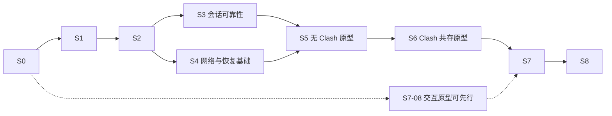

# JustConnect 实施计划与进度

更新日期：2026-10-20。目标：将核心源码纳入仓库、按 JustConnect 的 aTrust 需求维护，并编成库由 Qt 应用同进程调用。S0、S1-01 与旧独立进程方案的 S1-02 保留已验证记录；应用、六组新包、S1-10／11 全仓收尾及 S2-01／02 的平台结果与 aTrust 配置已验收；实机项目仍按后续任务推进，旧构建结果不能代替新架构验收。校园透明访问及自动共存仍未实现。代码将按产品需求持续优化、重构与精简，UI 纳入整体重设计，形成 JustConnect 自己的使用体验。

## 使用方式

1. 从阶段总览选择下一项，按任务 ID 实施；ID 保持稳定，调整顺序时修改依赖和说明。
2. 开始任务时更新“当前工作”，记录状态、依赖、验收证据和具体缺口。
3. 每个任务 ID（如 S1-10）完成其明确的交付、验证及全仓收尾复查后才勾选，并附清理／保留结论、提交、测试或实测记录；不等到整个 S1 结束才收尾。仅代码完成或尚未完成收尾时保持未勾选，标为“待验收”。
4. 每次实现同时更新相关任务、阶段状态和受影响的验收记录。阶段状态使用：未开始、进行中、待验收、已完成、受阻；受阻须写明缺少的输入、设备或能力及可继续的独立工作。
5. 三平台可分别推进同一依赖链；某个平台通过不能替其他平台勾选。阶段完成须满足本阶段的全部完成条件，构建通过不能替代网络实测。
6. 新改动使已有结论失效时，重新打开相关任务或验收格，记录原因并保留原证据；不能让旧构建的通过状态沿用到未经验证的新核心或新网络路径。

本文件是任务和进度的主要记录。[架构说明](docs/ARCHITECTURE.md)描述当前代码，[开发说明](docs/DEVELOPMENT.md)维护构建操作；来源与历史案例放在文末参考索引。

## 当前工作

| 项目 | 当前记录 |
| --- | --- |
| 当前任务 | 依次完成 S2-04／05／06／07／08，收尾整个 S2（进行中） |
| 依赖依据 | S1-08 的真实 C ABI／Qt 接入、S1-11 的核心精简及 S2-01 的平台结果契约已验收；配置界面和纯校验不依赖真实代理改写，Fudan 实际认证样本仍按 S1-04／S2-03 验收 |
| 状态 | S2-04 至 S2-07 正式实现、交付及各自全仓收尾已验收；继续 S2-08 认证缓存。各任务独立验证、提交及收尾；当前仅能实测 Fudan，另一服务器及真实校园验收缺口继续保留 |
| 已有基础 | S1-03／05／07／08 已验收；应用、测试与打包统一通过 CMake 构建本仓库内嵌库，六组包验证 ABI／来源／依赖／架构／系统版本／签名，源码归档可完整重建 |
| 已知缺口 | S1-04 真实样本、S1-06 其余设备权限及校园／生产 TLS／透明访问仍按各阶段验收。预览签名状态与最低系统约束见 S1-09；未执行正式签名／公证及旧系统实机验收，D2 未选型 |
| 网络验证 | 暂无真实校园登录、透明转发、Clash 共存或异常恢复的通过记录 |
| 外部条件 | 实机验收需要相应操作系统、校园账户及交互式 MFA；缺少时记录待验收，不降低验收要求 |

## 阶段总览

| 阶段 | 交付目标 | 前置依赖 | 状态 |
| --- | --- | --- | --- |
| [S0](#s0) | 仓库、命名、工作流与文档基线 | 无 | 已完成 |
| [S1](#s1) | 同仓库 aTrust 核心库、C ABI、Qt 适配与六组构建 | S0、已有 S1-01；先做 S1-06 | 进行中 |
| [S2](#s2) | aTrust 配置、认证复用与基础设施结果可靠 | S1-01；核心交互需 S1 库化契约与 Qt 适配 | 进行中 |
| [S3](#s3) | 会话、保活、重连和正常关闭可靠 | S1、S2 | 未开始 |
| [S4](#s4) | 策略、平台网络操作和原型恢复基础 | S1、S2，可与 S3 的独立部分并行 | 未开始 |
| [S5](#s5) | Clash 未运行时的三平台透明原型 | 对应平台的 S3、S4 | 未开始 |
| [S6](#s6) | Clash 各开关组合的可行路径 | 对应平台的 S5 | 未开始 |
| [S7](#s7) | 自动发现、一键流程、托盘、双语 UI 与完整恢复 | 网络实装依赖对应平台 S5／S6；UI 原型可先行 | 未开始 |
| [S8](#s8) | 完整实测、安装包和交付文档 | S1—S7 | 未开始 |

主线先完成库化的工具链／权限验证和会话边界，再证明认证与数据路径，最后完成自动化。S2 的平台错误传播、凭据存储可独立实施；结构化事件和 Go／C++ 构建边界已成为 S1 的必需交付，不再推迟到可选改进。各工作单元仍须先验证、提交，再继续依赖该单元的开发。针对性重构随受影响功能一同推进；UI 信息结构和原型可提前验证，再分步接入已证明的能力，避免所有界面改动积压到网络实现结束。

## 全程保持的目标与约束

| ID | 要求 |
| --- | --- |
| R1 | Windows、macOS、Linux 同等支持网页和终端。PowerShell、zsh、bash 保持原用法，不配置代理环境变量、SSH 配置或 ProxyCommand，不重启已有终端；开启后可直接 SSH 到校园 IP／域名。已有连接不保证跨路径切换保持。 |
| R2 | 校园资源 → JustConnect → aTrust；普通流量沿用本地 Clash 分流，Clash 不可用时直连；局域网、WSL、Tailscale 等受保护目标保持原解析与路由。不能以 HTTP 代理连通推断任意 TCP／UDP 都受支持。 |
| R3 | 覆盖 Clash 未运行，以及运行时系统代理与 TUN 的四种开关组合，包含两者均关闭。两个开关独立，运行中切换不得要求重新配置校园访问，也不得强制切回用户刚修改的状态。另行核对 `rule/global/direct` 模式。 |
| R4 | 保护回环、实际局域网、WSL、Tailscale IPv4／IPv6、MagicDNS、子网路由、出口节点及检测到的其他覆盖网络。冲突默认保护原网络，允许按明确的目标／网段选择校园侧并撤销；不假定同一目标 IP 的两侧可同时访问。Tailscale 能否点对点直连仍受两端网络条件影响。 |
| R5 | 依据校园下发的域名、IP、端口及协议资源分流，不把整个 `10.0.0.0/8` 或整校域名强制送进 VPN。校园失败返回错误，不偷偷改走别的出口；用户明确选择原网络侧的冲突目标按选择处理。 |
| R6 | 产品仅启动 aTrust；提供 Fudan 与 Custom。复旦入口为 `vpn.fudan.edu.cn:443`，认证方式实时获取，优先 Fudan UIS OAuth2，登录域和登录地址不写死。保留其他学校的 aTrust 支持及必要 MFA。 |
| R7 | 修改网络前保存快照与所有权记录；任一步失败撤销本次修改，正常退出先解除接管、再停止核心。恢复不覆盖外部新设置，不猜测旧版本未保存的原始配置，不自动终止官方 VPN 或其他程序。 |
| R8 | 不导入其他应用的数据。自身配置升级保留有效值与用户选择，仅清理废弃字段和确认失效的缓存。认证缓存按学校／服务器／账户隔离并限制当前用户访问；密码和 TOTP 持久保存使用系统凭据服务，不回退到明文或 Base64；不默认关闭 TLS 校验，日志隐藏凭据、令牌、控制接口密钥及回调参数。 |
| R9 | VPN 核心在 Qt 宿主进程内运行，通过内部 C ABI 调用；不以外部核心程序、本地控制 HTTP 服务或插件系统作为最终架构。必要的最小权限助手、恢复守护和 Qt WebEngine 子进程各有职责，不承载另一份 VPN 核心。同进程取消不能依赖杀子进程，宿主崩溃的网络恢复必须有独立保障。 |
| R10 | 围绕 JustConnect 的校园访问、共存和恢复需求主动优化、重构、精简代码及 UI，允许重新设计布局与操作流程；每次改动有明确改善目标、行为或性能验证和独立提交，不以改名、增加抽象层或堆砌选项代替改进。 |
| R11 | 日常流程遵守日常使用要求：打开后确认学校／服务器并连接，窗口和托盘都可连接／断开，关闭窗口默认后台保留，可在设置中改为关闭即退出；断开与注销认证分开。 |
| R12 | 应用界面与文案默认英文，可显式切换简体中文并保存选择；主窗口、托盘、设置、认证交互和应用生成的错误／通知使用同一语言。按钮文字由最终设计确定，不把本计划的示例当作固定文案。 |
| R13 | 提供可发现的设置页面，至少包含语言与主窗口关闭行为；应用偏好与学校配置分开管理，保存后按约定生效并跨重启保留。本节需求是基本目标，允许继续完善信息结构、视觉与交互设计，扩展须有实际用途并保持日常操作简洁。 |

沿用 Qt Widgets 和轻量分层：`core/` 保存 C++ 规则与状态，`application/` 定义 `CoreEngine` 端口并组织用例，`infrastructure/` 的 `EmbeddedCoreEngine` 实现 C ABI／存储／系统能力，`presentation/` 展示结果并接收操作。`corelib/` 统一放 JustConnect 的 Go 会话、C ABI 入口及整合后的协议源码，使用单一 Go 模块，不保留独立上游模块或 `third_party/zju-connect/`。来源和许可证就地记录，源码可直接优化、重构与精简；模块路径迁移服务于一体化构建，包名和协议实现不做批量改名。Go 协议细节不混入 C++ 领域模型。应用层可继续使用 Qt Core、QObject 和定时器，不依赖 Widgets、WebEngine 或 Go 实现细节。状态机决定动作，会话执行动作；主窗口与托盘使用同一会话。上述名称和目录是迁移目标，当前实现仍见架构说明。

## 日常使用要求

以下为基本要求，设计可进一步扩展，保持操作简洁；页面布局、控件和视觉风格由原型确定。`Connect`、`Disconnect`、`Open JustConnect`、`Exit` 仅为英文示例，最终文案以清晰、简洁及平台习惯为准。

| 场景 | 预期行为 | 实现与验收落点 |
| --- | --- | --- |
| 启动与确认服务器 | 正常启动显示主窗口及当前学校／服务器；首次未配置时可选择学校或填写 Custom。保留上次有效选择，日常确认后点击一个主操作即可连接，不必每次进入设置或重新输入服务器。默认不因启动或打开窗口自行发起连接，已有用户明确选择的自动连接设置单独保留 | S2-02／07、S7-06／08 |
| 主窗口连接／断开 | 未连接可连接，真正就绪后可断开；连接、认证、恢复和断开过程中显示实际状态并提供适当取消，阻止重复启动。断开结束校园隧道及接管、取消重连并恢复自身网络修改，程序保持运行；不把隐藏窗口或保留认证等同于连接仍在后台继续 | S3-01／04、S7-02／06 |
| 关闭窗口与后台驻留 | 托盘可用且未选择其他关闭行为时，点击主窗口关闭键默认隐藏到托盘，无论当前是否连接；保持既有连接与认证流程。设置可改为关闭即有序退出，保存偏好本身不执行关闭，下次关闭按选择生效。窗口最小化与关闭是不同动作，不额外要求把普通最小化改为隐藏。Windows 使用通知区域，macOS 使用菜单栏，Linux 使用桌面提供的托盘入口；选择隐藏但无托盘或入口不可用时保留可访问窗口及退出入口，不把唯一窗口隐藏到无法找回的位置 | S3-05、S7-06／08／12、S8-03 |
| 托盘操作 | 左键默认打开／恢复并激活主窗口；右键菜单未连接时可连接、已连接时可断开，并始终提供打开窗口与明确退出；处理中按同一会话状态禁用重复操作并提供适当取消。连接使用当前已确认配置，需要学号／密码、SSO 或 MFA 时才展示并激活相应交互，取消后回到一致状态，不重复弹窗。平台托盘点击／菜单事件差异须实测，保留等效且可发现的打开、连接／断开和退出路径 | S2-05、S7-06／10、S8-03 |
| 托盘状态 | 图标至少清楚区分已连接与未连接，提示文字／菜单与主窗口同步；连接中、需要认证、断开中或失败不能伪装为已连接。不仅依赖颜色，兼顾深浅主题、macOS 菜单栏图标和高 DPI。只由同一会话状态派生显示，不另维护托盘连接标志 | S3-01、S7-06／09 |
| 尽量免重复认证 | 将校园连接寿命与可复用认证状态分开：窗口隐藏、主窗口或托盘断开不主动清除仍有效的认证；再次连接先按服务器支持的方式恢复有效票据／会话，确需重新认证才弹窗。正常退出也不默认清除允许安全持久化的有效认证，重启后能否恢复按实测能力说明。明确“清除登录状态／登录数据”才删除对应缓存；服务器已失效、撤销或要求 MFA 时如实重新认证，不承诺永久免登录，也不靠静默重放密码或后台维持已断开的隧道实现 | S2-04／08、S3-02、S7-10 |
| 明确退出 | 托盘或应用菜单的 Exit 始终执行有序退出，不受关闭行为设置影响；选择“关闭即退出”后的主窗口关闭也进入同一退出流程。即使窗口已隐藏或认证弹窗打开，也须取消交互及重连、撤销自身网络修改、停止核心并结束程序。清理失败／超时走已有恢复约束，退出与普通断开均不顺带清空有效配置或认证缓存 | S3-05、S7-03／06、S8-02 |
| 设置页面 | 主窗口提供清楚的设置入口，至少可更改语言和主窗口关闭行为。语言默认 English、可选简体中文；关闭行为默认隐藏到托盘、可选退出应用，并说明连接与后台运行的影响。两项均为应用偏好，不随学校／账户切换，不要求断开连接才能修改；保存失败保留原有效值并明确反馈，不显示虚假的保存成功。无托盘时提示后台隐藏不可用并保留可访问窗口及明确退出入口，不静默变更或覆盖用户偏好；已选择的关闭即退出不依赖托盘可用性 | S7-08／11／12、S7-10、S8-03 |
| 默认英文与中文切换 | 未选择语言时使用英文，不随系统中文环境自动改成中文；设置可切换简体中文，选择属于应用而非学校配置，重启后保留。切换更新已有窗口、托盘及随后出现的交互，不重连、不清认证；应用可控制的文案完整翻译，学校自身 SSO 网页和系统授权界面的语言遵循各自设置 | S7-11、S7-10、S8-03 |

## JustConnect 的产品取向与持续收敛

自己的特色落实在日常使用和实现质量上：一键进入校园网络，日常终端与网页照常使用，Clash／Tailscale／局域网保持原有行为；状态与失败原因可理解，改动范围可解释且能够恢复。核心实现可围绕这些目标直接调整，保留有价值的协议和平台能力，不受上游 CLI 的配置粒度、类划分与窗口布局限制。

| 方向 | 具体做法与验收落点 |
| --- | --- |
| 一致的校园策略 | 校园资源、保护目标、地址冲突选择形成同一份策略，由核心、Clash 联动和诊断共同使用；同一目标不能在不同入口产生互相矛盾的解释。S4、S6、S7-07 |
| 简洁的操作流程 | 首次选择 Fudan／Custom 并完成必要认证；日常确认当前学校／服务器后连接，主窗口与托盘均可断开／重连，窗口默认关闭到托盘。有效认证尽量复用，MFA、权限和冲突只在需要时出现；高级参数归入设置，日志按需展开。具体行为按上方交互要求验收。S2、S3、S7-06／08／10 |
| 清楚的运行状态 | 首页说明当前学校／配置、是否真正就绪、正在等待什么，以及可执行的下一步；校园、Clash 共存与原网络保护按实际观测展示，未知明确标注。状态不依赖用户阅读日志，也不以进程存在代替连通。S3-01、S7-06／07 |
| 针对性的代码收敛 | 优先收回分散的配置读写／校验、重复状态映射、主窗口与托盘的平行流程、旧核心兼容分支和重复平台逻辑。复用已有会话、配置服务和端口，按实际变化原因拆分职责；每次重构说明删减了哪些重复和保持了哪些行为。S1-10／11、S2-01／07、S7-06 |
| 有证据的性能优化 | 按真实场景测启动、连接／取消、重连、CPU／内存、日志积压和吞吐；优先处理重复资源解析、无界日志／缓存、忙轮询、同步阻塞和不必要跨 FFI 拷贝等实测热点。记录前后数据及网络行为回归，不承诺仅凭库化或代码减少就提高性能。S1-04／11、S7-09／10、S8 |
| 舒服且统一的视觉 | 以重新设计并美化整套 UI 为明确目标，按日常连接流程重做页面布局、信息层级和视觉风格；沿用 Qt Widgets 实现，默认英文、可切简体中文，统一字号层级、留白、间距、图标、色彩和状态文案；支持浅／深色、高 DPI、键盘与屏幕阅读器，保留三平台菜单和窗口习惯。视觉强调当前状态与主操作，默认展示的信息量与用户当前任务相称。S7-08／09／11、S8-03 |

实施时以用户场景确定边界；每次只改一个可验证的功能或重构单元，及时删除被替代的分支、样式和配置项，同时维护有效配置迁移与测试。设计和代码优化是持续工作，不另起一次全面重写，也不要求先建通用插件或设计框架。界面只展示已实现的能力，静态原型与真实联网验收分别记录。

## S0 仓库与开发流程基线

- [x] **S0-01**：应用名称、配置路径、更新来源和项目链接使用 JustConnect；采用 `ExternalCoreProcess`、`ConnectionError`、`JustConnect` 配置分组，兼容已有预览配置字段；保留第三方核心来源、许可证和贡献者致谢。证据：[954fc37](https://github.com/wtalioy/JustConnect/commit/954fc37989e7bb40e1cce8445942047d67eaa513)。
- [x] **S0-02**：`origin` 指向自己的独立仓库，保留历史及上游 remote；开发在 `develop`，推送／PR 运行三平台测试，手动预览提供六组产物；推送 `main` 打包，发布 Release 才上传对应附件。权限、预览签名与凭据配置见[开发说明](docs/DEVELOPMENT.md)。证据：仓库中的两份 workflow 及 S0-03 的运行记录。
- [x] **S0-03**：建立一次可用的云端构建基线：Windows、macOS、Linux 各 15 项测试及 x64／ARM64 六组预览包通过。证据：[测试](https://github.com/wtalioy/JustConnect/actions/runs/39243039993)、[预览打包](https://github.com/wtalioy/JustConnect/actions/runs/39243056960)，对应应用提交 `954fc37`。

完成范围仅限上述准备。README 当前留空，Windows／macOS 文件图标暂用系统默认；Apple 开发者签名和公证未验证。旧应用遗留的自启动项与网络设置清理仍由后续恢复工作处理，不能据此认定 S1—S8 已完成。

## S1 核心库化与同进程集成

前置：S0。复用当前固定的 [zju-connect](https://github.com/Mythologyli/zju-connect) 源码基础，专门维护 JustConnect 的 aTrust 运行路径；不照搬上游 CLI、全协议配置和发布体系，也不重写已有认证／隧道协议。导入源码后直接修改、测试和提交，后续从上游有选择地合入修复，不再维护外部补丁队列或等待 PR 合并。

### 实施顺序与任务

任务 ID 保持稳定；S1-03／04 的旧 CLI 参数与文本解析任务改为库接口和真实结构化样本。每个任务继续拆成可独立验证的小步；每小步测试通过后提交，再做下一步，测试不能积累到最后一次性处理。S1-06 的链接和设备权限分别验收；真实设备缺少时，源码导入、契约与离线回归可继续，但不得实施依赖该平台未证明权限路径的网络接管。

| 顺序 | 任务 | 依赖及本单元的验收 |
| --- | --- | --- |
| 1 | S1-06：链接／权限原型 | 依赖 S1-01；先用最小 Go 库与 Qt 宿主证明六组链接、调用、内存及线程边界，列清真实设备／权限缺口 |
| 2 | S1-05：源码纳入仓库 | 依赖 S1-06 的工具链结论；记录来源并导入源码／必要测试，直接维护修改，建立可重复的 Go 测试入口 |
| 3 | S1-03：正式 C ABI 与结构化契约 | 依赖 S1-05／06；确定配置、会话、错误、事件、认证回应及所有权，先有契约测试 |
| 4 | S1-07：可嵌入的 Go 会话 | 依赖 S1-03；完整启停、取消、部分失败清理及不可致命退出的库路径通过 Go 回归 |
| 贯穿 3—5 | S1-04：真实实现与 FFI 回归 | 随 S1-03／07／08 提交；测试真实库和受控网关，不能只验证两侧各自的替身 |
| 5 | S1-08：Qt 接入 | 依赖 S1-07 及对应 S1-04 回归；同一宿主完成查询／认证／启停，旧会话不能回调新会话 |
| 6 | S1-09：CMake／CI／安装包切换 | 依赖 S1-08；六组实际包调用库自检，来源、ABI、依赖和架构可追溯 |
| 7 | S1-10：删除旧进程链路与构建冗余 | 依赖 S1-09 验收；删后再次通过测试和六组包检查，不长期维护两套正式后端 |
| 8 | S1-11：aTrust 精简与性能基线 | 主要清理依赖 S1-10；无调用的部分可先独立验证、删除；按 Go 依赖与覆盖删除废弃功能，保留必要 TCP／UDP／DNS／Clash 入口并对照性能；Qt 配置迁移另由 S2-02 处理 |

- [x] **S1-01**：本地 Qt SDK、编译器、CMake 和应用测试已验证；版本及路径见[开发说明](docs/DEVELOPMENT.md#当前-linuxwsl2-开发环境)。库化新增的 cgo 编译／链接依赖仍须 S1-06 单独验证，不视为已具备。
- [x] **S1-02**（旧方案基线）：已以 [当时的 core/manifest.json](https://github.com/wtalioy/JustConnect/blob/9a092e0/core/manifest.json) 固定上游 `c19eb4ed34b9cf6e8e8ea3315fe9973c8411eb63`、Go 1.27.2、校验和与空补丁清单，完成独立可执行核心的三平台／六组构建和包内校验。证据保留在下方；此勾选不代表库化交付，清单与脚本在 S1-05／09／10 迁移。
- [x] **S1-03**：定义 JustConnect 内部、版本化的 C ABI 和能力查询；只暴露不透明整数句柄、固定宽度类型及有长度的字节缓冲区，不跨边界暴露 Qt 对象、Go 指针／slice／string、C++ 异常或 STL 类型。初版只允许一个活动 VPN 会话，并发启动明确返回忙错误。首批提供构建信息、创建、异步启动、有界阻塞事件读取、认证回应、停止及销毁；S4-02 再按实际能力扩展策略更新。事件队列限制内存，认证与终态不丢失，诊断日志可限流且不阻塞数据面／退出，停止时唤醒等待者。首版用 UTF-8 JSON 承载低频配置／事件，包转发留在 Go 内部，避免每包跨 FFI。调用时复制借用的输入，输出使用调用者缓冲区；验证长度、容量不足、枚举、句柄失效、ABI 不匹配和敏感值脱敏。版本信息包含 JustConnect 提交、上游基线及本地修改版本，不再比较 CLI 的 `0.0.0` 与上游 release 或提供单独替换核心的入口。
  - **已验收（2026-10-20）**：实现提交 `43df369`、宿主提交 `526d868` 与取消边界修复 `c66be1d` 提供单一契约生成、正式 C 导出及 Go 有界事件／句柄传输。配置和认证回应严格校验，敏感输入不进入错误或诊断；过期回应同步检查上下文，不依赖工作协程先清理，并以移除检查即失败的测试验证。协议与构建入口见 [CORE-ABI.md](docs/CORE-ABI.md)。`c66be1d` 的[六组原生 CI](https://github.com/wtalioy/JustConnect/actions/runs/39356166583)全部通过：每组均实际执行正式库的 257 轮、缓冲区护栏、C11／C++17、四线程检查，以及同一 C 导出的认证成功回应／忙错误／迟到和重复回应／取消／重启；普通 Go 回归六组通过，race 在 Linux／macOS x64／ARM64 与 Windows x64 五组通过，固定 Go 不支持的 Windows ARM64 明确记录，仍通过普通 Go 与两个真实宿主。库启用 cgocheck2，Unix 静态、Windows DLL。[三平台应用 CI](https://github.com/wtalioy/JustConnect/actions/runs/39356166708)各通过 25 包限定 Go 基线与 16 项应用测试。另通过本地 race 100 轮、约 12 万次配置 fuzz、Windows 桥接测试和生成文件防漂移检查。正式库报告 `embedded_vpn:false` 并产生暂不可用终态；仅带测试标签的驱动模拟认证，正式协议会话和 Qt 接入不计为完成。
- [ ] **S1-04**：建立 Go 单元测试、真实 C ABI 宿主集成测试及 Qt 适配回归，使用受控 HTTP／TLS 网关与脱敏的真实资源／认证样本。覆盖错误输入、内存所有权、认证取消／超时／重复或过期回应、监听端口冲突、半途失败、终态事件、事件积压与旧会话结果。验证重复启停后监听端口、会话 goroutine、TUN／路由所有权和句柄释放；压力与竞态检查按工具链实际支持执行，不通过关掉 cgo 指针检查来过关。真实校园样本缺少时保留待验收，不将模拟网关写成 Fudan 实测。
  - **契约／FFI 部分已验证**：S1-03 的 `c66be1d` 已通过[六组真实 C 宿主契约回归](https://github.com/wtalioy/JustConnect/actions/runs/39356166583)；此部分覆盖桥接层与测试认证驱动，S1-07 又通过受控 HTTP／TLS 网关、正式协议会话／监听清理与六组原生宿主；S1-08 又完成六平台 Qt 适配／界面与受控协议回归；脱敏真实校园样本仍待 S2，本项保持未勾选。
- [x] **S1-05**：将选定协议源码、参与构建的公共包和必要回归测试直接整合到 `corelib/`，作为 JustConnect 自有的单一 Go 模块与后续会话入口，不另设上游源码模块或本地 `replace`。记录上游 URL、完整提交、导入范围、原始归档校验和及许可证，保留版权和包的职责结构；自有模块路径迁移只修改必要的导入引用，不批量改协议类名。固定 Go 工具链及 `go.sum`，Go 第三方依赖使用缓存，不默认把整个 module cache 或 vendor 目录纳入仓库。源码直接维护和持续精简，上游跟进使用可审查的差异和相关测试，不维护外部补丁队列。确认合并后的源码与分发许可要求，保存实际修改后的对应源码；正式会话及 ABI 仍由 S1-03／07 实现。
  - **已验收（2026-10-20）**：`1611e9c` 导入 137 份上游 Go 文件（含 46 份测试），迁移为单一 JustConnect 模块并重建依赖锁；来源、许可证和维护边界见 [corelib/UPSTREAM.md](corelib/UPSTREAM.md)。`197ea01` 修正 Unix 权限断言适用范围，`f9b4111` 为 TLS 密钥日志和 PCAP 共用安全文件入口：写入前收紧权限，Unix 使用 `0600`，Windows 使用仅当前用户的受保护 DACL。Windows 本机验证新建、已有 Everyone 权限、拒绝写入六个用例通过，拒绝时原文件内容不变，同一回归也已通过 CI。`f9b4111` 的[三平台 CI](https://github.com/wtalioy/JustConnect/actions/runs/39284985278)全部成功：各平台均通过固定 Go 1.27.2、模块与依赖锁校验、全部源码构建、24 包限定离线基线（含无测试包及回环 TLS 网关集成测试）和 16 项应用测试。本机 Linux 24 包限定基线与 Windows x64 17 个离线测试程序也通过。认证测试包因原始 `session.do` 未定义仍明确标为 `BLOCKED`，不计为通过；其取消和会话缺陷按 S1-07 修复并恢复完整套件，正式会话／C ABI 与 Qt 接入仍属后续任务。
- [ ] **S1-06**：用最小 C ABI 库链接当前 Qt 的 Windows／macOS／Linux x64 与 ARM64 宿主，验证初始化、调用、工作线程、缓冲区及重复创建／销毁。优先 `c-archive` 静态链接；必须实测 Windows cgo 编译器、Qt MSVC、COFF／CRT／链接器组合，不能由 Go 宣称支持某 buildmode 推断 MSVC 已兼容。静态路径确有阻碍时验证随包固定的 `c-shared` 库，仍同进程调用；选择和证据写入 D5，不退回外部核心，不为库化整体更换 Qt。提前核对 TUN 创建、设备权限、句柄／fd 生命周期及 GUI／WebEngine 权限边界；不能假定 Windows Wintun 句柄可像 Unix fd 一样跨进程交付。必要助手只做最小网络操作；若某平台尚无法让非提权宿主持有数据路径，明确记录阻塞，不能默认将整个 GUI 提权或把核心移入助手。CI 链接通过与真实设备权限验收分别记录。
  - **链接部分已验收，整体待真实设备权限验收**：代码 `481c61b` 的[六组原型 CI](https://github.com/wtalioy/JustConnect/actions/runs/39272524508) 全部通过；Linux／macOS 使用 `c-archive`，Windows 静态库首次 Go 调用超时后以 `c-shared` 通过。六组均实际验证 257 轮缓冲区／生命周期、四个 QThread、Go GC 与同宿主 WebEngine JavaScript；[三平台应用 CI](https://github.com/wtalioy/JustConnect/actions/runs/39272524710) 各 16 项通过。上游 TUN 候选的 Linux 内核原型已在 WSL2 和原生 x64／ARM64 通过：提权创建后向零有效 capabilities 的普通用户交付 fd、UDP 双向收发、正常关闭及 SIGKILL 后设备／自动路由清理；未接入 Go／Qt，真实授权助手与路由／DNS 恢复未验证，macOS／Windows 设备权限未验收。不据此预定产品使用 TUN。复现入口与具体缺口见[原型记录](docs/CORELINK-PROBE.md)；本项保持未勾选；S1-05 已按独立源码基线验收。
- [x] **S1-07**：将初始化、认证、underlay、解析、栈及必要监听收进会话对象，配置显式传入；复用现有 `SetupContext`、公开 dialer 与 `authchallenge.Handler`。认证方式查询、DNS／选线和建立隧道同样受调用者取消约束，日志经注入接口脱敏交付，不改宿主全局日志目标。移除库调用路径中的 `os.Exit`、`log.Fatal`、进程级信号／stdin／浏览器接管、环境变量配置及全局关闭注册表；不只检查 `main.go`，同时审查 aTrust 会话、L3／TCP 隧道、gVisor、DNS 和监听 goroutine。错误向会话返回并触发一次清理，修复调用者 context 被覆盖、setup 结束误取消长期会话的问题，随实际修复同步恢复上游取消测试。初始化部分成功也能撤销；Stop／Destroy 幂等，阻塞 I/O 可打断，停完才允许再次 Start。可恢复 panic 在产生它的 goroutine 内转成错误，不能用入口 `recover` 冒充处理 `os.Exit`、其他 goroutine panic 或 Go 致命运行时错误；不可恢复故障按宿主崩溃交由独立恢复保障。
  - **已验收（2026-10-20）**：`253ae7d` 恢复认证取消与完整测试，`cd1f78a` 收拢客户端维护／隧道，`de5bb87` 接入正式会话／ABI 并删除旧全局路径，`0a81fe5` 修复 SOCKS 半关闭及平台计时测试。最终[六组原生 CI](https://github.com/wtalioy/JustConnect/actions/runs/39368117638)和[三平台回归](https://github.com/wtalioy/JustConnect/actions/runs/39368117501)全部通过；六组均实际完成受控 TLS 网关下的认证、代理数据、活动停止与查询重启，五组完整 race 通过。来源、生命周期及构建入口见 [CORE-ABI.md](docs/CORE-ABI.md)。当前库不创建系统 TUN、不修改系统路由／DNS；不据此声称 Qt 正式切换、校园实测或 Clash 共存完成。
- [x] **S1-08**：将应用端口 `CoreProcess` 改为表达库能力的 `CoreEngine`，由 `EmbeddedCoreEngine` 实现；替换 `ExternalCoreProcess`、命令构造、文本解析、`writeInput`、认证方式子进程查询及 CLI 版本探测。Qt 工作线程读取有界事件队列，再通过排队信号提交给应用线程，不从 Go goroutine 操作 QWidget；Go 内等待认证回应时可取消，不阻塞 Qt 主线程。所有事件／回应带会话代次和请求标识，销毁前停止事件泵并等待借用数据结束；测试销毁与晚到事件竞态。结构化日志仅作诊断，不再根据提示词驱动状态。库在宿主生命周期内保持加载，释放会话不等于卸载 Go runtime；不实现运行中卸载重载或双后端自动回退。
  - **已验收（2026-10-20）**：`29932b3` 交付工作线程适配器，`8c9c23c` 将应用连接／认证／查询／版本切换为正式内嵌库并删除旧 C++ 进程链路，`caf83a2` 修复旧心跳测试的真实时间依赖及 Windows 日志解码。最终[六平台原生 CI](https://github.com/wtalioy/JustConnect/actions/runs/39373967086)全部通过，各执行完整 Go 回归及 7 项原生／Qt 宿主检查，五组支持的完整 race 通过；[三平台应用 CI](https://github.com/wtalioy/JustConnect/actions/runs/39373967115)各 15 项 CTest 通过，Windows 安装目录验证再次实际完成查询、认证、代理收发和停止。结构化状态、原始字符串身份、旧／重复回应和取消、销毁竞态、界面心跳及代理时机均有回归。清理和失败修复证据见[历史实施与清理证据](#implementation-history)；S1-04 的真实样本、S1-06 其余设备权限、S1-09／10 包迁移与校园／Clash 验收保持独立，不据此勾选。
- [x] **S1-09**：用 CMake 的核心库 target 统一驱动 Go／C ABI 头生成、链接及实际宿主测试，源文件、`go.mod/go.sum`、构建选项变化均正确触发增量构建；Tests 与打包使用同一入口，显式 `CGO_ENABLED=1` 并记录 Go／C／C++ 工具链、ABI、平台和架构。保留 Qt 公共安装步骤和用户确定的触发规则：推送 develop 三平台测试、develop 手动六组预览、main 六组打包及 Release 附件。CI 加入 Go 格式／vet／相关包测试、FFI 测试和支持环境的 race 检查；六组库化包实际执行离线自检，验证 ABI、版本、动态依赖、系统最低版本与签名，不能只检查生成了 `.a/.lib`。动态库方案检查包内固定路径与依赖来源。源码包来自本仓库的实际修改树，发布产物不再附一份被误当成实际实现的原始源码归档。
  - **已验收（2026-10-20）**：`da23fc2` 统一生成／增量依赖及正式应用 `--core-self-test`；Windows LF／生成文件、包环境与源码归档换行、签名宿主和 SDK RPATH 问题均已修复并保留回归。最终源码 `a729296` 的[三平台应用 CI](https://github.com/wtalioy/JustConnect/actions/runs/39383282228)全部通过，每组运行完整 19 包 cgo／格式／vet、16 项 CTest 和 22 项 Python 用例（平台不适用项明确跳过），Windows 安装目录另实际完成受控协议收发。同一最终源码的[六组原生 CI](https://github.com/wtalioy/JustConnect/actions/runs/39383282309)全部通过，各 7 项 C／Qt 宿主与完整 Go；五组支持的 race 通过，Windows ARM64 的 Go race 仍明确不支持，普通测试与真实宿主均通过。
  - **六组实际交付**：`a729296` 的[最终预览](https://github.com/wtalioy/JustConnect/actions/runs/39383294934)全部成功，六份包、六份检查 JSON 和一份对应源码／校验和已上传。解压 ZIP／AppImage、挂载 DMG 后在清除 SDK 搜索环境、临时工作目录中运行正式应用；校验生产能力、ABI、版本／提交、生命周期、全部原生文件架构与依赖来源。Windows 两组各 47 个原生文件，实际验证移走固定 DLL 后自检失败，程序与 DLL 的 Authenticode 均为 NotSigned；Linux x64／ARM64 分别 127／134 个原生文件，实际 glibc 下限均为 2.43；macOS 两组各 37 个 Mach-O，二进制及声明最低版本均为 14.4，绝对 SDK RPATH 拒绝、实际全部相对 RPATH 留在 bundle 内，ad-hoc 签名通过 deep／strict 校验。正式 Developer ID／公证、Windows 发布签名和旧系统实机未验，不将静态元数据或预览签名冒充这些结果。
  - **增量、来源与清理**：本地实测 Go 源码、go.mod／sum 变化重建、缺失 cgo 头重新生成、无变化构建不做工作；源码归档下载后 SHA-256 与每份受 Git 管理文件逐字节一致，在无 `.git` 的目录完整重建应用并实际通过同版本／同提交的离线 ABI 自检，重建报告 `source_state:archive`。部署统一安装 CMake 的 CoreRuntime 组件及来源／工具链／许可证；六组包均无旧 CLI、core-provenance 或 Wintun。工作流已移除旧构建 action 调用；保留 Qt 公共安装与既定触发／Release 附件规则。旧下载文件及 10 项专属 Python 测试按明确的 S1-10 清理节点删除，不作为产品后端。
  - **归档增量修复**：将 Go 模块锁、契约／生成器／源码的配置依赖移到 Git／源码包共用入口，并跟踪源码包提交标记。已在无 `.git` 的实际源码包中修改契约并观察真实应用能力值随 C／Go 常量自动更新；修改 go.mod 的固定版本会重新配置并拒绝错误工具链；修改来源标记会更新编译后的提交，恢复后重建正常且无变化构建无操作。本地 16 项 CTest、22 项 Python（1 项平台不适用）通过；最终 `a729296` 的三平台应用、六组原生及六组实际包复核全部通过。这里的“无 Git”仅指源码目录没有 `.git` 元数据，仍使用同一个 CMake 入口和内嵌核心。
- [x] **S1-10**：按下方清理表删除旧核心下载／补丁／EXE 校验链路及无用 action、脚本、测试和文档，替换旧进程替身为库端口／真实 ABI 测试；删除正式包中的独立 `zju-connect` 程序及 PATH 查找／上游核心更新逻辑。Qt、网络、平台所需的其他 QProcess 使用不做批量清除。清理完成后再验证三平台测试、六组产物及包内无旧核心；历史通过记录仍保留，但不能充当新架构证据。
  - **清理与本地证据**：删除旧清单、下载／解包／补丁／CLI 版本与 EXE 校验脚本及 10 项专属测试、旧 composite action；无调用的 Wintun 四组 DLL、头文件及专属文档／许可和忽略例外一并删除。保留 `setup-qt`／`setup-core-toolchain`、系统代理／自启动所需 QProcess、库端口／真实 ABI 和安全／取消／失败回归；认证协议中保留的上游进程身份只是协议字段，不查找或执行外部程序，后续按真实样本收敛。包检查按大小写无关的文件名拒绝旧核心／来源目录／Wintun，新增嵌套文件与目录回归。固定工具链完整 19 包 Go 校验／vet／构建／测试、13 项 Python（本地跳过 Windows 签名集成 1 项）、16 项 CTest 和正式应用 ABI 自检通过；最初本机 PATH／aqt 缺失已用命令级 Go PATH 及隔离 venv 修正并完整重跑，不修改全局环境。最终 CI／实际包结果见下。首轮重写消息后的 `9d7e25d` 在 Windows Python 包检查中发现新增夹具只模拟操作系统而未模拟架构，`platform.machine()` 返回空值；已固定夹具架构，断言不变，本地 13 项 Python 重新通过。本机 Windows Python 为 3.10，缺少检查器要求的 `hashlib.file_digest`（需 3.11+），不记该环境为通过，Windows 修复验收使用 CI 的 Python 3.14。
  - **已验收（2026-10-20）**：清理提交 `9d7e25d`、夹具修复 `81c65de`；最终 `81c65de` 的[三平台应用 CI](https://github.com/wtalioy/JustConnect/actions/runs/39390183565)全部通过（完整 19 包 Go、13 项 Python，平台不适用项明确跳过；各 16 项 CTest，Windows 安装目录实际协议回归）；[六组原生 CI](https://github.com/wtalioy/JustConnect/actions/runs/39390211614)全部通过，含正式／认证宿主、Qt／受控协议、完整 Go 及五组支持的 race，Windows ARM64 普通 Go／FFI／Qt 通过，race 不支持的原边界不变。
  - **实际包与来源**：[六组预览](https://github.com/wtalioy/JustConnect/actions/runs/39390215357)全部通过，六份 JSON 已下载复核，均报告 ABI 1、正式能力、干净来源 `81c65de` 及正确平台／架构。三平台 x64／ARM64 实际 ZIP／DMG／AppImage 在清除 SDK 搜索环境后运行应用自检、依赖／架构／来源／系统版本及签名检查，递归确认无旧核心、旧来源目录和 Wintun。Windows 两组各 47 个原生文件且移走固定 DLL 后自检失败、签名 NotSigned；Linux x64／ARM64 分别 127／134 个原生文件，实际 glibc 下限均 2.43；macOS 各 37 个 Mach-O，声明／实际最低系统 14.4，ad-hoc 严格验签通过。源码归档 SHA-256 正确，265 份受管文件与提交逐字节一致，保留完整来源／许可证和共享构建入口，所有已删除路径均不存在。正式发布签名／公证、旧系统桌面和校园网络不在本项验收中。
  - **全仓收尾已完成**：按单个任务 ID 重新核对全部受管代码、测试及调用／资源／配置／构建／CI／文档。预期保持正式 ABI、认证、代理、UI 及配置迁移行为，删除无调用的 Qt Core5Compat 依赖、三个 UI 方法、旧设备管理 API、L3 元数据辅助函数、解析器 getter、报文访问器及测试专用生产包装；不删除或放宽有效回归。本地完整 19 包 Go 校验／vet／构建／测试、13 项 Python（1 项 Windows 平台不适用）、16 项 CTest、正式应用 ABI 自检及 actionlint 已通过；禁用 Qt Core5Compat 查找的干净应用构建通过，生成构建和 ELF 依赖均无该模块。首次直接构建漏带本机 sysroot 库路径，补齐预设中的命令级环境后重新构建通过。最终跨平台／实际包证据见下一条；详细保留结论见[全仓收尾记录](#s1-10-closeout)。
  - **收尾最终验收（2026-10-20）**：规则澄清 `fdd2525`，实际清理 `8d79d47`。该实现的[三平台应用 CI](https://github.com/wtalioy/JustConnect/actions/runs/39392959349)、[六组原生 CI](https://github.com/wtalioy/JustConnect/actions/runs/39392959361)和[六组实际包](https://github.com/wtalioy/JustConnect/actions/runs/39392971094)均全部通过：完整 Go／Python／Qt、正式与认证 ABI／Qt／协议宿主、五组支持的 race 保持原覆盖（Windows ARM64 的 Go race 仍不支持），未新增跳过。六份 JSON 已下载复核，均为 ABI 1、正式能力、正确平台／架构、干净来源 `8d79d47`，没有 Qt Core5Compat；包检查同样拒绝旧独立核心、旧来源目录和 Wintun。macOS 两组均由原 37 个原生文件减至 36 个，唯一移除的是 Core5Compat framework，最低系统仍 14.4、ad-hoc 严格验签通过；Windows 各 47 个原生文件，固定 DLL 移走后自检失败，预览签名 NotSigned；Linux x64／ARM64 分别 127／134 个原生文件，实际 glibc 下限仍 2.43。对应源码归档 SHA-256 正确，264 份受管文件逐字节匹配，已删除路径均未残留。部署脚本语法、qrc 资源及当前 Markdown 本地链接检查通过。S1-10 功能与任务级全仓收尾现均完成。
  - **提交规范**：按用户要求将最近连续 13 条缺少前缀的提交改成 `type: description`，逐条确认 tree、作者、提交者及时间不变，通过明确旧 SHA 的 `--force-with-lease` 更新 develop；新清理提交为 `9d7e25d`（原 `46b8775`）。历史 CI 的旧提交号继续保留，以准确对应原始证据；规范已写入 `AGENTS.md`，后续提交遵守。
- [x] **S1-11**：以 JustConnect 的 aTrust 功能为边界，删除不再引用的 CLI／EasyConnect／移动端专用代码、校内默认策略及已废弃的配置和依赖；保留协议所需测试、许可证、来源信息，以及 Clash 桥接必要的 SOCKS／HTTP 和实际使用的数据栈。每次删除先检查依赖闭包并回归，只移除对应废弃功能的测试；aTrust 错误处理和生命周期覆盖保留并随接口更新。建立包体积、宿主内存／CPU、TCP／UDP 吞吐／时延、重复重连和慢节点基线；仅针对复现的瓶颈优化，不预设“库化一定更小、更快”或替换 gVisor／整个协议栈。

  - **单元一（已验收，`c088d66`）**：删除 `GraphCodeFile`／`OutputPath` 及沿密码／短信认证链透传的文件参数；工厂矩阵保留全部认证方式，新增受控 TLS 回归实际交付 PNG、编码坐标／尺寸并验证取消不提交后续回应。完整 19 包 Go 校验／vet／构建／测试、13 项 Python（本地 1 项平台不适用）、应用构建及 16 项 CTest 通过。Go 模块依赖未变化，Qt 配置与认证材料未改写。[三平台 Tests](https://github.com/wtalioy/JustConnect/actions/runs/39408428478) 与 [六组 Core ABI](https://github.com/wtalioy/JustConnect/actions/runs/39408428312) 全部通过。
  - **单元二（已验收，`bbc192f`／`b8eba44`）**：受控网关增加实际 L3 UDP 回声及固定 5 ms 节点回应等待；原生 CTest 强制运行正常／慢节点各 20 次完整认证连接、停止重绑和等待认证取消，输出生产库来源、启动／CPU／峰值 RSS／TCP、UDP goodput／时延及重连指标。安装包报告增加实际归档／安装文件／宿主／DLL 字节数及离线自检耗时；三平台调用方和拒绝缺失归档回归同步更新。复用 SOCKS 握手与现有校验和实现，无新增运行依赖或性能阈值；测量定义与复现方式见 `docs/DEVELOPMENT.md`。首次三平台 CI 的 Windows 暴露体积夹具文本换行转换（25 B 对比 23 B）的平台假设，夹具改为明确 CRLF 字节并保留精确体积断言后重新验收。本地完整 19 包 Go／vet／构建、`go mod tidy -diff`、13 项 Python（1 项平台不适用）、应用构建／16 项 CTest、原生构建／8 项 CTest、actionlint 均通过。
  - **单元三（已验收，`6db2c06`）**：全仓复查及调用闭包确认没有运行调用方，删除旧 TCP 握手包装／anti-MITM 无 context 包装、旧 IPv4 VIP 解码与专属重复测试、无调用 conntrack 删除入口、underlay getter／超时包装、Android 专属覆盖选项及绕过 TCP 优先 L3 的 context 选项与随之无调用的匹配包装。握手／TLS 测试改调正式函数；保留实际 L3 拒绝／常规 TCP 匹配回归，删除仅对应废弃绕行选项的两项测试。发送帧解码／锁内 conntrack 查询移入测试文件，resolver 观察直接读取原子状态，underlay 空字段自检合并至实际拨号不自动探测的回归，测试报文由夹具编码，不保留只供夹具使用的生产 setter；取消、失败、重连、回收、报文与安全覆盖不减少。本地完整 19 包 Go／vet／构建、Go race、模块锁不变、13 项 Python（1 项平台不适用）、应用构建／16 项 CTest、原生构建／8 项 CTest、文档本地链接与 diff 检查均通过；最终三平台／六组原生及六组安装包全部通过，证据与基线见[任务收尾](#s1-11-closeout)。单元二 [三平台 Tests](https://github.com/wtalioy/JustConnect/actions/runs/39410966112) 与 [六组 Core ABI](https://github.com/wtalioy/JustConnect/actions/runs/39410449246) 全部通过。
  - **验收结论**：验证码内存契约、废弃协议闭包精简、六平台正式宿主与包性能基线及任务级全仓收尾已完成；不改动未复现瓶颈的数据栈。12 个正常／慢节点场景全部完成 20 次认证重连、真实 TCP／UDP 回声及清理／取消；266 份对应源码核对和无 Git 独立重建通过。完整数据、限制、保留原因及删除条件见[收尾记录](#s1-11-closeout)。

  - **提前清理的独立部分**：S1-03 后已删除集成模块中无产品调用方的 EasyConnect 实现及专属测试、旧 CLI 初始化注册表、配置默认值及对应测试，保留 macOS 仍使用的 DNS 方法；gVisor 不再依赖 EasyConnect 错误或为它退出宿主。较弱的入站包前缀测试由现有完整字节断言覆盖，删除重复项。S1-07 进一步删除无产品调用的系统 TUN／Shadowsocks／转发／外部保活、FakeIP／IPSet 副本、全局关闭与原始日志，SOCKS／HTTP（含 UDP）由会话拥有；相关废弃测试与依赖一并移除，新增实际协议及失败路径回归。S1-08 已用正式库端口接替并删除 Qt 旧运行链路及专属测试；旧下载／包校验链路按 S1-09／10 验收替换。本项性能与正式宿主基线已随最终代码及任务级全仓收尾验收。

### 构建与旧代码清理节点

应用、测试与打包均已使用正式内嵌库。S1-10 删除了已无调用的旧核心 action、下载／补丁／独立 EXE 校验脚本、旧清单、专属测试和 Wintun 分发文件；来源摘要保留在 `corelib/UPSTREAM.md`，不参与运行构建。以下清理结果已由收尾实现 `8d79d47` 的三平台应用、六组原生及实际包重新验收，证据见 S1-10。

| 文件／机制 | 迁移动作与清理结果 |
| --- | --- |
| `core/manifest.json` 的归档与补丁清单 | S1-05 将来源记录放到 `corelib/`，新源码的工具链及依赖由单一 Go 模块维护；旧清单已不参与产品构建，S1-10 已删除旧清单与补丁应用机制，来源提交／归档摘要完整保留在 `corelib/UPSTREAM.md` |
| `scripts/build-core.py`、`tests/build_core_test.py` | S1-09 用 CMake 核心库 target、Go 测试和 C ABI／Qt 集成测试接替；S1-10 已删除下载、解包、补丁应用、CLI `-version` 和独立二进制校验脚本／测试 |
| `.github/actions/build-core/action.yml` | S1-09 把 Go／cgo 工具链准备接入 workflow，实际编译统一走 CMake；S1-10 已删除该旧构建 action，保留 `.github/actions/setup-qt` |
| `.github/workflows/ci.yml`、`build.yml` | S1-09 更新库测试、链接、缓存键和产物自检；独立核心构建／解压检查步骤已删除，保留 develop／main／手动预览／Release 触发规则与最小权限；S1-10 复查无旧核心调用，触发与权限保持原样 |
| 三平台 `deploy-*`、macOS 签名与包检查 | S1-09 移除独立核心复制及 `core-provenance` 布局，静态方案打包宿主，动态方案带固定核心库并签名；改为调用宿主库自检及检查实际修改后的来源／许可证 |
| `CoreProcess`／`ExternalCoreProcess`、命令／输出解析、`CoreExecutable`、旧测试替身 | S1-08 已将调用方迁移到库端口并删除旧 C++ 实现及专属测试；S1-10 复查无 PATH 查找／上游更新／旧进程替身；保留库端口、真实 ABI 与应用行为回归 |
| `libs/wintun/`、`.gitignore` | 已无构建、源码或运行调用；S1-10 删除 DLL、头文件和仅服务这些文件的说明／许可证及忽略例外；未来透明入口按 D2／S4 选型，不预置驱动 |
| 当前开发说明和构建证据 | S1-10 已同步实际构建入口、来源说明、包布局及历史清单链接；旧 S1-02 证据保留且不沿用验收结论 |

完成条件：同仓库源码在六组目标上编译为库，Qt 通过 C ABI 实际调用；生命周期、认证交互、错误／资源清理及 Go／C++ 内存与线程边界有回归证据；新包按实际链接方式可追溯且无独立 VPN 核心程序。S1-05—11 与改写的 S1-03／04 均验收后才记 S1 完成；S2-01／04 等独立工作仍可先行。真实设备权限、校园登录与共存验收各自记录，缺少条件不得宣称可用。

原始认证缺陷已于 S1-07 修复：`253ae7d` 恢复全部认证测试，调用者／会话取消均保留，`cd1f78a` 修复 setup 结束误取消维护会话、失效退出及后台工作清理；两提交均通过三平台 CI。不存在已知失败例外，后续改动必须运行完整 Go 套件。

旧 S1-02 验证记录：`9a092e0` 完成本地 Linux／amd64 两次独立构建且二进制逐字节一致、7 项构建脚本测试、16 项应用 CTest，[三平台 CI](https://github.com/wtalioy/JustConnect/actions/runs/39262020575)通过。`81b85f8` 完成本地 10 项构建／校验脚本测试、16 项应用 CTest、[三平台 CI](https://github.com/wtalioy/JustConnect/actions/runs/39263157320)及[六组开发预览](https://github.com/wtalioy/JustConnect/actions/runs/39263164818)，包括旧独立核心及来源文件的包内检查。这些仅是迁移前基线，不覆盖 cgo 链接、同进程内存安全、权限或网络功能。

## S2 aTrust 配置、认证与基础结果

前置：S1-01；涉及核心交互需 S1-03／04／07／08，打包验收还需 S1-09。平台代理错误传播和凭据服务可独立先做。网关基线可在受控的无 Clash 环境实测，完整共存仍须经过 S5／S6；真实修改代理前先完成 S2-06。

- [x] **S2-01**（已完成）：修正 `SystemProxyBackend` 及平台实现的结果契约，检查真实系统 API／子进程状态、超时和必要字段回读；报告失败、权限取消、不支持及部分修改，不能在 `void` 调用后无条件返回成功。同步将平台／自启动实现中的弹窗移至界面层，按平台拆分源文件，由 CMake 选择实现。
  - **单元一（已验收，`241457f`）**：系统代理采用结构化成功／失败／取消／权限拒绝／不支持／超时及可能已修改标记，查询错误不再混成冲突；会话保留失败清理状态，界面按真实结果提示，退出清理失败不再清零。Windows、macOS、Linux 与不支持平台由共用 CMake 选择，删除旧跨平台混合函数与无条件成功适配。WinINet／RAS／通知逐次检查并回读；Unix 子进程有界等待、检查退出状态，逐端点／模式／绕过项回读；GNOME 与 KDE 分开操作。针对真实子进程错误／崩溃／超时、注入 OS 边界失败与回读错配、真实 Qt 查询失败不修改、会话部分失败／退出失败补充回归；六平台运行真实只读查询，Linux 使用临时 GSettings keyfile 执行实际写入／回读／清除，不触碰用户桌面配置。本地完整 19 包 Go 校验、13 项 Python（1 项平台不适用）、应用构建／19 项 CTest、原生构建／11 项 CTest（含既有正常／慢节点基线）、macOS Qt 源码语法检查与 actionlint 通过；[三平台 Tests](https://github.com/wtalioy/JustConnect/actions/runs/39417147189) 与 [六组原生／真实只读查询](https://github.com/wtalioy/JustConnect/actions/runs/39417147247) 全部通过。
  - **单元二（已验收，`5d28418`）**：自启动按平台拆分并返回结构化结果；Windows Run 项引号／同步状态／回读、Linux QSaveFile 原子提交与精确内容回读、macOS 有界登录项查询／按路径修改／回读，错误交付界面。只有系统操作成功后保存启用偏好；偏好保存失败返回失败，迁移失败保留旧版本以重试；设置应用失败不关闭窗口、不清认证材料。新增实际设置窗口失败／成功操作、真实偏好存储失败、Linux 临时目录实际注册／GIO 解析启动／清除及 Windows 唯一测试 Run 项注册／清除回归；macOS 命令边界验证取消／坏回应／零退出但未修改，并由真实 osacompile 编译脚本，真实 System Events 交互授权仍需桌面验收。GIO 实测拒绝含百分号的首个可执行路径，使用固定脚本 exec "$0" 和独立路径参数，通过含引号、美元／反引号、百分号及反斜杠的真实启动检查，不将路径拼入脚本。本地完整 19 包 Go、13 项 Python（1 项平台不适用）、应用构建／21 项 CTest、原生构建／12 项 CTest、macOS 源码语法与 actionlint 检查通过；[三平台 Tests](https://github.com/wtalioy/JustConnect/actions/runs/39419478195) 与 [六组原生](https://github.com/wtalioy/JustConnect/actions/runs/39419478491) 全部通过。
  - **单元三（已验收，`aa61dad`）**：全仓复查发现手动代理不应清空未启用的 Windows PAC URL，改为仅写实际管理的模式／端点／绕过字段，并删除不再读取的 URL 缓冲；GNOME／macOS 明确禁用且回读本地代理的认证开关；GNOME 隔离存储验证已有用户名／密码未被改写，不据此声称 macOS 凭据／真实切换恢复已验收。补充回读类型及非空结构校验；新增回归先复现零退出／空绕过输出被误认成功，再验证有效空列表、坏类型、独立端点值及隔离真实存储保留凭据。Linux 只读使用 memory 后端，写入用私有 keyfile；不将它们描述为真实桌面 dconf／权限验收。本地完整 19 包 Go、13 项 Python（1 项平台不适用）、应用构建／21 项 CTest、原生构建／12 项 CTest、macOS 源码语法、actionlint、模块锁／脚本语法及文档本地链接检查通过；最终三平台、六组原生和六组预览包全部通过，对应源码逐字节核对／无 Git 独立重建通过；全仓清理／保留及真实环境缺口见[任务收尾](#s2-01-closeout)。
  - **验收边界**：真实会话代理改写及按所有权恢复严格留到 S2-06，S2-01 不用未恢复的真实设置做写入测试；Linux 使用隔离 keyfile，Windows 自启动测试只操作预先确认不存在的唯一测试项并注册退出清理，macOS 不触发未经验证的自动化授权。三个单元及任务级全仓收尾已完成；勾选仅覆盖本任务的结果契约与平台拆分，不沿用为真实会话恢复或交互权限的验收。
- [x] **S2-02**（已完成）：限定 aTrust 产品范围，移除 EasyConnect 专用界面、配置字段及相应测试；增加 Fudan／Custom 配置入口。核心配置通过库接口校验，不再拼接任意附加命令行参数；Go 源码与依赖精简见 S1-11。自身升级保持有效 aTrust 配置，不清空其他应用或所有账户的数据；旧字段清理与认证缓存清理分别处理。
  - **单元一（已验收，`06c23a0`／`ab3b13f`）**：配置版本升至 9，升级只补齐缺失默认值，保留已有 aTrust 端点／认证／监听值、其他账户与未知配置，不再建议整份重置；旧分组复制保存失败保留来源，版本提交失败恢复旧版本，退出只同步数据而不抢先标记升级完成。新增无版本及 4／5／6／7／8／9／未来版本的重启读取、未知配置与另一文件保留、存储失败重试回归；本地应用构建／21 项 CTest、完整 19 包 Go／vet／构建及 13 项 Python（1 项平台不适用）通过。
  - **CI 修复（已验收，`ab3b13f`）**：首轮 Windows 应用 CI 在既有真实子进程异常退出检查耗尽 5 秒期限，其他平台及配置迁移检查通过。按 [Microsoft abort 文档](https://learn.microsoft.com/en-us/cpp/c-runtime-library/reference/abort) 在主动 abort 的 Windows 测试子进程禁用 WER 报告／弹窗，并补充失败模式与返回详情；仍保留原有失败断言和期限，不跳过回归或放宽通过条件；修复后 [三平台 Tests](https://github.com/wtalioy/JustConnect/actions/runs/39427349262) 和 [六组原生](https://github.com/wtalioy/JustConnect/actions/runs/39427349774) 全部通过。
  - **单元二（已验收，`2ec3237`）**：以 ABI v1 的兼容增补导出 `jc_config_validate`，直接复用 `bridge.ParseConfig`，不创建会话或进行网络操作；Qt 配置校验与启动共用同一 JSON 映射及能力边界。真实 C／Qt 回归覆盖版本不匹配、空输入、长度上限、未知字段、句柄全部占用时重复校验及无效设置的一致拒绝。本地完整 19 包 Go／vet／构建、13 项 Python（1 项平台不适用）、应用构建／21 项 CTest、原生构建／12 项 CTest 全部通过；[三平台 Tests](https://github.com/wtalioy/JustConnect/actions/runs/39428709708) 和 [六组原生](https://github.com/wtalioy/JustConnect/actions/runs/39428709713) 全部通过。
  - **单元三（已验收，`ceb42d6`／`4c27335`）**：设置页／向导共用 Fudan／Custom 服务器控件，查询返回项优先 UIS OAuth2，保留返回的登录域与 URL，不预写认证身份。保存前调用真实纯校验接口；删除 EasyConnect、任意附加参数、未实现选项的控件、运行字段与旧高级窗口／调用／夹具，保留严格拒绝未知 JSON／非法地址／非回环监听的安全覆盖。迁移按明确清单清理废弃字段，失败恢复旧字段／版本供重试；保留有效端点、认证、监听禁用值、未知键和其他账户／文件。导入／重置只改窗口草稿，取消不改源文件／配置；导出原子提交。认证身份比较由配置模型维护，网络／废弃字段／URL 预览更新不清缓存，显式身份改变只在保存成功后清当前配置；主窗口和设置页复用这一规则。本地应用构建／22 项 CTest、完整 19 包 Go、13 项 Python（1 项平台不适用）、actionlint、脚本／资源／文档链接检查通过；实际 Qt 回归包含非法 DNS、保存／自启动失败、预置切换、取消导入／重置、导出及账户／配置缓存隔离，原生构建／12 项 CTest 通过。任务级全仓复查已核对当前调用、测试／夹具、配置、构建／CI、资源和文档；最终三平台／六组原生、六组预览包及对应源码核对／无 Git 独立重建全部通过，完整证据见[任务收尾](#s2-02-closeout)。
  - **跨平台回归修复（已验收，`4c27335`）**：`ceb42d6` 的 macOS 应用／预览检查发现向导测试依赖了被 macOS 忽略的 QMessageBox 标题（[Qt 文档](https://doc.qt.io/qt-6/qmessagebox.html#setWindowTitle)）。改为完整正文、Warning 类型和 Ok 按钮的跨平台契约，并实际点击确认；仍检查非法配置不落盘、保存失败保留窗口／旧版本，不增加跳过或放宽期限。修复后的三平台、六组原生与六组预览包／源码全部通过；不沿用失败提交的验收状态。
- [x] **S2-03**（已完成）：移除 `AuthInfoWindow` 的子进程查询，通过应用用例异步调用核心库返回认证方式；复用公开的认证／dialer 接口，运行时保留 Fudan UIS／Custom 的登录域、地址及 `authId/subType` 等实际字段。证书验证由会话配置明确控制并区分信任、协议和网络失败，不将上游移除 pinning 的历史当作默认跳过 TLS 验证的依据。认证成功仍不等于透明访问就绪。
  - **单元一（已验收，`32f3f6f`）**：新增应用层 AuthMethodsQuery，通过既有 CoreEngine 异步查询并等待成功清理后交付；取消／失败抛弃部分和晚到结果，窗口不再直接管理核心查询状态。查询事件、Qt 选择／保存、配置映射及 Go 登录匹配保留 authId/subType；旧选择歧义或已变化时明确要求重新查询。2026-10-20 使用验证证书的 HTTPS 读取复旦公开 authConfig，获得 Fudan UIS 的真实字段形态（已保存只含公开方法元数据、去除登录 URL 查询和会话／安全字段的样本）；未登录或提交账号，不视为真实 OAuth2 登录验收。本地完整 19 包 Go／vet／构建与 race、13 项 Python（1 项平台不适用）、应用构建／22 项 CTest、原生构建／12 项 CTest 通过。复查已核对查询／配置／登录调用方、夹具、共享构建入口和契约文档；[三平台 Tests](https://github.com/wtalioy/JustConnect/actions/runs/39439819728) 与[六组原生](https://github.com/wtalioy/JustConnect/actions/runs/39439819953) 全部通过。macOS 首次在未改动的独立 WebEngine 检查发生 15 秒页面启动超时，同一提交重跑通过，断言及期限未变；保留这项运行器记录。证书默认策略与错误分类由下一单元补齐，最终验收见任务收尾。
  - **单元二（已验收，`42a76c7`）**：认证 HTTP、节点探测、IP／TCP／L3 隧道共用带 context 的标准 TLS 握手与会话策略；默认验证系统信任链及主机名，显式配置可附加有界 PEM CA 或关闭验证（持续显示风险提示），没有失败后的不安全重试。严格配置校验拒绝坏 CA 与超限输入，ABI／Qt 分别保留证书信任、协议、网络和超时状态。真实 Qt／C ABI 回归先拒绝未知 CA，再用显式信任完成查询／短信认证／代理收发及停止；Go 覆盖错误主机名、未知 CA、握手取消／超时和关闭、节点信任失败／LAN 回退。本地完整 19 包 Go／vet／构建、完整 race、13 项 Python（1 项平台不适用）、应用构建／22 项 CTest、原生构建／12 项 CTest 通过；最终 L3 调用签名及界面整理后的 11 项相关原生检查（性能场景此前已通过，未重复运行）和受影响包 race 复查亦通过。2026-10-20 新 Go 实现用系统证书验证实际读取 Fudan 公开 authConfig，真实 domain／authId／subType 与公开样本相符；没有提交凭据或完成登录。
  - **本单元精简**：合并认证／隧道／探测的重复 TLS 握手，移除强制跳过验证的旧默认与专属断言、无运行调用的独立探测 key-log setter、L3 内部无意义的 TLS 配置透传参数；删除仅检查构造赋值的测试，认证 key-log 验证改为真实 HTTPS 请求。保留 Sangfor 协议层防篡改、私有调试文件权限、节点评分／取消／panic、真实网络和 ABI 资源边界等独有回归。TLS 策略变化不冒充认证身份变化，不因此清除其他账户材料。任务级全仓复查、三平台／六组原生及六组预览包／对应源码均已验收，详见[任务收尾](#s2-03-closeout)。
- [x] **S2-04**（已完成）：接入系统凭据存储，处理锁定、不可用、拒绝和删除；保存失败可手动登录，不降级保存。需要迁移的自身旧凭据先确认安全写入，再移除旧值；保留有效配置，确保不同学校／服务器／账户不串用缓存。票据、Cookie 等可复用认证材料按敏感数据处理，遵循 R8 的隔离与访问限制；持久化使用适合该平台的安全存储，不写入普通配置或日志。
  - **平台目录整理（已验收，`f10362d`）**：按用户反馈先将 Linux／macOS／Windows 实现移入对应子目录，未支持平台回退单独归档，公共接口／命令执行／共享规则留在外层；保留既有适配边界与单一 CMake 选择入口，不改平台代理／自启动行为。本地验证现有应用和原生宿主／平台回归后独立提交，再检查三平台／六组 CI；通过并记录后继续系统凭据后端；凭据草稿已单独暂存，未作为可用功能提交。本地应用构建／22 项 CTest、原生构建／11 项相关 CTest、13 项 Python（1 项平台不适用）、actionlint 与旧路径引用检查通过；九份移动文件逐字节比较确认仅包含路径／include 改动，未修改业务逻辑。[三平台 Tests](https://github.com/wtalioy/JustConnect/actions/runs/39447006671) 与[六组原生](https://github.com/wtalioy/JustConnect/actions/runs/39447006659) 全部通过；S2-04 的系统存储、迁移和界面接入仍未验收。
  - **系统存储单元（已验收，`6a5f086`／`de3ae71`）**：新增统一的读／写／删及明确结果端口，Windows Credential Manager、macOS Keychain、Linux Secret Service 分别维护原生实现；值以不透明字节交付且有界，不写应用明文文件。验证使用随机隔离条目、专用临时 Keychain、独立 D-Bus 和加密测试 keyring，覆盖二进制回读、更新／删除不影响另一作用域、锁定、不可用及拒绝；超出明确输入／框架容量时返回 Limit，不增加明文降级。Linux 真实隔离检查覆盖不可用、二进制写入／更新、锁定时拒绝读写删、重启并解锁后保持原值、按作用域删除和真实总线写权限拒绝；加密 keyring 无明文测试值且仅当前用户可访问。本地应用构建／23 项 CTest、原生构建／12 项相关 CTest、13 项 Python（1 项平台不适用）、actionlint 与 diff 检查通过。[三平台 Tests](https://github.com/wtalioy/JustConnect/actions/runs/39452213285) 通过；首次原生运行因后续独立导出修复推送取消了尚未完成的两组，不计为通过。最终 `de3ae71` 的[三平台 Tests](https://github.com/wtalioy/JustConnect/actions/runs/39453412896) 与[六组原生](https://github.com/wtalioy/JustConnect/actions/runs/39453413585) 全部通过，包含实际 macOS／Windows SDK 编译及原生隔离存储回归；此单元尚未连接界面或迁移旧凭据，S2-04 保持未完成。
  - **公开配置导出单元（已验收，`de3ae71`）**：默认配置拥有唯一公开字段清单，导出只取这些字段并排除密码／TOTP／登录 URL，未知键及其他账户材料不复制；保留有效服务器、认证身份、用户名和监听禁用选择。QSaveFile 原子提交前拒绝覆盖当前配置及其符号链接，失败保留源文件。新增跨平台公开字段／敏感字段排除、导出后迁移读取、覆盖／链接／提交失败回归，并更新实际设置窗口的导出操作检查；本地应用构建／23 项 CTest、13 项 Python（1 项平台不适用）及 diff 检查通过；[三平台 Tests](https://github.com/wtalioy/JustConnect/actions/runs/39453412896) 与[六组原生](https://github.com/wtalioy/JustConnect/actions/runs/39453413585) 全部通过。此单元不改变 Go／原生 ABI。旧凭据迁移、导入和界面接入仍独立待完成。
  - **作用域与迁移规则单元（已验收，`2267110`）**：`ProfileCredentials` 统一维护稳定配置命名空间与服务器／端口／完整认证身份／手机号／账户的键，密码更新和网络偏好不改变归属。保存及旧值迁移必须读回一致，删除须确认目标已不存在；未知版本／损坏／超限记录不交付凭据。迁移失败保留来源，旧 INI 与较新的安全凭据冲突时不覆盖新值；真实 INI 提交失败保留原文件与重试值，重启后可重试。无可靠账户绑定的旧 Cookie 文件仅可验证后隔离，不自动恢复到当前账户；复制／重命名的命名空间管理、异步界面接入和旧运行路径替换仍待下一单元。本地应用构建／24 项 CTest、13 项 Python（1 项平台不适用）及 diff 检查通过；针对性检查覆盖多身份／配置隔离、二进制 UTF-8 旧密码、回读锁定、来源被替换和真实提交失败。[三平台 Tests](https://github.com/wtalioy/JustConnect/actions/runs/39456125736) 和[六组原生](https://github.com/wtalioy/JustConnect/actions/runs/39456125761) 全部通过；没有将端口替身回归写成原生 API 证据。
  - **旧缓存路径清理单元（已验收，`85803ee`）**：核对全部调用确认正式库不再写 `client-data.json` 后，删除路径查询时创建目录／空明文缓存的原型副作用；保留纯路径定位供迁移及显式清理，现有缓存删除与不同配置隔离行为保持。测试自行创建旧缓存夹具，补充查询不产生文件的检查。本地应用构建／24 项 CTest 及 diff 检查通过，[三平台 Tests](https://github.com/wtalioy/JustConnect/actions/runs/39457270622) 全部通过；此单元不改变 Go 或原生宿主调用。该路径待 S2-04／08 替换与升级路径验收后再评估删除，不提前移除仍在使用的迁移入口。
  - **后台凭据访问单元（已验收，`62eb311`）**：增加复用上述规则的串行后台适配，配置快照不携带旧密码／TOTP；凭据迁移、读取和保存均在工作线程，交付结果前重新核对来源及认证身份。首次空配置可保存新凭据；未编辑凭据时不覆盖已有安全值，失败不新增明文；读取／保存期间切换账户或服务器的旧结果被拒绝，旧账户写入不交付给新账户。本地应用构建／25 项 CTest 与 diff 检查通过，包含真实线程阻塞时 GUI 事件仍响应、旧缓存失败保留／重试及晚到结果的针对性回归。[三平台 Tests](https://github.com/wtalioy/JustConnect/actions/runs/39459290037) 全部通过；此单元不改 Go／原生宿主调用。该单元尚未装配主窗口、登录与设置，不把替身端口测试当作原生授权实测。
  - **配置复制隔离单元（已验收，`53782e5`）**：复制配置改用默认配置拥有的公开字段及统一旧分组迁移草稿，不复制密码／TOTP、存储命名空间、其他账户票据、登录 URL 或未知私有键；原配置不变，目标不覆盖已有文件，缺失或损坏来源不会误建空配置。草稿在迁移后再次过滤私有默认占位及仅用于协议判定的元数据，未来版本仍不放行私有键。对比全仓配置读写补齐既有代理覆盖提醒偏好的默认声明，保留用户名、认证身份、监听禁用和有效偏好；原地升级继续保留来源的未知／其他账户数据。本地应用构建／25 项 CTest、补充损坏文件后的复制针对性检查及 diff 检查通过；[三平台 Tests](https://github.com/wtalioy/JustConnect/actions/runs/39460752807) 与[六组原生](https://github.com/wtalioy/JustConnect/actions/runs/39460752795) 最终全部通过；首次 macOS 作业在未修改的独立 `webengine_test` HTML 加载阶段耗尽原有 15 秒期限，复制／迁移／后台存储及真实协议 UI 均通过，同一提交仅复跑失败作业后通过，没有放宽时限／断言或跳过回归。设置窗口导入将在后续凭据装配单元使用同一公开草稿入口，当前不将其记为已安全接入。
  - **SSO 浏览器状态隔离单元（已验收，`3ff24e1`）**：受控真实 HTTP 回归先复现默认共享内存 Profile 导致新登录窗口携带前一个窗口的 Cookie；改为每个登录窗口独立内存 Profile，验证 Cookie 在当前窗口有效、另一窗口不携带，且浏览器数据不采用磁盘 Profile。旧默认 Profile 原本为内存模式，不虚构历史磁盘 Cookie 迁移。本地应用构建／25 项 CTest、原生构建／12 项相关 CTest（未重复未受影响的性能场景）与 diff 检查通过；[三平台 Tests](https://github.com/wtalioy/JustConnect/actions/runs/39463550450) 与[六组原生](https://github.com/wtalioy/JustConnect/actions/runs/39463550376) 全部通过；真实 IdP／学校登录及核心安全缓存恢复仍待对应后续验收。
  - **界面接入单元（已验收，`62fade1`／`a9b82b0`）**：连接、设置和配置引导共用后台凭据入口；INI 只加载公开字段，删除旧 Base64 读取与交互重载，导入使用公开草稿，不创建私有默认占位。未记住的输入仅用于本次会话，系统存储失败不降级明文且允许手动登录；设置支持空字段保留和明确删除。批量公开保存检查完整快照并回滚失败值，保存过程中限制配置移动／切换；关闭窗口不取消已授权的后台保存，退出等待工作线程后销毁配置。原生记录和 INI 不是跨资源事务，公开提交失败时原生值可能已更新，界面提示未完成而不虚报全部成功。未确认服务器／认证方式／账号的旧材料加密归档，不自动登录；未来格式保留原值。已无调用的旧缓存删除函数和认证比较辅助方法一并删除，旧“自动选择”配置必须重新确认认证方式。本地应用构建／25 项 CTest、原生构建／12 项相关 CTest（未重复未受影响的性能场景）、13 项 Python（1 项平台不适用）及 diff 检查通过；最终 [三平台 Tests](https://github.com/wtalioy/JustConnect/actions/runs/39476682308) 与[六组原生](https://github.com/wtalioy/JustConnect/actions/runs/39476682385) 全部通过。原生宿主首次链接缺少本地 sysroot 的运行库搜索路径，补齐既有环境后构建通过，未改构建规则或测试条件。
  - **界面 CI 修复（已验收，`a9b82b0`）**：`62fade1` 的 macOS 实际登录回归在标题匹配处失败；Qt [明确规定 macOS 忽略消息框标题](https://doc.qt.io/qt-6.8/qmessagebox.html#setWindowTitle)。改为逐条核对完整错误正文、Warning 类型、唯一 Ok 操作和后续手动连接结果，保留读／写两次拒绝及原值保护断言，未扩大跳过或超时。核对原生宿主新增设置层和共享测试夹具依赖，补齐 Core ABI 的路径触发范围，避免后续只改这些文件时漏跑原生 CI。本地应用／原生宿主构建和对应真实 UI 回归、actionlint 及 diff 检查通过；[三平台 Tests](https://github.com/wtalioy/JustConnect/actions/runs/39476682308) 与[六组原生](https://github.com/wtalioy/JustConnect/actions/runs/39476682385) 全部通过。`62fade1` 另完成源码归档，并在无 Git 的临时目录独立构建／25 项 CTest 通过；最终交付仍需使用修复后的对应提交重新导出。
  - **空值删除保护（已验收，`51bd54a`）**：新回归先复现空密码／TOTP 保存会隐式删除已有原生记录；删除现限定为明确的 clear 操作，空的私有保存请求拒绝且保留原记录，手动登录确认空输入时仅提交公开账号信息。设置中的空值保留及独立清除行为继续保留原回归。清理已无正式调用的 remove 包装，原有删除隔离及回读失败断言改由正式 clear 入口覆盖。同时核对手动登录期间的存储命名空间变化，只有原作用域仍匹配时才复用已读取的 TOTP，并增加实际登录窗口回归。本地应用构建／25 项 CTest、原生构建／12 项相关 CTest 和 diff 检查通过；[三平台 Tests](https://github.com/wtalioy/JustConnect/actions/runs/39478353416) 与[六组原生](https://github.com/wtalioy/JustConnect/actions/runs/39478353445) 全部通过。
  - **任务验收（`51bd54a`）**：[三平台 Tests](https://github.com/wtalioy/JustConnect/actions/runs/39478353416)、[六组原生](https://github.com/wtalioy/JustConnect/actions/runs/39478353445) 和[六组预览包／对应源码](https://github.com/wtalioy/JustConnect/actions/runs/39478418931) 全部通过；逐份核对六组包的安装后离线自检、实际运行库、提交／工作树来源、版本、依赖审计、体积及哈希，Linux 包包含 Qt DBus。对应源码 SHA256 为 `5d45c0d8eba6ed1dd5b5bca77c3c2851ef34874f22af97609ca2739ebb6bb92b`，CI 与本地归档逐字节一致；最终源码在无 Git 的临时目录独立构建应用及相关宿主，通过离线自检、实际协议 UI、后台凭据和存储契约共 5 项回归，报告正确提交／版本及 archive 来源。此前 `a9b82b0` 的独立源码完整构建／25 项 CTest 亦通过。全仓清理、保留条件与真实环境边界见[任务收尾](#s2-04-closeout)；勾选仅覆盖本任务的安全存储、迁移和界面契约，不代替 S2-05／08 或真实校园登录。
  - **真实环境边界**：用户确认目前只能手动测试 Fudan；另一学校／aTrust 服务器的实测条件尚缺，S2 整体验收中继续保留该项，不用离线夹具或公开元数据查询代替登录。
- [x] **S2-05**：通过 `authchallenge.Handler` 与版本化事件传递 aTrust TOTP、RADIUS、短信、OAuth2／CAS、文字／点击式验证码及可信设备步骤，不再匹配终端提示词或向 stdin 写入数据。图片及回应通过受控内存交付，外部登录 URL 校验来源；Qt 负责浏览器交互与回调交付，Go 不自行打开浏览器。请求标识、可跳过选项、取消、超时和重试均显式建模；取消或切换后的回应被拒绝，未支持的后续认证步骤明确报错。
  - **回调／导航（`ea20f8b`）**：Go 在实际请求边界校验网关 HTTPS 来源、端口、准确路径及唯一非空票据；门户返回复用同一规则。Qt 只交付主框架的对应种类回调，阻止危险导航和票据被浏览器消费，屏蔽 IdP 控制台文本进入应用日志；实际页面保留正常脚本／内部 iframe。[三平台 Tests](https://github.com/wtalioy/JustConnect/actions/runs/39484572162)、[六组原生](https://github.com/wtalioy/JustConnect/actions/runs/39484572166) 通过。
  - **浏览器 TLS（`55720e9`）**：会话以固定来源和 TLS 策略创建独立内存 Profile，学校 CA 只作用于该窗口；最低 Qt 6.10，固定 SDK 仍为 6.12。实际 HTTPS 回归覆盖默认拒绝、CA 成功、随后默认窗口仍拒绝，以及关闭验证不跨主机／端口／资源重定向放行；请求拦截器不读取 GUI 可变状态。[三平台 Tests](https://github.com/wtalioy/JustConnect/actions/runs/39490280525)、[六组原生](https://github.com/wtalioy/JustConnect/actions/runs/39490280593) 通过。
  - **可信设备／未支持步骤（`34b04cc`）**：先复现没有处理器仍登记设备；只接受独立 `trusted_device` 请求的明确 `confirm`，Qt 默认取消，拒绝、缺少处理器或确认前后已取消均不发送登记。未知后续服务和缺少 token 类型返回固定 `JC_AUTH_UNSUPPORTED`，不输出服务器原文；实际 C ABI／Qt 网关链路包含短信、设备确认及隧道收发。[三平台 Tests](https://github.com/wtalioy/JustConnect/actions/runs/39492319531)、[六组原生](https://github.com/wtalioy/JustConnect/actions/runs/39492319680) 通过。
  - **认证等待（`5d6b382`）**：单一契约限制每次等待五分钟，核心设置 deadline，调用方更短的期限仍生效；超时为 `JC_TIMEOUT`，用户取消／停止仍为取消。回应交付再次检查状态，迟到回应不能进入新代次；Qt 结束本次等待且不自动重连，可手动重试，无新增配置／前端计时器。[三平台 Tests](https://github.com/wtalioy/JustConnect/actions/runs/39494277951)、[六组原生](https://github.com/wtalioy/JustConnect/actions/runs/39494278037) 通过。
  - **资源上限（`1ae61cd`）**：先复现普通／gzip 大响应无界读取和小压缩体积的大像素图片解码。统一认证请求限制解压后 8 MiB；Go／Qt 按 ABI 常量验证 PNG／JPEG／GIF、128 KiB、8192 单边和 4,194,304 像素，点选输入／回应最多 32 点，回应画布同样有界；正常格式、临界大小、损坏／超限、协议失败及重置回归保留。[三平台 Tests](https://github.com/wtalioy/JustConnect/actions/runs/39495525515)、[六组原生](https://github.com/wtalioy/JustConnect/actions/runs/39495525512) 通过。
  - **任务收尾与交付（`315c2d3`）**：按[全仓复查](#s2-05-closeout)删除无人读取的终端提示和已被正式回归替代的探针，保留有效迁移及独有回归，无新增依赖。本地完整 19 包 Go／格式／vet／构建、相关 race、应用构建／25 项 CTest、原生构建／12 项相关 CTest、文档／diff 检查通过；未重复未受影响的本地性能场景，六组原生 CI 保留完整场景。[三平台 Tests](https://github.com/wtalioy/JustConnect/actions/runs/39497371961)、[六组原生](https://github.com/wtalioy/JustConnect/actions/runs/39497371958)、[六组包及源码](https://github.com/wtalioy/JustConnect/actions/runs/39497371716) 全部通过。勾选覆盖正式交互契约和交付，不代替 S2 整体的真实校园登录／人工 MFA。

- [x] **S2-06**：先完成当前系统代理的快照与按所有权恢复，确认原有代理／PAC／绕过项可保留；部分失败撤销已应用字段，外部新值不被覆盖。真实后端测试先具备这条恢复路径，正常退出不再直接清空未知设置，为 S3 的关闭验证提供基础。
  - **会话归属（`7207872`）**：没有持有或待恢复改动时不清除未知代理；未恢复前不能重复启用或覆盖原快照。菜单在空闲且有清理责任时可用，确认返回后重检状态。
  - **三平台恢复（Linux `92cd768`、Windows `c38d060`、macOS `d523493`；修正 `5384749`／`2ac2e4c`／`373f2e3`）**：首次写入前保存完整目标，失败回滚／回读并保留重试责任；只恢复仍属本次操作的字段及相关模式。GNOME／KDE 覆盖实际类型、控制／Unicode 转义、参数样式字符串、认证和绕过语义；带用户信息的 KDE URL 在修改前拒绝。Windows 按 LAN／RAS 记录 WinINet 原值，不清空 PAC URL；macOS 以锁定事务维护服务的原生字典，保留空配置、禁用服务和外部增删。实际 WinINet 在临时 runner 验证，GNOME／KDE／SCPreferences 使用私有配置；macOS 私有写入仍需 sudo -n，普通只读探针不提权。SDK 准确签名、原始类型检查、同步／锁顺序及损坏夹具修复未放宽断言。
  - **活动监听与晚到结果（`433eabb`）**：系统代理使用连接快照，配置端口后来变化不影响活动监听；禁用必要监听则明确拒绝操作。冲突结果和确认框按连接代次隔离，新会话重新查询；旧结果不能设置代理或改变“不再提示”。恢复未完成或失败时不抢先接管。
  - **停止中应用（`0c0ea1c`）**：连接结束统一请求恢复，进行中操作与后续恢复保持连续忙状态；成功／部分修改才恢复，确认未修改的失败不清除未知设置。原错误正常交付，恢复失败只尝试一次并保留手动重试，退出不重复恢复。删除协调器专属成功分支及界面的重复恢复路径，真实 Qt 回归覆盖模态错误弹窗重入。
  - **验收与收尾（2026-10-21，交付 `192124a`）**：按[全仓复查](#s2-06-closeout)清理与记录；`c349d6f` 将 257 次取消回归与连接拒绝分开，分别严格断言 CANCELLED／NETWORK_FAILURE。应用构建／26 项 CTest、原生构建／13 项相关 CTest、工作流／文档／diff 检查通过；Go／性能实现未改，CI 保留完整检查。[三平台 Tests](https://github.com/wtalioy/JustConnect/actions/runs/39515932785)、[六组原生](https://github.com/wtalioy/JustConnect/actions/runs/39515932784)、[六组包及源码](https://github.com/wtalioy/JustConnect/actions/runs/39515975112)全部成功。源码在无 Git 临时目录完整重建／26 项 CTest／离线自检通过，六份包报告和源码摘要均已核对。勾选覆盖正式后端与交付，用户桌面授权、校园／Clash 实测及 S3 有界关闭仍待各自验收。

- [x] **S2-07**：结合 aTrust 字段和配置流程改造，收拢 `ProfileService` 的读取、编辑、校验、保存和切换用例，逐步移除调用方对 `QSettings*` 的直接依赖；主窗口、设置页与认证入口共享一套有效配置。删除重复校验和过期兼容分支，保留有效旧值及用户选择。回归覆盖保存失败、取消编辑、切换配置、旧对话框晚到结果和迁移后的重启读取；不为每个字段建立独立服务或新的配置框架。
  - **生命周期保护（`9fdc91e`）**：切换／复制／重命名／删除前确认源配置同步及目标可读取；失败保留当前选择、对象和待保存值，不先改后端状态，界面明确提示。
  - **共享映射（`2e7ac3e`）**：ProfileService 维护公开 INI、实际保存草稿、认证查询及连接配置的同一映射；删除旧加载器类、重复窗口字段转换和 TLS 取值接口，保留引导未展示的网络设置。
  - **窗口生命周期（`117be26`）**：设置／引导只接收来源快照并持有独立读取对象；原始对象释放、旧窗口关闭／销毁及晚到凭据不影响新配置或用户已输入的密码，保存仍按账户隔离。
  - **保存与格式失败（`bc90aa4`）**：活动选择、自启动和静默启动共用状态提交／失败恢复；偏好失败保留窗口和草稿。统一检查磁盘 INI 原文，修复 Qt 缓存丢失格式错误后重复尝试改写坏文件的问题，迁移／公开保存／凭据来源及连接入口共用保护；覆盖修复重试、坏目标／复制和凭据拒绝。
  - **收尾与交付（2026-10-21，`08416d4`）**：按[全仓复查](#s2-07-closeout)清理重复刷新及过期文档；解析副本以显式权限新建且仅写内容，验证只读来源、原文保值和临时清理。本地应用／26 项 CTest、原生／13 项相关 CTest、13 项 Python（1 项平台不适用）、文档／资源／工作流／脚本检查通过。[三平台 Tests](https://github.com/wtalioy/JustConnect/actions/runs/39523535419)、[六组原生](https://github.com/wtalioy/JustConnect/actions/runs/39523535454)、[六组包及源码](https://github.com/wtalioy/JustConnect/actions/runs/39523536266)全部成功；六份报告及源码摘要核对、无 Git 全部目标重建／26 项 CTest／离线自检通过。勾选覆盖正式配置用例与交付，不代替 S2 的真实校园认证验收。
- [ ] **S2-08**：建立与活动隧道分离的认证缓存生命周期，复用实际核心支持的票据／Cookie／设备身份恢复路径；若 C ABI 缺少必要输入／输出，按现有版本化契约补齐并验证真实 Qt／Go 调用，不另起登录后端。按学校／服务器／账户隔离，窗口隐藏、普通断开或退出不主动注销／清除仍有效且允许保存的材料；切换账户只使用该账户的缓存，显式清除或服务器明确失效时按作用域处理，不误删其他账户。有效期及恢复结果遵循协议与服务器，不硬编码免登录时长；不可恢复时进入一次必要认证，瞬时网络失败不直接抹掉有效缓存。覆盖安全存储失败、缓存损坏／过期、同账户断开重连、账户隔离、显式清除及重启恢复，记录目标学校的实际支持范围。

  - **核心恢复边界单元（`bfc73a4`，本地与 CI 通过）**：扩展现有 ClientData，以网关／端口、认证方式／域／编号／子类型、手机号、登录别名和服务器确认账户绑定 Cookie／设备身份；恢复先探测并核对在线账户，损坏、旧无绑定、错作用域或服务器明确失效仅回退一次正常认证，网络失败不通知清除。初始化及活动隧道明确失效均交付去重通知，普通 Close 不注销；缺少密码返回必要凭据错误，不提交空密码。仅保留后续实际使用的 manifest 能力字段，认证环境以 JSON 编码设备标识。字段隔离收拢为解析边界测试，完整 HTTPS／TCP/IP 网关保留重连、异服务器、损坏、过期、错账户、隧道拒绝和网络失败；核对核心调用方与原生夹具，无新增依赖。本地完整 19 包 Go／格式／vet／构建、完整 race、应用构建／26 项 CTest及原生构建／14 项 CTest（含性能）通过。[三平台 Tests](https://github.com/wtalioy/JustConnect/actions/runs/39529388299)及[六组 Core ABI](https://github.com/wtalioy/JustConnect/actions/runs/39529388284)全部成功。C ABI 输入／输出、系统安全存储、界面及真实 Fudan 验收仍待接入，不能据此宣称应用已免重复认证。
  - **安全缓存记录单元（`761e5af`，本地与 CI 通过）**：系统凭据端口使用与密码／TOTP 分离的版本化条目，绑定完整配置身份与服务器确认账户，不持久保存匿名条目。保存／清除复用回读验证，拒绝损坏、异账户移植和未知版本；系统锁定、拒绝、不可用、取消、超限、写入／删除未生效与写后回读失败均明确返回状态。原生写入后回读失败不能保证回滚，不宣称成功；没有明文备用。复查凭据键调用方、旧迁移及原生端口，原密码键保持兼容。本地应用构建／26 项 CTest和原生构建／13 项相关 CTest通过；异账户／异配置、普通重新读取、独立密码清除、显式清除及失败保值均有针对性覆盖。[三平台 Tests](https://github.com/wtalioy/JustConnect/actions/runs/39530713273)及[六组 Core ABI](https://github.com/wtalioy/JustConnect/actions/runs/39530713229)全部成功。异步生命周期和应用调用仍待接入。
  - **缓存 ABI／Qt 端口单元（`afc8283`，本地与 CI 通过）**：版本 1 增补可选缓存输入／能力标志、有界保存及明确失效事件和必要凭据状态，未启用时保留原事件集合。复用核心 ClientData 回调，服务器确认账户与登录别名分离，限制为 16 KiB，存储交付失败不中断有效连接。连续刷新合并为最新结果，失效淘汰旧保存，新保存排在失效之后，最多两个缓存位置。Qt 在同一端口映射输入并校验输出，不记录票据；认证方式查询不携带材料。补充严格配置／损坏 Base64／大小与账户绑定、两千次刷新积压、明确失效后单次认证及空密码拒绝回归。正式 C 宿主验证缓存往返，真实 Qt／Go 网关验证首次保存、普通停止及新引擎无第二次认证恢复；两者均由服务器探测计数确认。复查契约生成、导出、端口调用方、夹具及错误分支，无新入口或依赖。本地完整 Go／race、应用构建／26 项 CTest、原生构建／14 项 CTest（含性能），Qt 接入后应用／26 项及原生／13 项相关回归通过。[三平台 Tests](https://github.com/wtalioy/JustConnect/actions/runs/39532089348)及[六组 Core ABI](https://github.com/wtalioy/JustConnect/actions/runs/39532089315)全部成功；应用保存策略在后续单元接入。
  - **异步缓存存储单元（`1a96cb7`，本地与 CI 通过）**：复用现有单线程凭据入口，使用独立 QSettings，读写前后核对完整来源和缓存修订号。明确清除立即使旧回调失效，再排队原生删除；在途读取不交付材料，在途写入后执行清除，旧刷新不能重建缓存。系统删除失败如实报告、保留记录且仍禁止旧回调保存；密码／TOTP 与其他账户不受影响。SSO 必须有选定账户，残留 SMS 手机号不能形成匿名绑定。回归覆盖 GUI 响应、串行读写、读取／写后回读与清除竞争、晚到刷新、账户切换、网络偏好修改、重复损坏配置及原生锁定。复查来源调用方、迁移与原生端口，没有增加另一套线程池或依赖。本地应用构建／26 项 CTest和原生构建／13 项相关 CTest通过；[三平台 Tests](https://github.com/wtalioy/JustConnect/actions/runs/39533112423)及[六组 Core ABI](https://github.com/wtalioy/JustConnect/actions/runs/39533112880)全部成功；界面保存策略在后续单元接入。
  - **应用缓存生命周期单元（本地通过，CI 待验收）**：设置明确启用且默认关闭，公开配置与运行模型复用一个所属键。连接先尝试安全缓存，恢复需要密码时再请求一次输入并保留同账户 TOTP；普通停止保留记录，更新供自动重连使用。首次 SSO 先绑定服务器确认账户再存储，存储入口拒绝与已选 SSO 账户不一致的记录；密码登录别名不与服务器账户混同。明确清除默认取消，接受后同时丢弃活动内存并推进存储修订号，旧刷新不能写回，独立密码／TOTP 和其他账户保留；账户绑定尚未结束时，清除、配置操作及新连接复用同一保存判断，明确提示等待，不误报完成。保存失败保持连接及旧记录，并限制重复通知；核心无法交付材料时不误报为系统容量限制。普通退出等待核心、串行存储及首次 SSO 绑定续接，防止保存链被退出截断。真实 Qt／Go 网关经应用控制器首次认证及安全记录回读，再以新配置对象、控制器和核心恢复，无第二次认证；另覆盖明示保存、重置取消、原生锁定、必要密码、SSO 绑定／错账户、清除与晚到更新，以及绑定续接期间退出。本地应用构建／26 项 CTest和原生构建／13 项相关 CTest通过（`build/s208-cache-app-final-*`）；提交后执行三平台 CI。真实 Fudan 重启与学校策略仍待人工验收。

  - **旧缓存清理单元（本地通过，CI 待验收）**：文件菜单明确清除当前配置未绑定的隔离副本及旧文件，默认取消，复用串行凭据入口与完整来源校验。验证原生删除后才处理所属文件；锁定、拒绝、取消及删除未生效均报告失败并保留文件，不触及独立密码／TOTP、正式账户缓存或其他配置。删除配置前说明仍保留的系统记录及清除入口。旧迁移与定位函数仍服务于受支持旧版本，停止支持这些版本后再删除，不能把无绑定旧 Cookie 投入新登录。本地应用构建／26 项 CTest、原生构建／14 项 CTest（含性能）通过，覆盖原生失败保值、删除回读失败、路径／符号链接、其他配置与正式缓存隔离、来源过期及后台执行。

  - **任务收尾与持续精简（本地通过，交付待验收）**：以全仓 309 份受管文件为入口核对应用／核心调用、测试与夹具、公开配置、原生端口、CMake、三个 workflow、部署／源码脚本和文档。缓存键／账户规则归 ProfileCredentials／连接模型，公开策略键归 DefaultSettings，应用复用串行入口；没有增加线程池、登录后端或依赖。原生 CI 路径收拢为 `core/**`，覆盖新增缓存类型头文件的独立修改。保留仍有调用的配置版本 4–8、旧分组／自启动及无绑定材料迁移，停止支持这些旧版本后删除；保留账户隔离、失败保值、取消、过期、队列边界及平台回归，`settingsprofileloader_test` 仍验证当前配置映射契约。修正旧收尾文档中过时的“身份改变即清缓存”描述，按实际账户选择／隔离／明确删除记录行为。本地完整 Go 19 包／格式／vet／构建、完整 race、应用 26 项／原生 14 项 CTest、Python 13 项（1 项平台不适用）、workflow 与 diff 检查通过（`build/s208-closeout-*`、`build/s208-legacy-clear-*`）；待最终 CI、六组交付包及对应源码检查补齐。Windows Fudan 人工步骤记录在 `docs/DEVELOPMENT.md`，S2-08 保持待验收。

完成条件：三平台后端与凭据服务均有真实结果验证；核心库的结构化认证及真实 FFI 离线回归通过，并取得 Fudan OAuth2 与另一学校／服务器认证样本的实测记录。认证保留须记录同账户断开重连、过期重新认证、明确清除及安全保存后的重启恢复结果，区分学校策略限制与实现缺口。涉及人工 MFA 的缺口保留待验收。用户当前仅能实测 Fudan，另一学校／aTrust 服务器的真实验收仍是明确缺口，不能由离线夹具或公开元数据替代。

## S3 会话、保活、重连与正常退出

前置：S1、S2。只改善现有连接的可靠性，不引入透明接管。

- [ ] **S3-01**：区分库初始化、会话启动、认证成功、续期／恢复、需要重新认证和业务就绪；在主窗口与托盘展示同一会话状态、最后一次保活时间与结果。没有事件时显示未知，不能以宿主存活、库调用返回成功或日志安静推断在线。
- [ ] **S3-02**：审查并适配固定核心的会话续期／票据恢复能力；核心明确要求重新认证时进入终态，停止核心并提供一次登录入口，默认不静默重放密码。重复事件或旧会话完成不能覆盖终态，也不能重复弹窗、停止或登录。优先使用 S2-08 的有效认证恢复，区分网络暂时失败与服务器明确失效；普通断开不等于注销，不为维持认证继续转发流量。
- [ ] **S3-03**：实现自动／指定目标／关闭保活，新增配置默认自动，旧配置按实际有效行为迁移并保留关闭选择和生效目标。区分 DNS 探测、应用流量保活与会话续期；仅使用获授权、可重复访问的资源，不向 SSH 等服务发送 HTTP 探测，不把 HTTPS／CONNECT 连通推断为续期成功。能力不足时明确说明。
- [ ] **S3-04**：按具体错误执行有界退避，限定次数与最大间隔并显示进度；错密、限流、证书、权限、核心不兼容和明确失效不进入自动登录循环，不能把所有初始化失败归为网络错误。断开／切换／退出取消计时器，恢复就绪后再重置预算，避免瞬断反复清零。
- [ ] **S3-05**：统一用户退出、系统会话结束和可捕获终止请求的关闭入口；认证／提权模态窗口不阻断，重复请求幂等，由 Qt 宿主管理进程级信号。先解除网络接管，再取消库会话并等待有界清理，最后停止事件泵／销毁句柄；不通过 kill 子进程或强杀 Go／Qt 工作线程模拟关闭。超时停止重连和新会话启动，记录残留、执行独立恢复并提示重启；不卸载仍有执行线程的库。界面在有序关闭前保留事件循环，平台操作不长期阻塞主线程。主窗口关闭由 S7-12 的应用偏好决定，默认隐藏到可用托盘；选择关闭即退出、明确 Exit 或系统结束均进入同一有序关闭入口，无托盘时不得隐藏唯一可操作窗口。设置页和认证对话框的关闭／取消按各自语义处理，不套用主窗口退出偏好。
- [ ] **S3-06**：用现有核心替身覆盖启动失败、停止期间事件、重复完成、重连取消、宿主仍存活时的会话失效和旧连接事件；检查最终状态及副作用次数。对真实网关做超出其观测空闲时长的有／无保活对照，不套用别校超时结论。补充有效认证恢复、过期后只出现一次认证交互、主动断开不重连、断开不清票据以及明确清除后不再复用的回归。

完成条件：状态、重连和退出回归在三平台通过，真实会话与空闲对照有记录；关闭后当前已有代理设置的处理不误报成功。异常强杀和新网络接管的完整恢复仍需 S4／S7。

## S4 策略与网络操作的恢复基础

前置：S1、S2，可与 S3 的独立部分并行。先实现原型所需的最小操作与恢复能力，完整产品守护放在 S7。

- [ ] **S4-01**：读取校园资源、实际接口／路由／DNS、局域网、WSL、Tailscale 和其他覆盖网络，形成可解释的规则模型；保护目标优先，冲突仅按明确范围手动选择。策略同时约束透明入口与核心分流，不把所有受保护目标统一绑定物理网卡。
- [ ] **S4-02**：通过核心库 API 传入带版本与会话代次的共存策略，包含上游代理、保护网段／域名和冲突选择；先校验完整快照，再原子替换并回报生效代次，无效更新保留最后有效版本。取消原跨进程策略文件轮询作为主路径的设计；文件仅按实际需要用于诊断导出。更新与关闭竞态、旧代次拒绝和错误分类须有回归，能力通过 S1 的 ABI／能力查询核对。
- [ ] **S4-03**：在 S2-06 的代理恢复基础上，为原型需要的路由、DNS、TUN 操作提供读取快照、应用、回读及按所有权恢复的后端；记录原值、实际修改和本次连接标识，失败能撤销部分完成的操作。外部新设置不被恢复覆盖，未知遗留配置只报告，不猜测或清空。
- [ ] **S4-04**：按 S1-06 的实际设备权限结论实现最小授权路径：核心仍在 Qt 进程，助手只执行经验证的设备／路由／DNS 操作，验证调用者、会话所有权、参数和授权结果；拒绝或取消不留修改，不交付可任意执行命令的高权限接口。验证 AppImage 挂载路径、只读包、助手可信来源与句柄／fd 归属，不默认给 GUI／WebEngine 整体提权。检测到官方 VPN 运行时提示冲突，不自动终止它。
- [ ] **S4-05**：统一认证方式查询、登录、网关解析和重连的出口策略，避开 Clash Fake-IP 与 TUN 回环；分别处理控制连接、校园 DNS、业务和受保护网络出口。VPN 网关地址落在校园资源前缀内时仍可达，校园 DNS 必须经允许的资源路径到达，不靠任意换公共 DNS 掩盖错误。
- [ ] **S4-06**：在受控环境验证应用失败、部分成功、取消和外部改写时的恢复。原型变更前先有可验证的回滚及独立测试进程清理保障，不能依靠主窗口仍存活；未经这一项验证，不在日常网络环境应用透明接管。

完成条件：三平台具备原型需要的操作与恢复路径，故障注入证明只撤销自身修改；资源、出口和 DNS 规则可解释。记录原型环境与尚未覆盖的系统网络管理方式。

## S5 无 Clash 的透明原型

前置：对应平台 S3、S4。先证明应用代理之外的系统流量可以正确进入校园路径，再决定完整透明机制。

- [ ] **S5-01**：复用库内 SOCKS5／HTTP、显式上游 dialer 等能力验证数据路径基线，分别验证校园入口、非校园出口和 UDP。默认仅回环监听，检查实际端口及中继地址；确需非回环监听时限定地址与访问范围，不把 `udp: true` 当作端到端证明。
- [ ] **S5-02**：实现最小透明入口，使未设置代理的已打开终端可直接 SSH 到校园 IP；同时验证非校园 TCP／UDP、局域网和受保护网络行为，不强制使用系统代理覆盖终端。
- [ ] **S5-03**：补系统 DNS 与核心内部 DNS 路径，验证校园域名 SSH、网页、公共域名和 MagicDNS；覆盖 A／AAAA、CNAME、缓存和断开重连。Fake-IP 过滤、选择解析服务器和解析请求的转发分别验证，不清空用户整套 DNS 配置。
- [ ] **S5-04**：验证地址重叠的默认保护、选择校园侧、切回原网络及撤销；明确不能同时访问的相同 IP。保护范围不得扩大成所有私网，校园失败不得偷走直连。
- [ ] **S5-05**：填写 V1 三平台结果、实际入口／DNS／出口和关闭后的恢复证据，确认所选方案具备 TCP、UDP 与相应 IPv6 能力。某平台缺少入口时先解决，不以其他平台的结果代替。

完成条件：V1 在三平台通过；实现路径和限制已有决策记录，校园访问、普通网络与受保护目标均能在开启／关闭后保持预期。

## S6 Clash 共存原型

前置：对应平台 S5。原型允许手工提供端口或临时规则来定位问题，最终用户流程仍须由 S7 自动完成。

- [ ] **S6-01**：验证 JustConnect → Clash 的非校园出口和 Clash → JustConnect 的校园入口，两侧使用一致的校园资源策略。从 Clash 转入的校园请求若不匹配核心资源则返回错误，不能经上游送回 Clash；本地代理、认证端点和网关不递归进入校园链。
- [ ] **S6-02**：逐项填写 V2—V5，覆盖网页先进入 Clash、终端直接连接以及两个开关运行中分别／同时切换。另测 `rule/global/direct`，不得通过强制切换用户模式或固定开关组合通过验收。
- [ ] **S6-03**：核对目标 Clash／Mihomo 控制接口能读取和修改的实际字段及重载方式；确定无需永久改写订阅的联动路径。需要临时规则时只增量处理本软件拥有的项，保留用户 DNS、过滤模式、代理组选择与其他规则；读取配置不等于能安全修改任意字段。
- [ ] **S6-04**：验证同进程核心出站如何避开自身和 Clash 的再次捕获，排除先于校园分流；覆盖多网卡、网络切换、提权和 AppImage 路径。原 `zju-connect` 进程排除规则不再适用，也不能仅把它改成整个 JustConnect 进程直连：同一进程的控制连接、校园转发、普通上游流量和网页／更新访问必须分别遵守 R2。以实际 socket／接口／路由等机制证明出口，自动网口检测或进程规则存在均不能单独计为通过。
- [ ] **S6-05**：覆盖不同 Fake-IP 过滤模式、校园解析与现有缓存，以及用户已有的 `route-exclude-address`。若从 Clash TUN 排除校园目标，必须已有另一条验证过的接管路径；不能排除整段校园地址，`no-resolve` 也不代替校园 DNS。
- [ ] **S6-06**：在三平台复测 IPv4／IPv6、TCP／UDP、校园 SSH／网页与 Tailscale／局域网，记录两端规则命中和实际出口，确认无代理回环且普通流量保持 Clash 分流。

完成条件：V2—V5 全部通过，三平台均有可行的接管、DNS 和回环排除方案。不能将手工配置原型写成已交付的自动共存。

## S7 自动化、UI 重设计与完整恢复

前置：网络联动和真实就绪依赖对应平台 S5、S6；S7-08 的交互原型可在库化期间独立先做，S7-09 可在原型与状态契约明确后逐步实施。根据已证明的路径接入产品流程，保持 R1—R13。UI 顺序为 S7-08 → S7-12／S7-11／S7-09／S7-06 → S7-10，业务自动化按各项依赖推进；不把新 UI 当成网络能力已完成。

- [ ] **S7-01**：自动发现 Clash／Mihomo 实例、控制接口和实际代理端口，不固定假设为 `7890/11080`；Windows 覆盖 Clash Verge 命名管道，macOS／Linux 使用可用的本地接口。进程／端口／接口共同判断可用性，系统代理或 TUN 关闭不等于 Clash 未运行；多实例首次选择，失败允许手工填写，不记录控制密钥。
- [ ] **S7-02**：由应用层共存会话串联认证、核心启动、转发／DNS 就绪、应用接管和关闭；任何失败逆向撤销已完成操作。重连、会话失效和授权取消共用此生命周期，主窗口与托盘不维护第二套业务状态。
- [ ] **S7-03**：完成独立于 Qt／Go 宿主的恢复守护，覆盖宿主崩溃／强杀、库不可恢复故障、系统会话结束、超时关闭及恢复进程重启；同进程核心不再配置独立 Job Object。必要权限助手的生命周期另行约束，不能把“核心不再是子进程”视为不需恢复。只恢复仍属于本软件的设置，不终止其他软件或其核心实例。
- [ ] **S7-04**：自动响应 Clash 启停、端口变化、订阅刷新、核心重启、出口和系统代理／TUN 切换，幂等更新有效策略，必要时重连校园隧道。普通用户切换 Clash 不导致争抢设置或关闭校园访问；其他外部修改只停止争抢受影响的项并提示，恢复不覆盖对方的新值。
- [ ] **S7-05**：接入已验证的临时联动与按所有权撤销；重复开启／关闭不积累代理、规则或 DNS 项，订阅刷新后重新核对，退出保留用户期间的新选择。清理确认属于旧版本的网络／自启动遗留，无法判定的项目明确提示。
- [ ] **S7-06**：按新信息结构实现主窗口与托盘共用的“开启／关闭校园访问”，由同一会话状态导出主操作、进度、取消／重试和通知；失败提供明确原因与下一步，地址冲突提供可撤销选择。默认流程由会话完成必要的连接和接管，不要求用户先连接再手动设系统代理。收回主窗口中的配置业务和重复状态分支，已有 controller／coordinator 按实际职责复用或合并，组合入口负责装配；操作过程中配置切换和关闭均有一致规则。按日常使用要求及 S7-12 的关闭偏好落实默认关闭到托盘／可选退出、左键恢复／右键菜单、按状态连接／断开和 Exit；由同一会话驱动图标、提示、菜单及按钮，不通过模拟点击隐藏按钮组织业务。托盘发起认证时只恢复必要交互，普通后台连接成功不强制弹出主窗口。
- [ ] **S7-07**：提供可解释的诊断结果，区分监听、认证入口、DNS、规则、回环和恢复失败；包含入口、解析来源、命中规则和出口并脱敏，不要求用户直接阅读完整抓包。操作异步且可取消，旧连接回调不得修改新状态。
- [ ] **S7-08**：重新梳理首次设置、日常连接、MFA、失败重试、配置切换、冲突选择和退出恢复的用户路径，制作体现新布局与视觉方向的可点击原型和关键状态稿。优先从用户任务重新设计，现有窗口布局、控件排列和样式不作为必须保留的约束；先明确排版、配色、图标与交互反馈的整体方向。首页以学校／配置、真实状态和一个主操作为核心，设置页至少包含语言／关闭行为，与学校配置及诊断分层进入；可围绕主题、启动、通知等实际需求继续设计，以清晰用途和操作收益决定是否纳入，避免把协议内部开关全部暴露给用户。保留必要高级能力并提供合理默认值，减少重复按钮、术语和无关选项。先用模拟状态走通流程并收集反馈，记录操作步骤与问题，再分步替换现有窗口；原型不修改系统网络。原型同时覆盖设置页与语言／关闭选项、窗口已隐藏、托盘重连需认证、断开保留登录状态、明确退出和无托盘回退，以及英文／中文关键状态；按钮最终文案在原型中确定。
- [ ] **S7-09**：按新原型实现完整的界面重设计与美化，形成 JustConnect 自身统一的视觉与交互风格；更新 `.ui`、`mainwindow*.qss`、图标和状态文案，统一构图、字体层级、留白、间距、控件大小、图标风格、交互反馈和浅／深色表现；只提取实际复用的样式／组件。先改主界面，再统一设置与认证窗口，移除被替代的样式和重复状态逻辑。验证窗口缩放、长学校名／错误文案、高 DPI、键盘焦点、可访问名称、对比度和减少动画设置；日志默认折叠且有容量边界，后台高频事件不导致 UI 卡顿或跳动。托盘图标按同一状态映射区分连接／未连接及必要过渡状态，验证深浅桌面背景和非颜色识别；文案接入 S7-11 的统一翻译入口。
- [ ] **S7-10**：实际操作验证首配后日常一键连接／关闭、MFA 取消、认证过期重试、配置切换、地址冲突撤销、无 Clash 及不同 Clash 开关、托盘／无托盘和退出恢复。记录原有与新流程的步骤、容易误解的状态和需要手动维护的项目，确认操作减少且错误可处理；新视觉在三平台实机检查并保留关键状态截图，必要交互补针对性自动回归。只完成静态稿、换色或编译不算 UI 重设计验收。逐项验收上方日常流程：已连接／未连接时两种关闭偏好、设置保存失败及跨重启／配置切换保留、托盘打开／连接／断开／退出、隐藏时需要认证及取消、票据有效的重复连接与重启恢复、失效后的认证入口、明确清除登录状态，以及英文／中文切换后各窗口与托盘一致且连接不受影响。记录实际认证次数与服务器要求，不能仅凭缓存文件存在宣称免重复认证。
- [ ] **S7-11**：落实默认英文与可切简体中文。使用 Qt 现有翻译机制管理应用文案及对应 Qt 标准对话框翻译，替换固定中文 locale、直写用户文案和依赖中文字体的全局默认；保留结构化错误码，在展示处翻译，不靠匹配日志文本。无语言选择时默认英文，显式选择通过 S7-12 的应用偏好统一持久保存，不随学校切换。切换时更新已打开的主窗口、菜单／托盘、设置、应用认证窗口、状态／通知、用户可见诊断说明及后续错误，不重启连接或清除认证；学校网页和系统界面不冒充应用可控翻译。构建／打包包含相同翻译资源，缺失条目回退英文。回归覆盖首次英文、中文系统环境下默认英文、切换与重启、活动连接中切换、认证弹窗和长文案布局，合并现有重复文案与状态映射，不新建翻译框架。
- [ ] **S7-12**：设计并实现统一设置页，至少提供语言和主窗口关闭行为，复用现有设置与存储能力，收拢全局偏好的读取、校验、保存及变更通知，不与学校 Profile 混存、不新增并行配置框架。语言按 S7-11 生效；关闭行为默认隐藏到托盘，可选关闭即退出，保存成功后用于下一次主窗口关闭，修改本身不停止活动连接。显式 Exit 或已选择的关闭即退出始终进入有序退出；选择隐藏但无可用托盘时说明原因并保留窗口／退出路径，不擅自改为退出或隐藏到不可访问状态，也不覆盖已保存偏好。已有明确用户选择须迁移保留；缺省使用产品默认值，无效值有明确回退，写入失败保持原有效值并反馈。设置页可进一步按实际需求扩展并合理分组，额外选项须说明作用、默认值与生效时机，不让基本连接依赖高级设置。验收覆盖首次默认值、保存／失败／取消、两种关闭行为、连接／认证过程中的关闭、无托盘、跨学校切换及重启保留；窗口与托盘复用同一偏好和关闭入口。

完成条件：无需手工维护原型配置即可完成连接与共存，V6 的动态切换和异常恢复通过；新 UI 的关键状态、精简操作流程及三平台视觉／交互通过 S7-08—12 与 V7 验收。完整恢复保障验证前不交付自动修改日常网络的版本。

## S8 实测与交付

前置：S1—S7。按实际构建的应用／核心组合验收，任务和记录注明提交、平台、架构与网络环境。

- [ ] **S8-01**：完成 V1—V5 三平台矩阵，覆盖 IPv4／IPv6、TCP／UDP、校园 IP／域名 SSH、网页、普通流量、Tailscale／MagicDNS／子网／出口节点、局域网、WSL 及地址冲突；比较关闭、开启、再次关闭的行为。
- [ ] **S8-02**：完成 V6 故障矩阵，包括端口占用、认证取消、权限拒绝、固定代理／PAC／自定义 DNS 和路由、睡眠唤醒、网络切换、长期离线、外部设置改写、同进程宿主崩溃／强杀、库停止超时、带模态窗口退出。无静默重复登录、无限重试或遗留网络设置。
- [ ] **S8-03**：完成 V7 桌面与产物检查：标准菜单／快捷键、键盘焦点、主题／字体／高 DPI、Dock／主窗口恢复及无托盘入口；目标 KDE／GNOME、X11／Wayland 行为可用。实际包验证 WebEngine 认证、AppImage 最小权限路径及 Windows ARM64 宿主／核心库／TUN 的架构与运行；覆盖同进程权限边界。按 V7 实测托盘可用／缺失的桌面、单击恢复和上下文菜单、隐藏后的认证窗口激活及连接状态图标；覆盖默认英文、切换中文及重启后的语言选择。
- [ ] **S8-04**：运行与改动相符的自动测试和三平台 CI；手动生成同一提交的六组开发预览包，核对源码来源、库 ABI、实际宿主自检、动态依赖与可启动性。新增库或合入上游修改同时检查许可证，打包成功不代替 V1—V7。
- [ ] **S8-05**：更新安装、认证、Clash 共存、冲突选择、恢复和诊断文档，明确已验证范围与限制；README 在使用流程稳定后补写真实内容。按开发说明执行 main／Release 工作流；未配置 Apple 凭据时仅标注临时签名预览，开发者签名与公证必须另有真实通过记录。

完成条件：V1—V7 全部通过，当前安装包可追溯且文档匹配实际行为；尚未覆盖的系统／学校明确记录，不能以默认值或宣传文字替代验证。发布签名的配置与验证状态独立记录，不冒充已公证。

## 验收记录

每格填写“未测／通过／失败／不适用（说明原因）”及证据链接。仅确实不存在的环境项可记不适用，不能用它跳过所承诺的平台或 Clash 组合；具体测试记录同时注明应用／核心提交、系统、架构、配置与结果。

| ID | 场景 | Windows | macOS | Linux |
| --- | --- | --- | --- | --- |
| V1 | Clash 未运行：校园 SSH／网页、普通网络、受保护网络及恢复 | 未测 | 未测 | 未测 |
| V2 | Clash 运行：系统代理关／TUN 关 | 未测 | 未测 | 未测 |
| V3 | Clash 运行：系统代理开／TUN 关 | 未测 | 未测 | 未测 |
| V4 | Clash 运行：系统代理关／TUN 开 | 未测 | 未测 | 未测 |
| V5 | Clash 运行：系统代理开／TUN 开 | 未测 | 未测 | 未测 |
| V6 | 动态切换、会话失效、崩溃、权限及按所有权恢复 | 未测 | 未测 | 未测 |
| V7 | 安装包、双语 UI、主窗口／托盘连接与退出、认证保留、视觉／可访问性及提权路径 | 未测 | 未测 | 未测 |

V2—V5 每项都要验证网页先入 Clash 与终端直连两条路径、校园 IP／域名、普通 TCP／UDP 和受保护目标，并记录 Clash 模式、Fake-IP、现有排除规则与开关变化。不同架构、桌面和学校的明细可链接独立记录；未通过的必测子项会使对应格保持未通过。

V7 逐项记录日常使用要求，包含首次确认服务器、窗口／托盘共用连接与断开、两种连接状态下关闭到托盘／按偏好有序退出、设置页的语言／关闭偏好保存与失败、跨重启／学校切换保留、左键恢复／右键菜单、隐藏时认证及取消、Exit 与无托盘回退的操作结果及关键截图；另测重试、配置切换和冲突撤销。认证保留分别记录有效票据重复连接、安全保存后的重启恢复、过期／撤销后重新认证与明确清除，注明实际登录／MFA 次数和服务器限制。语言验证覆盖首次默认英文、切换简体中文、重启保留及活动连接不受切换影响；两种语言均覆盖主窗口、托盘、设置、认证／错误、浅／深色、高 DPI、键盘与长文案。截图用于视觉验证，不能代替操作结果或网络验收。

## 待定决策

| ID | 决策与收敛位置 | 当前状态 |
| --- | --- | --- |
| D1 | 源码维护与上游跟进：S1-05／07、S3-02／03 | 同仓库直接维护，源码整合进 `corelib/` 单一 JustConnect Go 模块，不设独立上游源码模块；固定基线并选择性合入，保留来源与许可证，不维护外部补丁队列。具体修复仍须审查与验证 |
| D2 | 三平台透明入口、路由优先级、系统 DNS 与回环排除：S5、S6 | 待原型证明；各平台可采用不同实现，TUN 仅是候选。Clash 的 TUN／系统代理开关不决定 JustConnect 自身入口，也不作为校园访问的前提 |
| D3 | Clash 可安全增量修改的字段、接口及重载路径：S6-03 | 待目标版本实测，不能预设任意字段均可通过 API 修改 |
| D4 | 同进程共存策略 API 与生效确认：S4-02 | 已调整为版本化、原子替换的库 API；原每秒轮询策略文件方案不再作为实施前置 |
| D5 | Go 库链接方式、cgo／Qt 工具链及设备权限：S1-06 | 六组原型 CI 已通过，选择 Linux／macOS `c-archive`、Windows 固定随包 `c-shared` DLL。Windows LLVM-MinGW UCRT → MSVC 静态可链接，但两组均卡在首次 Go 调用；DLL 实际调用通过，Qt 工具链不变。上游 TUN 候选中 Unix 外部 fd 可接入的源码依据已核对；WSL2 与原生 Linux x64／ARM64 的隔离内核 fd 交付、普通用户收发及关闭／强杀清理通过，Go／Qt 接入及真实授权待验收。macOS 设备交付未测，现有 Windows Wintun 的非提权交付尚未证明。入口选型仍属 D2；正式会话／Qt 宿主已按 S1-05／07／08 复验，包交付由 S1-09 接续验收。详见[原型记录](docs/CORELINK-PROBE.md) |

确认决策时写明结论、依据、应用范围和对应任务／提交；失败的原型也保留结论，避免下一轮重复尝试。实测需要用户输入时记录具体所需账户／MFA／设备，其他独立任务继续推进。

## 后续改进

这些工作按实际需要安排，不要求在原型前一次性完成。状态不得与已交付功能混淆；若不纳入当前版本，记录理由和后续触发条件。

| ID | 工作与触发条件 | 当前状态 |
| --- | --- | --- |
| A1 | 配置用例、统一校验与有效配置切换 | 已由 S2-07 完成；保留实际所需的 QSettings 后端，不另造配置框架 |
| A2 | 剩余构建约束：Go／C ABI 库 target、头文件与链接依赖已纳入 S1-09；C++ 领域／应用库再按实际依赖拆分，测试链接同一实现，明确 PUBLIC／PRIVATE 边界，领域／应用不得引入 Widgets／WebEngine | 部分需求前移 S1，其余未开始 |
| A3 | 结构化事件、会话／认证请求标识及能力验证 | 已前移为 S1-03／04／08 必需交付；取消先稳定文本协议再考虑事件的旧顺序 |
| A4 | SSO 自动填充：确有需求时再做，按配置、VPN 来源、HTTPS 页面来源隔离，用户选择保存／删除，不覆盖已有输入，不替代手动登录和 MFA；与 Qt 托盘兼容分别处理 | 待评估 |
| A5 | 新核心或协议：当前只维护 aTrust 的内部库端口和必要 C ABI，不预建动态插件、通用多协议框架或多套前端。未来出现真实第二种核心时再适配，保留 Qt／Go 边界 | C ABI 已纳入 S1，其余按需 |

## 上游问题转化为库化验收

上游 issue 和 PR 提供回归场景与实现参考，不代表当前基线仍存在同一缺陷。已合入的修复先核对源码，未合并改动先去掉堆叠前置再审查。库化不需要保留其 CLI 参数和文本日志形式。

| 来源与核对结果 | 在 JustConnect 中采用的改进与验收位置 |
| --- | --- |
| [#137](https://github.com/Mythologyli/zju-connect/issues/137)、已合入 [#140](https://github.com/Mythologyli/zju-connect/pull/140)／[#141](https://github.com/Mythologyli/zju-connect/pull/141)／[#144](https://github.com/Mythologyli/zju-connect/pull/144) | 外部接入已具备公开 dialer、`authchallenge.Handler` 与调用者 setup context；直接复用，不重做 Android fork 的大型交互流程。S1-05／07／08、S2-03／05。现有 `mobile_android.go` 仍为 EasyConnect／Android 入口，不能直接作为桌面 aTrust 库 |
| [#154](https://github.com/Mythologyli/zju-connect/issues/154)、开放 [#157](https://github.com/Mythologyli/zju-connect/pull/157)／[#159](https://github.com/Mythologyli/zju-connect/pull/159) | 取消上下文、setup 与长期会话寿命、会话失效致命退出：S1-07 先修取消和安全生命周期，S3-01／02 再实现有界恢复；错误由结构化事件交付，不移植 CLI 提示词 |
| [#154](https://github.com/Mythologyli/zju-connect/issues/154)、开放 [#162](https://github.com/Mythologyli/zju-connect/pull/162) | S3-03 验证真实应用流量保活与票据续期的差别、目标权限及默认值；该 issue 的单网关空闲时长不作为 Fudan 默认超时，不把所有 HTTPS 场景一律判为不能保活 |
| [#78](https://github.com/Mythologyli/zju-connect/issues/78)、开放 [#163](https://github.com/Mythologyli/zju-connect/pull/163) | S1-04／07、S3-05 验证端口冲突、accept／写入错误、半途失败与立即重启的清理；不以 TIME_WAIT 单独推断端口泄漏。#163 的 `hook_func.Fatalf` 是“清理后退出”，仍不适用于宿主库；改为错误返回、一次会话清理，不能直接照搬 |
| [#142](https://github.com/Mythologyli/zju-connect/issues/142)、已合入 [#145](https://github.com/Mythologyli/zju-connect/pull/145) | SSH 端口转发资源不匹配曾导致 panic；核对现有修复并保留受控失败回归，覆盖库内服务和 Qt 宿主不被普通资源错误终止：S1-04／07、S5-01 |
| [#148](https://github.com/Mythologyli/zju-connect/issues/148) | UDP 经 SOCKS 到达不代表命中 aTrust UDP 资源；S4-01、S5-01、S6-06 按 IP／端口／协议分别测试并解释未授权，校园侧失败不得静默直连，不通过扩大网段或忽略服务端 ACL 掩盖问题 |
| [#123](https://github.com/Mythologyli/zju-connect/issues/123) | Clash TUN 的本地 SYN-ACK 不能证明远端可达；S3-03、S4-05、S6-04 使用与目标协议一致、可验证实际出口的探测，UI 就绪不是 connect 成功的别名 |
| [#135](https://github.com/Mythologyli/zju-connect/issues/135) | IPv6、0-RTT 和选线属于上游仍需核对的能力；S1-03 明确能力，S5／S6 分别实测 IPv6 与多节点，不将编成库当作新增协议支持；不支持的目标明确失败，不影响受保护 IPv6 网络 |
| [#108](https://github.com/Mythologyli/zju-connect/issues/108)、[#120](https://github.com/Mythologyli/zju-connect/issues/120)、[#126](https://github.com/Mythologyli/zju-connect/issues/126)、[#137 的讨论](https://github.com/Mythologyli/zju-connect/issues/137) | S2-03／05 区分认证、可信设备、资源获取、TLS 信任与协议错误；空资源列表不得直接当认证失败或全网授权。TLS 兼容性需具体服务器验证，不能套用全局跳过证书检查；调用者 TLS 配置 [#143](https://github.com/Mythologyli/zju-connect/pull/143) 已关闭且未合并，不能当现成能力 |
| 开放 [#160](https://github.com/Mythologyli/zju-connect/pull/160)／[#161](https://github.com/Mythologyli/zju-connect/pull/161)／[#164](https://github.com/Mythologyli/zju-connect/pull/164) | 审查票据恢复对资源快照的实际依赖、sign key／cookie 脱敏及 `authId/subType` 保留；直接通过内存接口和安全存储实现，不新增秘密命令行参数：S1-07、S2-03／04／05、S3-02 |
| 开放 [#158](https://github.com/Mythologyli/zju-connect/pull/158) | 借鉴 Go 格式、vet、真实测试和 race 检查；S1-09 结合 cgo 工具链实际支持落地，不照搬上游只针对 CLI 的构建工作流 |
| [#82](https://github.com/Mythologyli/zju-connect/issues/82) | 历史报告为 EasyConnect 的 Windows 上传问题；只取跨平台性能对照方法，S1-11／S8 建立 aTrust 自己的上传／下载、并发、CPU 与内存基线，不宣称该旧问题已在当前 aTrust 复现 |

链接与内存规则以 [Go build modes](https://pkg.go.dev/cmd/go#hdr-Build_modes)、[cgo](https://pkg.go.dev/cmd/cgo#hdr-Passing_pointers)、[cgo.Handle](https://pkg.go.dev/runtime/cgo#Handle) 和 [Qt 线程／对象规则](https://doc.qt.io/qt-6/threads-qobject.html)为依据。Go 支持目标 buildmode 不等于当前 Qt 链接组合已经验证；源码状态、CI 和实际设备验收分别记录。

## 历史实施与清理证据

### S1-10 全仓收尾复查

按用户澄清，以 S1-10 为收尾单位；`fdd2525` 已先明确 AGENTS／计划中的任务粒度。复查以全仓受管文件清单和符号／调用检索为入口，逐项追踪候选的调用方、测试、接口与平台实现，同时核对资源、配置、CMake、脚本、三份 workflow 和当前文档；清理后 264 份受管文件。此处保留 S1-10 当时的清理审查及回归证据，不把静态查找当成所有行为已实测；后续状态见 [S1-11 收尾](#s1-11-closeout)。

| 范围 | 清理／保留结论与删除条件 |
| --- | --- |
| Go 会话、协议、解析与报文 | 删除无调用的设备查询／授信／撤销 API 及其专属文件、三个旧 L3 元数据编解码函数、两个 resolver getter、未使用的报文访问器／标志常量、无调用的验证码校验包装；正式回应校验仍由 `bridge.Response.valid` 执行，保留其空白／长度／能力／坐标等拒绝回归。仅供测试调用的布尔匹配包装删除，原矩阵直接验证正式资源匹配，范围／端口／协议断言不变。 |
| 隐式调用与接口 | `UnmarshalJSON` 由 encoding/json 调用，gVisor Endpoint 方法由外部依赖的接口调用，Qt 事件方法由框架回调，均保留；不按单次文本引用误删。C ABI 的导出、版本、内存／线程、代次和生命周期覆盖保留。 |
| Qt 界面、资源与依赖 | 删除无调用的 `retainSizeWhenHidden`、`currentUrl`、`undoLast` 声明／实现。Core5Compat 无源码调用，删除应用和两个测试目标的查找／链接及 CI 安装依赖，更新 SDK 缓存键，避免沿用含旧组件的缓存。三个 QSS、SVG、Qt WebEngine、菜单／托盘及 SingleApplication 均有现用链路，保留源码、资源与许可证。 |
| 测试与夹具 | 保留 46 份 Go、15 份 Qt 测试源文件及原生 C／C++ 宿主、三份 Python 回归和独立 Linux fd 原型。领域状态与会话信号、日志信号与文件落盘、Unix 权限与 Windows ACL、FFI／Qt／真实网关分别验证不同边界；短的 TLS 向量、空路径／错误、分片／缓存等用例有独有风险契约，保留。未删除测试文件，未降低断言或新增跳过。 |
| 配置、平台与迁移 | 当时保留的旧高级／EasyConnect 控件、映射及 Handler 提示已分别由 S2-02／05／07 的正式实现替代；现用 INI 迁移和缓存的保留条件见[当前配置收尾](#s2-07-closeout)。平台代理及自启动仍走正式后端，有界退出按 S3-05 验收。 |
| 构建、分发与文档 | 共享 CoreLibrary／Go 模块锁／契约生成器、受控网关、包审计、源码归档和 SDK 安装器均有正式调用；没有剩余旧核心构建／PATH／上游更新链路。sing-tun 仍提供 underlay 接口发现，gVisor 和 SOCKS／HTTP（含 UDP）仍供会话使用，保留依赖／许可证；不把协议精简或性能基线提前宣称完成。历史原型／旧清单链接及导入来源用于追溯，保留并与当前说明区分。 |

本单元只删除未使用的实现和依赖，未新增功能或逻辑，因此使用现有有意义回归验证原行为；不添加只检查符号不存在或常量相等的测试。本地及最终 CI／六组包证据在 S1-10 任务行下记录。校园账户、生产 TLS、真实桌面／设备授权、Clash 共存、正式签名和旧系统实机仍按原任务验收。

### S1-11 精简、性能基线与全仓收尾

最终代码 `6db2c0680d7800db7f1bad0cc75dbdc353d240b3` 的 [三平台 Tests](https://github.com/wtalioy/JustConnect/actions/runs/39412404116)、[六组 Core ABI](https://github.com/wtalioy/JustConnect/actions/runs/39412404160) 和 [六组预览包／对应源码](https://github.com/wtalioy/JustConnect/actions/runs/39412419380) 全部通过。Windows ARM64 仍按工具链限制不运行 Go race，其普通 Go、真实 C ABI、认证／协议／Qt 与性能检查全部必需并已通过。六组包及 12 个原生测量场景均已下载复核：ABI 1、正式生产能力、正确平台／架构及最终干净源码一致，没有旧 CLI／来源目录／Wintun／Core5Compat；预览不发布 Release。

复查以全仓 266 份受管文件为入口，核对模块／依赖闭包、符号与隐式调用、47 份 Go 测试、15 份 Qt 测试源、原生 C／C++ 宿主、三份 Python 回归、Linux fd 原型，以及资源、配置、构建脚本、三份 workflow 和当前文档。没有只检查本次 diff；具体结果如下。

| 范围 | 清理／保留结论及删除条件 |
| --- | --- |
| Go 生产实现 | 删除验证码路径透传、旧握手／anti-MITM 包装、旧 VIP 解码、无调用 conntrack 删除入口、underlay getter／超时包装、Android 专属监视选项及没有运行调用方的 TCP 优先 L3 绕行选项／匹配包装。正式带 context 的认证／握手、会话回收、VIP／L3 帧解析及错误传播保留；不改协议身份、网关字段或 TLS 兼容默认值。 |
| 测试与夹具 | TCP／TLS 回归直接调用正式函数；发送帧解码及锁内 conntrack 观察归测试文件，resolver 直接观察原子状态，报文由测试夹具编码。仅删除旧 VIP 解码的重复测试和废弃绕行选项的两项专属测试，将空字段自检合并进实际拨号不自动探测的回归。保留独有安全／边界／分片／失败／取消／重连／平台检查；没有通过降低断言或扩大跳过获得通过。新增验证码 PNG 交付／取消，以及真实 TCP／UDP、20 次认证重连和慢节点回归。 |
| 依赖与隐式调用 | `go mod tidy -diff` 无差异，模块锁不变。sing-tun 仍供 underlay 接口监视，其间接 gVisor、平台网络依赖及 MFA／OTP、DNS 测试工具仍在依赖闭包中；不按名字删除或改换数据栈。gVisor Endpoint 接口、JSON 解码和 Qt 回调即使没有直接文本调用也保留；许可证、来源及导入基线文档保留。 |
| Qt、配置、平台与资源 | 当前配置收拢及迁移保留条件见[配置收尾](#s2-07-closeout)。QSS／SVG、WebEngine、菜单／托盘、SingleApplication 及正式平台后端仍被调用，四项 qrc 资源保留；协议 mobileId／User-Agent 等身份字段须有真实样本支持变更，不当作移动端进程代码删除。 |
| 构建、CI、分发与文档 | 共用 CoreLibrary、ABI 生成器、固定工具链、包审计和源码导出均仍被正式调用；包体积／离线耗时由验证脚本统一记录，三平台调用方和 CRLF 字节夹具同步验证。性能测量复用正式宿主／网关和 SOCKS 握手，无新增运行依赖。部署 Bash 语法、actionlint、当前 Markdown 本地链接和资源引用通过；来源说明及架构／构建文档同步。 |

本地固定 Go 1.27.2 的完整 19 包验证／vet／构建／测试与 race、13 项 Python（1 项 Windows 专属不适用）、应用构建／16 项 CTest 和原生构建／8 项 CTest 全部通过。对应源码 SHA-256 为 `ef805024a34f66ca42179e492ca320b8f367fd2494b6b43452474ed97e6bc038`；CI／本地归档相同，266 份受管文件逐字节匹配最终 Git，且只额外包含来源标记。在无 `.git` 的导出树重新构建实际应用并通过离线 ABI 自检，正确报告 `source_state:archive` 与最终代码提交。

下列数据来自同一最终提交的 CI，保留为后续比较基线，不能把不同硬件／工具链的差异归因于操作系统或“库化”。原生宿主是 QApplication 加正式 C ABI，非完整主窗口／浏览器首屏；CPU 为完整子进程 CPU 时间，负载墙钟从 ABI 就绪后测到清理结束，峰值 RSS 为操作系统高水位。完整原始 JSON／工具链／运行日志位于上述 Actions 的 `coreabi-平台-架构` 和 `*-checks` 产物（14 天）；场景和复现命令见 [构建说明](docs/DEVELOPMENT.md#atrust-性能基线)。

安装包大小按 MiB（1024² B），安装文件排除符号链接；Unix 宿主含静态核心，Windows 单列 DLL。应用耗时是已安装程序离线 ABI 自检的墙钟，不是首屏时间。

| 平台 | 归档 MiB | 安装文件 MiB | 宿主／核心 DLL MiB | 应用离线自检 ms |
| --- | ---: | ---: | ---: | ---: |
| Windows x64 | 143.52 | 340.07 | 0.49／21.30 | 446.21 |
| Windows ARM64 | 126.01 | 318.31 | 0.58／20.36 | 2366.16 |
| macOS x64 | 170.72 | 413.47 | 11.27／0.00 | 872.92 |
| macOS ARM64 | 145.56 | 348.33 | 10.36／0.00 | 787.35 |
| Linux x64 | 152.59 | 405.03 | 23.31／0.00 | 29.37 |
| Linux ARM64 | 152.10 | 409.91 | 22.44／0.00 | 40.33 |

正常与慢节点各运行一个独立宿主进程。慢节点每次隧道回应／TCP 读取／UDP 回声额外等 5 ms，不等同于统一网络 RTT；每次连接保留原有三次节点探测等待。每个场景完成 20 次真实短信认证、连接就绪、停止并重绑 SOCKS／HTTP，最后取消一次等待用户输入的认证；所有收发内容及网关真实计数验证通过。空闲 CPU 是连接后约 200 ms 内的 CPU 增量。

| 平台／节点 | 逻辑 CPU | 启动 ms | 进程 CPU ms／负载 s | 峰值 RSS MiB | 空闲 CPU ms | 连接中位／最大 ms | 停止最大／认证取消 ms |
| --- | ---: | ---: | ---: | ---: | ---: | ---: | ---: |
| Windows x64／正常 | 4 | 45.94 | 406.25／30.54 | 39.09 | 0.00 | 1511.99／1516.08 | 1.22／0.27 |
| Windows x64／慢 | 4 | 58.65 | 437.50／34.31 | 39.14 | 0.00 | 1517.31／1521.71 | 1.16／0.28 |
| Windows ARM64／正常 | 4 | 54.47 | 390.62／30.62 | 40.70 | 0.00 | 1512.26／1516.47 | 0.80／0.29 |
| Windows ARM64／慢 | 4 | 52.70 | 515.62／34.44 | 40.73 | 0.00 | 1517.57／1555.27 | 19.23／0.34 |
| macOS x64／正常 | 4 | 107.43 | 623.09／30.81 | 29.11 | 2.01 | 1514.01／1524.45 | 0.74／0.36 |
| macOS x64／慢 | 4 | 185.83 | 887.19／34.64 | 28.57 | 1.96 | 1519.43／1522.90 | 1.68／0.20 |
| macOS ARM64／正常 | 3 | 43.44 | 268.47／30.70 | 47.73 | 0.41 | 1512.75／1525.00 | 3.82／0.09 |
| macOS ARM64／慢 | 3 | 135.63 | 517.00／35.42 | 47.61 | 0.33 | 1521.81／1537.81 | 2.07／0.80 |
| Linux x64／正常 | 4 | 25.66 | 302.67／30.48 | 68.43 | 0.58 | 1510.31／1513.00 | 0.40／0.14 |
| Linux x64／慢 | 4 | 25.29 | 357.16／34.10 | 69.04 | 0.61 | 1515.60／1516.97 | 0.57／0.20 |
| Linux ARM64／正常 | 4 | 31.73 | 253.12／30.47 | 86.04 | 0.18 | 1510.42／1512.93 | 0.34／0.14 |
| Linux ARM64／慢 | 4 | 30.88 | 290.19／34.07 | 84.18 | 0.19 | 1515.44／1519.00 | 0.46／0.13 |

首轮 TCP 64 KiB × 32、UDP 1200 B × 128，另各 16 次 32 B 往返；UDP 经 gVisor 和实际 aTrust L3 认证／分帧／校验和。下表每格依次为正常／慢节点，吞吐为单个未完成回声的有效载荷 goodput，非最大链路带宽；RTT 为 16 次中位数。

| 平台 | TCP MiB/s | UDP MiB/s | TCP RTT ms | UDP RTT ms |
| --- | ---: | ---: | ---: | ---: |
| Windows x64 | 114.832／0.715 | 4.271／0.203 | 0.131／5.671 | 0.255／5.639 |
| Windows ARM64 | 27.117／0.705 | 3.612／0.205 | 0.143／5.563 | 0.265／5.555 |
| macOS x64 | 61.476／0.677 | 0.667／0.178 | 0.525／6.079 | 0.656／6.302 |
| macOS ARM64 | 73.831／0.573 | 4.877／0.154 | 0.155／6.610 | 0.157／6.788 |
| Linux x64 | 107.678／0.744 | 4.949／0.210 | 0.126／5.350 | 0.200／5.423 |
| Linux ARM64 | 225.030／0.753 | 5.295／0.211 | 0.091／5.266 | 0.170／5.388 |

六份报告每 5 次重连均记录峰值 RSS；20 次重连及慢节点传输／清理完成，但历史高水位不能证明长期无泄漏。约 1.51 s 的连接中位数包含现有节点探测，不为压低基线改变它；本次没有定位到需要改写的数据栈瓶颈，未做推测性优化。Windows 两组各 47 个原生文件且移走随包 DLL 后自检失败、签名 NotSigned；macOS 各 36 个原生文件、最低 14.4、ad-hoc 严格验签通过；Linux x64／ARM64 各 127／134 个原生文件，实际 glibc 下限仍为 2.43。

S1-11 功能与任务级全仓收尾已完成；真实校园／生产 TLS、设备透明访问、Clash 共存、长时间实际负载、正式签名／公证和旧系统桌面仍待对应任务验收，S1-04／S1-06 及整个 S1 仍未勾选。Qt 配置迁移按上述删除条件继续保留。

### S2-01 平台结果契约、拆分与全仓收尾

代码由三个独立工作单元交付：`241457f` 处理系统代理结果／拆分，`5d28418` 处理自启动结果／偏好保存，`aa61dad6bd35270d74a5a5801d9f2acce99f6bc1` 修复收尾发现的 PAC 元数据与不完整回读。各单元先完成本地验证、提交和 CI，再进入后续依赖工作；没有将编译成功当作系统操作成功。

最终代码的 [三平台 Tests](https://github.com/wtalioy/JustConnect/actions/runs/39422246985) 和 [六组 Core ABI](https://github.com/wtalioy/JustConnect/actions/runs/39422246921) 全部通过。[六组预览包／对应源码](https://github.com/wtalioy/JustConnect/actions/runs/39422266115) 全部通过；macOS x64 首轮下载既有 Go 模块遇到 DNS 超时，第二次运行通过，未修改依赖锁或降低检查。

复查以全仓 280 份受管文件为入口，核对调用方、47 份 Go 测试、18 份 C++ 测试源、三份 Python 回归，以及夹具、资源、配置、两份共享 CMake、构建／部署脚本、三份 workflow 和文档；不限于本次 diff。清理／保留结论如下。

| 范围 | 清理／保留结论及后续条件 |
| --- | --- |
| 平台实现与调用方 | 删除混合 `systemproxyfunctions`、无条件成功适配及混合 `autostart.cpp`；平台代理和自启动各按平台选择实现，共用 Qt Core target 与命令状态检查。基础设施不再弹窗，界面复用结果文案；查询失败不写入，部分失败保留待清理状态。未新增运行依赖。 |
| 原生状态与数据 | 检查 WinINet／RAS／通知、Unix 子进程和必要回读；手动代理不清空原有 Windows PAC URL。GNOME／macOS 明确禁用本地代理认证开关，隔离 GNOME 存储实测保留原有用户名／密码。空白输出不能冒充有效空列表；不将模拟 API 回读当作真实代理恢复。 |
| 测试与夹具 | 根应用与原生宿主共用平台代理／自启动测试，保留失败、取消、超时、部分修改及坏回读的独有覆盖。真实子进程、Qt 设置窗口、偏好存储失败、Linux GIO 启动及隔离 GSettings 操作均有检查；原有认证、会话、协议、数据转发、安全、性能和设备 fd 回归继续保留。 |
| 配置与迁移 | 自启动系统操作成功后才保存偏好；保存失败保留窗口、认证材料和旧迁移版本。旧 EasyConnect／附加参数、有效配置迁移及直接 QSettings 调用仍有运行调用方，按 S2-02／07 的有效旧配置与重启回归完成后删除；认证材料的安全存储与生命周期继续按 S2-04／08 实施。 |
| 核心、资源、构建与许可 | 正式 C ABI、gVisor／JSON／Qt 隐式调用、SSO、SingleApplication、资源与许可仍被运行链路使用，未作推测性删除。根应用、原生宿主和包复用相同平台源选择；CI 监听平台源改动，Linux 显式安装 GSettings schema。架构、开发说明及当前 ABI 文档已同步。 |

本地完整 19 包 Go／vet／构建、13 项 Python（1 项平台不适用）、应用构建／21 项 CTest、原生构建／12 项 CTest、macOS 源码语法、actionlint、模块锁、脚本语法、资源引用和 Markdown 本地链接检查通过。最终 CI 应用检查为 Windows／macOS 各 19 项、Linux 21 项；原生检查为 Windows／macOS 各 11 项、Linux 各 12 项。六份原生日志已下载核对新增回归确实执行；12 个既有正常／慢节点性能场景均使用本次正式核心。Go race 在支持的五组平台通过，Windows ARM64 保留工具链不支持的明确记录，普通 Go 与真实 FFI 检查全部通过。

六份包报告已下载核对：ABI 1、正式生产能力、平台／架构及干净源码均正确；Unix 静态核心，Windows 使用随包 DLL，无 Core5Compat／Wintun。Windows 各 47 个原生文件且签名 NotSigned；macOS 各 36 个原生文件、最低 14.4、ad-hoc 严格验签通过；Linux x64／ARM64 各 127／134 个原生文件、实际 glibc 下限仍为 2.43。预览不发布 Release。

对应源码 SHA-256 为 `68bac948553583b0d164691e71e84e9fa91fdbc382771fd04290238617ab1ee2`，CI 与本地归档相同；280 份受管文件逐字节匹配最终代码提交，只额外包含来源标记。在没有 `.git` 的导出树独立构建实际应用，离线 ABI 自检通过，报告正式生产能力、最终代码提交与 `source_state:archive`。

真实环境边界保持具体：Windows／macOS 代理仅作实际只读查询；Linux readonly 使用 memory 后端，写入／回读／清除使用临时 keyfile，不代表桌面 dconf／KDE 会话已验收。Windows 自启动只操作预先不存在的唯一测试 Run 项并退出清理，Linux 使用临时目录；macOS 用真实 osacompile 编译脚本与注入命令结果，未验证 System Events 的真实交互授权和登录项写入。真实会话代理写入、快照、部分回滚及按所有权恢复仍须先完成 S2-06；当前 clear 只是关闭模式，不能恢复原有 PAC／端点／绕过项。单条 Unix 命令有期限，整个多步骤操作和原生 SDK／退出等待不据此声称有界，按 S3-05 验收。校园、Clash 共存、正式签名／公证、旧系统及长时间实机负载继续保留在对应任务。

### S2-02 aTrust 配置范围、安全升级与全仓收尾

三个工作单元分别交付保值升级（`06c23a0`，测试修复 `ab3b13f`）、纯配置校验接口（`2ec3237`）、Fudan／Custom 与界面／模型收敛（`ceb42d6`，跨平台提示回归修复 `4c27335`）。实现、测试、提交分单元进行；依赖的保存校验接入在接口三平台／六组 CI 通过后完成。最终验收代码为 `4c27335ff340bf8f053b3ea102eda0eb57c72437`。

最终 [三平台 Tests](https://github.com/wtalioy/JustConnect/actions/runs/39433999145)、[六组 Core ABI](https://github.com/wtalioy/JustConnect/actions/runs/39434020793) 与 [六组预览包／对应源码](https://github.com/wtalioy/JustConnect/actions/runs/39434015199) 全部通过。任务的配置入口、结果校验、升级保值与全仓收尾已验收，不把这次通过沿用为真实校园认证或免登录复用的验收。

全仓复查以 280 份受管文件为入口，核对生产调用、47 份 Go 测试、19 份 C++ 测试源、三份 Python 回归，以及夹具、配置、资源、两份共享 CMake、构建／部署脚本、三份 workflow、许可及当前文档；不限于 diff。结果如下。

| 范围 | 清理／保留结论与删除条件 |
| --- | --- |
| 配置入口与运行字段 | 设置页／向导复用服务器控件；Fudan 只预填计划端点，认证从查询返回项选择，Custom 保留其他学校及地址草稿。删除 EasyConnect、额外参数、TUN／旧转发等未实现控件、旧高级窗口及其 CMake／调用、无效运行字段和专属映射夹具；TOTP／短信／SSO、有效 DNS／网口／回环监听继续保留。单元三净减少 1,415 行代码／界面定义，无新增运行依赖。 |
| 校验与状态归属 | `jc_config_validate` 直接复用 Go 严格解析，无会话／网络副作用；Qt 保存与启动共用 JSON 映射，实际安装包离线自检也调用纯校验导出。预置、配置版本／清理清单、认证身份分别有明确所属模块，主窗口／设置页共用身份比较；不为字段建立服务或新配置框架。 |
| 升级、旧配置与缓存 | 只补齐缺失默认值，按清单清理已废弃的当前配置键；失败恢复旧键和版本，退出不抢先标记升级完成。保留端点、认证、监听禁用值、未知键、其他账户／配置文件及证书原文件；旧协议保留地址供人工确认但不自动连接。导入／重置编辑草稿，取消不写源文件；升级／旧字段／网络／URL 预览变化不清认证缓存，显式保存身份选择另一账户条目；旧无绑定材料先隔离，不因身份编辑直接丢弃，明确清除才按作用域删除。 |
| 仍需的迁移链路 | 已发布 INI／旧分组、原生凭据迁移及旧缓存仍有运行入口；当前保留原因与删除条件统一见[配置收尾](#s2-07-closeout)，不因字段精简清空账户。 |
| 其余核心、平台、资源与测试 | Go aTrust／gVisor／解析／回环代理、JSON／Qt 隐式调用、SSO、SingleApplication、四项资源及许可仍被运行链路使用；模块锁不变。应用命令行解析仍服务自身 --config 等选项，Linux 设备 fd 原型仍为 S1-06／S4 权限接入提供证据，正式入口验证替代后再删除。保留认证取消／失败／过期、协议／安全／性能和平台独有回归，删除旧字段的纯赋值检查，替换为实际 INI 重启读取／监听边界及 Qt 操作验证。 |

本地应用构建／22 项 CTest、完整 19 包 Go／vet／构建、13 项 Python（1 项平台不适用）、原生构建／12 项 CTest、actionlint、脚本语法、资源引用和 Markdown 本地目标检查通过。Qt 操作覆盖预置切换、非法 DNS、保存／自启动失败、实际确认按钮、取消导入／重置、导出与缓存／账户隔离；UI 改动后的原有认证／协议回归继续通过。离屏布局已核对，本机缺中文字体，未据此声称中文字形和真实桌面体验已验收。macOS QMessageBox 按正文／警告类型／按钮验证，不依赖平台忽略的标题；Windows 主动 abort 子进程禁用错误报告等待，期限和失败断言保留。

最终应用检查为 Windows／macOS 各 20 项、Linux 22 项；六组原生检查为 Windows／macOS 各 11 项、Linux 各 12 项，日志已下载核对，12 个既有正常／慢节点场景均使用最终提交的正式核心。五组支持的平台执行并通过 Go race；Windows ARM64 保留工具链不支持的明确记录，普通 Go、真实 C ABI／Qt 和性能检查全部通过。

六份包报告已下载复核：ABI 1、正式生产能力、正确平台／架构及干净的最终代码提交一致。Windows 各 47 个原生文件、随包 DLL、签名 NotSigned；macOS 各 36 个原生文件、最低 14.4、ad-hoc 严格验签；Linux x64／ARM64 各 127／134 个原生文件、glibc 下限 2.43；Unix 静态核心，无旧 CLI／Core5Compat／Wintun。预览未发布 Release，也未执行正式签名／公证。

对应源码 SHA-256 为 `8a5df1f311a4d3a9588cbced9bd9fcb0a9df4d84e0675d12b2656659a8705d06`，CI 与本地归档相同；280 份受管文件逐字节匹配最终代码，仅额外包含来源标记。在没有 .git 的导出树独立构建实际应用，离线纯校验／ABI 生命周期自检通过，报告正式生产能力、最终代码提交及 `source_state:archive`。

真实 Fudan UIS／另一学校登录、认证编号样本与生产 TLS 策略仍按 S1-04／S2-03 验收；名称优先仅作用于服务器返回的 OAuth2 列表，不能代替实际认证身份验证。凭据仍使用既有配置存储，安全存储和账户级免登录复用分别待 S2-04／08；本次仅验证配置／缓存保留边界，不宣称这两项已完成。真实代理恢复、透明访问／Clash 共存、交互权限、正式签名／公证与旧系统／长时间桌面实机项目保持原任务状态。

### S2-03 认证查询、完整身份与 TLS 策略收尾

`32f3f6f` 交付应用查询用例及完整认证身份，待三平台／六组原生 CI 通过后，`42a76c7` 交付统一 TLS 策略与错误分类。最终代码为 `42a76c74eb570aeff5efad8c2c2f5cd87ad731b2`；[三平台 Tests](https://github.com/wtalioy/JustConnect/actions/runs/39442939526)、[六组 Core ABI](https://github.com/wtalioy/JustConnect/actions/runs/39442939470) 及[六组预览包／源码](https://github.com/wtalioy/JustConnect/actions/runs/39442998467) 全部通过。第一单元的 macOS 独立 WebEngine 启动超时及同提交重跑记录保留在任务项，未放宽断言／期限或增加跳过。

任务级复查以 286 份受管文件为入口，核对全仓生产调用、49 份 Go 测试、20 份 C++ 测试源、三份 Python 回归、夹具／配置／资源、共享 CMake、构建／部署与 CI、来源／许可及当前文档，不限于 diff。

| 范围 | 清理、保留结论与删除条件 |
| --- | --- |
| 认证查询与身份 | AuthMethodsQuery 维护异步查询状态，等待成功清理后交付；取消／失败抛弃部分结果及晚到事件，查询只复制端点和 TLS 策略。窗口、向导、设置、INI 重启读取、ABI／Go 查询与登录匹配保留原始 authId/subType、域与 URL；旧选择只有唯一匹配时继续，歧义／变化明确要求重新查询。没有新的进程查询、终端解析或预写认证编号。 |
| TLS 归属与精简 | 默认验证系统证书及目标主机名；私有 CA 和关闭验证由同一服务器编辑控件明确维护。认证、节点探测、IP／TCP／L3 隧道复用一个带取消的 TLS 握手；去掉强制不验证默认值、无用 L3 参数与独立探测 key-log setter。保留隧道禁用 tickets、标准 TLS 版本默认值及 Sangfor 协议防篡改；失败类型不依赖文字解析，也不回传服务器原始错误。 |
| 回归取舍 | 删除只检查构造赋值的测试和要求跳过证书验证的过时断言；key-log 改为真实 HTTPS 请求与隧道握手。保留独有的配置／JSON 边界、认证身份歧义、未知 CA／主机名、取消／超时及关闭、节点 LAN 回退／评分／panic、协议、FFI、代理数据、性能和平台回归。模块锁及运行依赖未变。 |
| 旧配置与缓存 | 当前迁移、底层 QSettings 及旧缓存的保留条件见[配置收尾](#s2-07-closeout)；保留升级保值、失败恢复、重启及账户隔离回归。 |
| 其余全仓链路 | aTrust／gVisor／解析／回环代理、平台代理与自启动 QProcess、SingleApplication、WebEngine、四项资源、许可证与生成契约都有现用链路；没有恢复旧核心 CLI。Linux 设备 fd 原型保留到正式权限接入及实机验证替代。原文上游 README 作为来源快照保留（其未导入的服务／Docker 文档引用不视为当前构建输入）；维护文档 41 项本地链接目标、资源引用、actionlint 和 shell 语法检查通过。 |

本地完整 19 包 Go／vet／构建及 race、应用构建／22 项 CTest、原生构建／12 项 CTest、13 项 Python（1 项平台不适用）通过；最后 L3 签名与界面整理后的相关原生／race 已复查。Qt 实际回归先收到未知 CA 的证书错误且不交付方法，再以显式学校 CA 完成正式查询、选择、短信认证、SOCKS／HTTP 收发和停止。界面离屏检查确认新增 CA 区及关闭验证提示可见、无裁切；未代替三平台真实桌面体验。

最终 Windows／macOS 应用各 20 项、Linux 22 项，原生 Windows／macOS 各 11 项、Linux 各 12 项均通过；下载并核对六组日志及 12 个正常／慢节点性能场景，均使用干净的最终生产核心。五组支持的平台通过完整 Go race；Windows ARM64 仍明确记录工具链不支持 race，普通 Go、真实 Qt／ABI 与性能未跳过。六份实际包报告的 ABI、提交、平台／架构、正式生产能力与来源状态一致；Windows 随包 DLL、macOS ad-hoc 验签与最低 14.4、Linux glibc 2.43 的检查通过，预览未发布为 Release 或正式签名／公证。

对应源码 SHA-256 为 `8a9c191790ef324595a8833a784139c32842416e484893d1ae17e9b8393b8aa7`；CI 与本地归档一致，286 份受管文件逐字节匹配，仅附加来源标记。无 .git 的导出树独立构建实际应用，纯校验／ABI 生命周期自检返回 ok、正式生产能力及 `source_state:archive`。

2026-10-20 先用验证证书的 HTTPS 取得去除查询参数及安全／会话字段的公开 Fudan 样本，再由新 Go 查询使用系统信任成功读取同一入口；运行时得到 Fudan UIS、`id.fudan.edu.cn`、真实 authId/subType 及返回的登录地址。不提交凭据；真实 Fudan／其他学校账号登录、人工 MFA、生产数据节点 TLS 兼容性和校园业务仍按 S1-04／S2 整体验收保留缺口。S2-04／05／08、透明访问、代理恢复与 Clash 仍保持各自任务状态。

### S2-04 任务收尾与持续精简

复查覆盖全仓应用／领域／基础设施与界面、集成核心、调用方和夹具、平台构建、源码导出、包部署／审计、CI 与文档；没有把本次 diff 当作全部范围。

| 范围 | 清理结果与保留原因 |
| --- | --- |
| 凭据与公开配置 | 默认配置维护唯一公开字段清单，导出／复制／导入复用；删除私有默认占位、INI Base64 读取、只供旧交互覆盖使用的加载重载及无调用的认证比较方法。公开批次由 ProfileService 写入，原生调用在串行工作线程执行；原生失败不生成明文副本，空私有保存不能充当删除。 |
| 界面与生命周期 | 连接、设置和引导复用同一凭据入口；不记住时只在会话内使用输入，记住失败仍可手动连接。保存账号／完整认证身份与命名空间限制原生材料复用，旧窗口／取消后的结果不能启动另一账号；公开快照防止覆盖较新的网络／TLS 选择。已授权后台保存不依赖窗口存活，退出先完成工作线程再销毁配置。 |
| 原型与遗留材料 | 删除无调用的旧缓存删除包装及仅被测试调用的凭据删除包装；删除隔离／失败回读回归改走正式 clear 入口。已确认并清除本任务自建的旧平台目录改造前凭据草稿 stash（`a70d9c2`），正式实现均已提交验证。旧 INI／分组迁移仍服务已发布版本，读写失败保留来源；无法确认身份的旧密码及旧 Cookie 文件先加密隔离并回读，不自动用于登录。兼容路径在停止支持这些输入且确认无调用后删除；隔离材料在确认无需恢复或用户按所属作用域明确清除后删除。未来版本不猜测或覆盖。 |
| 测试与夹具 | 保留有效的安全、边界、取消、失败、重启及平台回归。共享内存存储夹具只验证应用端口与实际 Qt 操作，真实系统存储由隔离 Keychain、独立 D-Bus／加密 keyring 和唯一 Windows 条目验证；两类证据不混用。macOS 消息框回归核对正文／Warning／按钮及连接结果，遵守其标题语义，未放宽期限或跳过断言。 |
| 构建、依赖与交付 | 平台目录由共享 CMake 按系统选择；Linux Qt DBus 随包依赖审计，不分发 GNOME 提供方。原生 CI 路径覆盖新增设置层和共享 UI 夹具；正式 ABI／Go 集成链路与源码导出继续保留。 |
| 后续用例 | 配置用例和剩余底层接口见[配置收尾](#s2-07-closeout)。旧缓存路径保留到 S2-08 安全恢复及升级替换验收；平台代理恢复与认证交互分别已有 S2-06／05 独立证据，不能由凭据存储测试代替。 |

原生记录与 INI 不构成跨资源事务：公开提交失败时，已经回读确认的原生值可能已更新；界面报告未完成，公开变更回滚且不写明文。配置删除明确告知原生凭据保留，可先在设置中按保存账号清除；不为批量删除其他账号增加全局目录或扫描。

验证与交付：`51bd54a` 的[三平台应用](https://github.com/wtalioy/JustConnect/actions/runs/39478353416)、[六组原生](https://github.com/wtalioy/JustConnect/actions/runs/39478353445)、[六组预览包及源码](https://github.com/wtalioy/JustConnect/actions/runs/39478418931) 全部通过。本地应用／25 项 CTest、原生／12 项相关 CTest、13 项 Python（1 项平台不适用）、actionlint、diff 与文档检查通过；未在本地重复未受影响的性能场景，六组原生 CI 保留完整场景。六份包报告均核对正确版本、代码提交、clean 来源、实际运行库、依赖审计、体积和哈希。最终源码 SHA256 `5d45c0d8eba6ed1dd5b5bca77c3c2851ef34874f22af97609ca2739ebb6bb92b` 与 CI 逐字节一致，无 Git 独立应用构建／5 项相关回归及 archive 来源自检通过；`a9b82b0` 的独立源码曾完整构建并通过 25 项 CTest。

真实环境缺口：尚未实测用户桌面上的解锁／授权及校园账号登录。用户目前只能手动测试 Fudan，另一 aTrust 服务器仍无实测条件；S2 整体验收继续保留，公开元数据／受控网关／隔离系统条目不代替这两类真实环境结果。

### S2-05 全仓收尾复查

复查以全仓 304 份受管文件、调用方和构建关系为范围，核对应用／领域／界面、集成 Go、平台、测试／夹具、配置、脚本、三份 workflow 和文档。

| 范围 | 清理结果与保留条件 |
| --- | --- |
| 认证与浏览器 | 删除旧的仅验回调路径函数、无读取方的 Handler 终端提示及画布可变上限／无订阅信号。回调来源、图片／点数上限和 TLS 策略由明确模块维护；实际 Qt／Go 链路共用，不另起认证后端。 |
| 原型与依赖 | 已验证替代临时 Profile CA 探针后，删除本任务自建的探针源码、二进制及测试 CA，保留验证日志。没有新增第三方依赖；WebEngine、Qt DBus、gVisor、sing-tun 和 MFA 库仍在运行链路中。 |
| 测试与夹具 | 保留有效的格式／来源／凭据隔离、失败、取消、超时、迟到回应、重试及平台回归；成功图片夹具改为真实 PNG，未降低拒绝断言。受控网关验证实际短信／可信设备登记／隧道收发，宿主标识仍区分正式核心和测试驱动。 |
| 配置与平台 | 当前 INI／凭据迁移和旧缓存保留条件见[配置收尾](#s2-07-closeout)；三平台代理恢复已有 S2-06 独立验收，真实桌面授权仍待对应场景。 |
| 构建与交付 | 主应用、原生宿主和 CI 复用同一 Go／ABI／Qt 构建入口，六组包继续携带实际核心、来源和许可证；最低 Qt 6.10，固定 SDK 6.12。最终三平台 Tests、六组原生、六组预览包和对应源码均通过，证据见任务行。 |

最终交付代码为 `315c2d33e4405ef1b5bc1643f0b82a691d5f88eb`；六份包报告均核对安装后自检、实际运行库、正确版本／提交、clean 来源、依赖审计、体积和二进制 SHA256。对应源码 SHA256 为 `aab623a314e5d01327b707d47bcf3de1ee1cbfc3e0f66591c27d400ba0862379`，CI 与本地归档逐字节相同；无 Git 临时目录独立构建全部应用／测试目标，通过 25 项 CTest，离线自检报告正确版本／提交及 archive 来源。

真实校园登录、人工 MFA、用户桌面授权和生产数据节点互通仍待实测；当前只能手动测试 Fudan，另一服务器缺口保留，受控网关及公开元数据不代替真实结果。

### S2-06 全仓收尾复查

以 306 份跟踪文件清单为基线，核对应用／领域／界面、130 份集成 Go 文件、平台接口与调用方、全部测试／夹具、配置、CMake、打包脚本、三份 workflow、资源和文档；没有只按本次 diff 判断收尾。

| 范围 | 清理结果与保留条件 |
| --- | --- |
| 代理与调用方 | 正式快照替代旧的全局关闭路径；删除旧 macOS 命令行代理实现／夹具及协调器的成功分支专属收尾。恢复责任由 SystemProxySession 统一串行管理，界面不再另行自动重试旧改动。 |
| 测试与夹具 | Windows 夹具按连接保存不同原值，替代共享全局状态；macOS 使用真实私有 SCPreferences，Linux 使用真实 GSettings／KConfig。保留原生结果、权限、超时、取消、部分失败、原错误、迟到回应、模态重入、退出和外部修改回归；没有删除失败测试或降低断言。共用子进程状态回归仍验证实际运行的 Linux 代理／macOS 自启动命令边界及平台差异。 |
| 配置与迁移 | 配置用例、当前底层接口及有效迁移的保留条件统一见[配置收尾](#s2-07-closeout)；旧缓存及加密隔离按 S2-08 验证升级替换后再评估删除，不新增配置框架。 |
| 构建、依赖与文档 | 主应用／六组原生／包构建共用 Platform.cmake 和 CoreEngineTests.cmake。仅增加 macOS 系统框架和 Linux KConfig 测试工具；没有新增第三方链接／分发依赖。修正架构中的代理恢复责任、Qt DBus 依赖和已过时的固定 CTest 数量／写入范围说明。 |
| 验收边界 | 本地应用 26 项 CTest、原生 13 项相关 CTest及构建通过；Go／性能实现未改，完整检查由 CI 保留。最终三平台 Tests、六组原生、六组包／对应源码全部通过，见任务行。真实桌面授权及校园／Clash 场景继续待验收，当前只能手动测试 Fudan，另一服务器缺口保留。 |

最终交付提交为 `192124a520bd29ea0c95cc969bc61447c84fc8c0`。六份安装报告均核对版本 `192124a-nightly`、正确平台／架构、正式运行库、clean 来源、实际依赖审计、体积及二进制 SHA256。对应源码 SHA256 为 `932802960e34a3ce033dbfe333e287882579c5ea71344fe5665dd8aa82fe7e34`，本地与 CI 归档逐字节相同；无 Git 临时目录完整构建全部应用／测试目标，26 项 CTest 通过，正式静态运行库自检报告正确版本／提交及 archive 来源。

### S2-07 全仓收尾复查

以 305 份跟踪文件为入口，核对 application 25、core 4、infrastructure 34、presentation 32、corelib 130、tests 35，以及根文件、CMake、三份 workflow、11 份脚本、资源、SingleApplication 与当前文档。复查包含跨模块调用和隐式入口，未仅查看本次 diff。

| 范围 | 清理结果与保留条件 |
| --- | --- |
| 配置与调用方 | ProfileService 统一公开字段映射和切换／复制／重命名／删除保护，SettingsMigrator 统一迁移与原文格式检查，ProfileManager 统一状态写入。删除独立 SettingsProfileLoader 类、重复的窗口字段映射／TLS 取值接口及创建配置后的重复版本刷新。格式检查副本以显式权限新建、仅写内容，避免携带源文件只读等属性；只读来源、原文保值及临时目录清理回归保留。 |
| 窗口与有效配置 | 设置／引导不再借用主窗口 QSettings，校验配置由实际保存草稿派生；旧窗口关闭／销毁不交付晚到结果。主窗口和动态设置提供者仍需底层 QSettings 处理菜单、迁移与代理偏好，保留现有后端，不为清零该类型引入框架。 |
| 测试与夹具 | 保留磁盘映射、迁移重启、取消导入／重置、保存／状态失败、损坏文件重复拒绝、账号／命名空间隔离、后台串行和旧结果回归；同时保留协议、FFI、性能、安全／边界／取消及平台独有检查。旧加载器测试已验证共享正式映射，属于有效持久化回归；未删除失败测试、降低断言或扩大跳过。 |
| 现用迁移 | 版本 4—8、旧 ZJUConnect 分组及版本 6 自启动迁移仍服务已发布配置和导入，保留到明确停止支持这些输入且确认无读取调用。旧 INI 密码／TOTP 仅在安全存储写入回读后删除；无法绑定身份的加密归档保留，不当作新账户缓存复用。 |
| 缓存与其余实现 | 旧缓存定位、隔离及明确清理仍服务升级，待 S2-08 安全缓存恢复／升级替换验证后评估删除。aTrust、gVisor、解析／代理、平台 API、日志／更新、SingleApplication、四项 qrc、依赖与许可证仍在运行闭包中。Linux 设备 fd 验证仍被原生 CI 调用，保留到正式权限接入验收；KDE 含凭据 URL 的 CLI 限制仍按现有 shortcut 保留。 |
| 构建、CI 与文档 | 应用与原生宿主使用同一配置映射及 CoreEngineTests／Platform 入口；源码导出和六组包审计保留真实版本、架构、运行库与依赖检查。更正过时的“旧控件仍在使用”“clear 仍只关闭模式”及配置接口说明，将重复迁移删除条件归并到本表；无新增依赖或专用测试框架。 |

本任务的代码单元证据见任务行。收尾应用构建／26 项 CTest、13 项 Python（1 项平台不适用）、43 个本地文档目标、四项 qrc 资源、actionlint、Bash 语法及 diff 检查通过；收尾原生构建／13 项相关 CTest 同样通过，Go／性能实现未改，完整检查由 CI 保留。最终三平台／六组原生／六组预览包及源码独立重建全部通过，见任务行；此处不替代真实 Fudan／另一服务器、人工 MFA、桌面授权和 Clash 场景。

最终交付提交为 `08416d4cc20c3bbb9966f4957d5511b6114a2bae`。六份包报告均核对版本 `08416d4-nightly`、正式运行库、正确平台／架构、clean 来源、依赖审计、体积及二进制摘要；Windows 使用固定随包 DLL，Unix 静态核心，预览未发布 Release 或执行正式签名／公证。对应源码 SHA256 为 `3d6c8c275f0dc2325e9185615a6de7553a8aeded2f7d4303bb92697118bbd22a`，本地与 CI 归档逐字节相同；305 份受管文件匹配 Git，在无 Git 临时目录完整构建全部应用／测试目标、通过 26 项 CTest，离线自检报告正确版本／提交及 archive 来源。

### S1-07 Go 会话接入

S1-07 第一单元：HTTP 请求同时遵守调用者和认证会话的取消，响应体读取期间也可中断；修复原始测试方法名并删除已知失败例外。本地固定 Go 1.27.2 的完整 24 包测试通过（含恢复的认证包），认证包 race 连续 20 轮通过；覆盖回环 TLS 刷新取消、会话取消和流式响应取消。`253ae7d` 的[三平台 CI](https://github.com/wtalioy/JustConnect/actions/runs/39362820429)三组检查均已通过，完整模块本地 race 也通过。

第二单元：aTrust 客户端拥有认证对象、TCP 连接及后台维护；Setup 操作 context 在同步初始化后切换为客户端寿命，不再误杀刷新。认证查询、IP／L3／TCP 握手可取消，会话失效通过错误交付并停止维护；关闭等待启动、选线、刷新和 L3 工作完成，部分初始化失败撤销。TCP 完全关闭直接打断阻塞写，显式半关闭仍发送协议帧。删除已无调用方的 CLI 认证、验证码页面及其专属测试，保留宿主 Handler 和协议认证回归；未传 Handler 时明确返回不支持。修复选线对坏地址的 panic／索引错位及 IPv6 地址组合。本地完整 24 包测试、aTrust／认证／探测三轮 race 通过，受控 TLS 网关覆盖 setup 后刷新和保存失败回滚；连接关闭等待、无 deadline 认证取消、查询取消、失效错误和阻塞写关闭回归通过。`cd1f78a` 的[三平台 CI](https://github.com/wtalioy/JustConnect/actions/runs/39363850259)全部通过；数据栈、监听、日志及 ABI 正式会话尚待接续，不据此勾选 S1-07。

第三单元：`corelib.Session` 与正式 `RunProtocol` 组合认证、underlay、解析、gVisor 及显式回环 SOCKS／HTTP 监听；Query 通过相同生命周期查询认证方式。所有清理完成之后才释放 ABI 活动名额，Stop／Destroy 的幂等、代次及有界等待规则继续生效。日志只经注入接口交付固定诊断，不接管宿主目标、不输出 SID／签名／凭据／报文。恢复的认证测试、原报文／重连／安全回归均保留；修复验证码与“后续认证”标志被契约误当互斥的问题，能力约束仍保留，并验证所有认证处理器的跨层传递。

按正式调用闭包删除旧系统 TUN／路由／DNS 操作、FakeIP／IPSet 副本、Shadowsocks／端口转发／外部站点保活、全局日志及终止钩子，以及对应废弃测试；移除 9 条不再需要的模块依赖声明和 netaddr 替换。阶段末复查也覆盖现有 Qt／Python／构建／CI，Qt 旧 QProcess 链路仍是产品入口，保留至 S1-08／10 接替。SOCKS UDP 由监听对象拥有，加入源地址约束与流数上限；回应失败后的真实 UDP 端口回读／重绑和活动 association 停止均有回归。DNS 协调与探测／栈／代理／抓包 worker 的可恢复 panic 在各自 goroutine 内变成固定错误，资源等待不借助入口 recover；不可恢复的 Go 致命故障仍由后续独立恢复机制保障。

本地验证：受控 TLS／协议网关实际完成短信认证、查询、资源／选线／IP／TCP 握手、普通 HTTP、SOCKS 和 HTTP CONNECT 数据收发、活动停止及同端口重启；DNS／认证／IP 阶段取消、部分监听冲突回滚、会话失效、刷新寿命、栈初始化回滚／取消拨号和各 worker panic 交付通过。完整 18 包套件（cgo 模式额外包含 ABI 包）、完整 race、三个原生 C 宿主场景、16 项应用 CTest、13 项 Python 检查、六目标协议源码编译及 actionlint 已运行；首轮 `de5bb87` 的三平台 CI 中 Linux／macOS 通过，Windows 及部分原生目标暴露缓存测试的纳秒过期假设；改用明确过去的过期记录，不放宽回收断言。收尾半关闭回归也复现 SOCKS 客户端发送 EOF 后下行响应被提前丢弃，已透传连接半关闭并等待双向完成，错误／停止仍立即中断；服务层十轮 race、完整 race、三个原生宿主及 Windows 本机三个会话／解析／代理测试程序通过。修复提交 `0a81fe5` 的[六组原生 CI](https://github.com/wtalioy/JustConnect/actions/runs/39368117638)全部成功：Linux／macOS／Windows 的 x64、ARM64 各执行完整 Go 回归和三个 C 宿主场景，五组工具链支持的完整 race 通过，Windows ARM64 的 Go race 仍明确不支持；两组 Linux 独立 fd 检查也通过。[三平台应用 CI](https://github.com/wtalioy/JustConnect/actions/runs/39368117501)全部成功，各执行完整 18 包测试与 16 项应用 CTest。S1-07 已验收并勾选，S1-04 的真实样本／Qt、S1-06 的其余设备权限、S1-08／09 与后续网络验证保持原边界。

### S1-08 Qt 接入记录

第一单元实现 `CoreEngine` 与 `EmbeddedCoreEngine`，启动／回应／停止／事件读取只在专属 Qt 工作线程调用正式 C ABI，应用线程排队接收；每次最多交付一个尚未确认的事件，停止后忽略交互事件，销毁中断泵并等待句柄及借用数据释放。Windows 从可执行文件目录固定加载 DLL 并禁止卸载，Unix 使用静态库；提取现有原生宿主的 CMake 库入口供后续应用复用，不新增第二套 Go 构建逻辑。本地五项原生 CTest 通过，覆盖真实协议、Qt 主线程交付与心跳、旧代次／重复回应、认证取消、反复启停以及已排队回应／事件和立即销毁的竞态。`29932b3` 的[六平台 ABI](https://github.com/wtalioy/JustConnect/actions/runs/39370768391)和[三平台应用](https://github.com/wtalioy/JustConnect/actions/runs/39370768451)已全部通过。第二单元开始迁移连接、异步认证窗口、查询与版本显示，验证实际 Qt／协议收发及晚到回应；后续正式切换与最终验收见下。

第二单元：主窗口的正式连接端口、认证方式查询及版本显示已切到内嵌库。认证窗口异步接收结构化挑战，验证码与坐标从内存交付，SSO 使用挑战 URL；保留完整字符串身份，已消费的请求立即失效，取消等待库确认后才停止，重复／旧取消不会中断新请求。查询窗口等待终态清理后才允许确认；自动系统代理在通道就绪后开启，停止期间的晚到冲突检查不能应用代理。构建信息显示实际库的提交／工作树状态、ABI、平台和 Go 版本，删除独立上游核心版本比较。

必要的应用构建先复用 S1-08 第一单元的 Go 库入口，提取所有 workflow 共用的固定 Go／Windows cgo 工具链步骤；Windows 通过 CMake 安装同一固定 DLL，并加入移动 Qt 协议宿主到安装目录再实际查询／认证／收发／停止的 CI 检查。此部分为 S1-08 可运行的前提，提前完成 S1-09 的相关基础；不据此验收六组安装包、签名或依赖追溯。

清理复查覆盖全仓及受影响调用、夹具、构建／CI 和文档：删除 CoreProcess／ExternalCoreProcess、命令／输出缓冲／解析、CLI 路径／版本／授信、sudo／整体 GUI 提权与无调用的调试路径生成器；删除相应三组专属测试，移除不再使用的凭据参数／证书／进程路径字段、旧错误分支和配置引导中的 EasyConnect／证书页面及专属测试。窗口缩放坐标检查归入实际点选回应断言，保留独有的文字／取消、状态／重连、旧回应、故障／并发／平台回归。旧高级配置控件与选项校验暂用于查看及清除导入配置；旧下载和打包校验链路仍被 workflow 使用，明确保留到 S1-09／10；配置全面收敛和性能基线仍按 S1-11／S2-07 实施。

本地应用 15 项 CTest、原生 7 项 CTest（含真实 C 宿主与正式 Qt 窗口的受控 TLS／代理收发）、13 项 Python 检查、生成契约防漂移及 actionlint 通过。Qt 适配器覆盖旧／重复回应与取消、停止后重启、已排队事件／回应和销毁；界面回归覆盖 UTF-8 验证码、跳过认证能力、完整 64 位字符串标识、SSO／窗口关闭、认证查询清理及代理时机。正式切换单元的提交与最终 CI 证据见下，不宣称校园／Clash 实测。

最终 CI 首轮：`8c9c23c` 的[三平台应用](https://github.com/wtalioy/JustConnect/actions/runs/39373028682)全部通过，Windows 包括把宿主移到 CMake 安装目录后实际完成认证查询、短信回应、代理收发与停止。[六平台原生](https://github.com/wtalioy/JustConnect/actions/runs/39373028735)中两组 Linux 和 macOS ARM64 通过；macOS x64 的两个旧心跳测试依赖短时真实睡眠，在调度延迟下观察到不同 tick，两组 Windows 则被 Python cp1252 解码 Qt 中文日志中断。修复将四个相关心跳测试置于 Go 标准 `testing/synctest` 虚拟时钟中并等待 worker 建立计时器，保留原来的首间隔／抑制／计数／超时断言；CI 按原始字节保存和输出日志，保留子进程退出码，并上传 CTest 原始日志。四例本地 1000 轮 race、Windows 本机 1000 轮、完整 aTrust race、18 包完整 Go 基线及日志字节／失败码自检通过；不修改生产心跳逻辑，不跳过失败用例，修复提交的最终六平台结果见下。

最终验收：`caf83a2` 的[六平台原生 CI](https://github.com/wtalioy/JustConnect/actions/runs/39373967086)全部成功，每组 7 项 CTest 均包含真实 C ABI、Qt 事件／认证 UI、受控网关代理收发和停止重启；完整 Go 回归六组通过，完整 race 在支持的五组通过，Windows ARM64 工具链不支持 race 的边界保持原记录。[三平台应用 CI](https://github.com/wtalioy/JustConnect/actions/runs/39373967115)全部成功，各执行 15 项应用 CTest；Windows 再次通过安装目录中的实际 Qt 协议宿主验证。源代码和测试清理、文档及首次失败修复均已复查，S1-08 勾选完成；后续包交付、校园与共存范围未扩充验收结论。

### S1-03 后清理记录（历史）

此次收尾按规则固化、链接测试归并、Go 废弃依赖清理三个单元独立验证并提交。保留正式接口的边界、认证、并发与 GUI 共存覆盖，以及独立的 Linux fd 权限检查；当前 Qt 仍使用 QProcess，其必要代码与测试保留到 S1-10。

- 清理规则已写入 `AGENTS.md`（`25c9b55`）。旧模拟 ABI 的 Go 模块、导出、宿主和 CMake 已删除；独有 GUI 检查迁入正式 ABI，Linux 设备脚本移至 `tests/platform/`。`Core ABI` 工作流直接按 D5 选择链接方式，Go 版本从集成模块读取。本地 Release 两个正式宿主（含 QThread／WebEngine／认证）、16 项应用 CTest 和隔离 Linux 普通用户 fd 双向收发／正常与 SIGKILL 清理通过；actionlint 与差异检查通过。`00fcf5d` 的[六组原生 ABI CI](https://github.com/wtalioy/JustConnect/actions/runs/39358349707)及[三平台应用 CI](https://github.com/wtalioy/JustConnect/actions/runs/39358349649)全部通过，六组均实际执行正式 ABI／QThread／WebEngine 与认证宿主，两组 Linux 设备测试通过。

- Go 废弃依赖清理：本地限定基线 23 包（含无测试包）、aTrust／gVisor／TUN 无缓存回归、六目标协议源码编译和依赖锁校验通过；删除 8 条不再需要的模块依赖声明。`2dd408f` 的[三平台应用 CI](https://github.com/wtalioy/JustConnect/actions/runs/39359024032)与[六组原生 ABI CI](https://github.com/wtalioy/JustConnect/actions/runs/39359023998)全部通过：三平台各 23 包限定基线和 16 项应用 CTest，六组各两个正式 ABI／认证宿主，五组支持的 Go race 及两组 Linux fd 检查均通过。认证包的原有编译阻塞单独记录，相关测试未删、例外未扩大。

补充复查覆盖 16 份 Qt 测试、2 份 Python 测试、47 份 Go 测试（复查时共 264 个顶层 Test），以及正式 C／C++ 宿主、认证驱动、Linux 设备脚本与 CMake／CI 调用入口。按行为及实际调用关系逐项核对，未发现遗漏接入的测试文件。

| 范围 | 清理／保留结论 |
| --- | --- |
| Qt 日志、状态、配置、窗口与更新共 16 个宿主 | 均仍覆盖现用链路；状态规则与应用信号交付、日志信号与实际文件写入是不同边界，保留独有断言。EasyConnect Qt／CLI 仍在迁移期间运行，随 S1-08／10、S2-02 的实际替代一起删除对应测试 |
| Python 构建／SDK 安装测试 | S1-09 新增 9 个来源／包检查回归，SDK 保留 3 个安装器测试；旧下载 action 已退出工作流，10 个旧构建测试暂由全量 Python 回归运行，随 S1-10 删除对应脚本一并移除 |
| WebEngine、正式 ABI 与设备检查 | 独立 WebEngine 仍服务当前应用／打包流程，正式 ABI 验证 Go／Qt 共存与跨语言契约，Linux fd 脚本验证内核权限；覆盖范围不同，均保留 |
| aTrust 资源、重试及 TCP 握手 | 删除已被表格用例覆盖的 AddrPretend 单例、重复的域资源筛选示例、单次忙等待及重试预算示例；逐字节握手并入现有 10 种状态码用例。保留实际超时、失败、报文、签名及取消行为 |
| 构造与常量冒烟 | 删除仅抄写心跳／认证常量的两项检查及仅断言构造非空的 API 测试；dialer 注入仍由选项映射与实际 SetupContext 取消回归保障。手动接口构造测试并入实际拨号失败／不自动替换接口的用例 |
| DNS、代理、数据栈及文件安全 | 保留缓存与内存界限、TCP／UDP 分帧与转发、关闭／取消，以及 Unix 文件权限和 Windows 真实 ACL 检查；跨模块传递、底层规则与实际 I/O 不当作重复测试删除 |
| 认证包原始缺陷 | 12 份认证测试继续保留；原有 `session.do` 编译阻塞与取消缺陷仍由 S1-07 修复，不通过清理测试绕过 |

本单元删除或归并 9 个顶层 Go 测试（264 → 255，47 → 46 份文件），生产源码与依赖锁不变。`AGENTS.md` 补充无独有契约价值的冒烟检查应清理、不能仅因通过而删除有效回归的规则。前后覆盖集合均为 816 个生产代码块，无已覆盖块丢失；保留用例已实际检出 AddrPretend、域筛选、重试等待、重试预算和手动接口的五种故障注入。合并后的握手／重试／资源表格用例连续 20 次通过，本地 23 包限定 Go 基线与 16 项应用 CTest 通过。使用与 CI 相同的固定 aqt 提交和 py7zr 版本补齐独立环境后，13 项 Python 构建／安装器测试、两个正式 ABI／认证宿主，以及隔离 Linux fd 双向收发／正常关闭／SIGKILL 清理均通过；文档链接与差异检查通过。`6876e9a`／`b9092a0` 为同一清理单元，完整代码以 `b9092a0` 为准；其[三平台 CI](https://github.com/wtalioy/JustConnect/actions/runs/39361315496)全部通过，各平台实际运行 23 包限定 Go 基线、16 项应用 CTest、10 项构建脚本测试和按平台适用的 3 项安装器检查（Windows 跳过 Unix 符号链接用例）。本轮复查验收完成；认证包仍明确为原有阻塞。

## 进度与验证日志

| 日期 | 任务／范围 | 证据与结论 | 仍未覆盖 |
| --- | --- | --- | --- |
| 2026-10-20 | S1-07，可嵌入会话验收完成 | `0a81fe5` 的[六组原生 CI](https://github.com/wtalioy/JustConnect/actions/runs/39368117638)及[三平台回归](https://github.com/wtalioy/JustConnect/actions/runs/39368117501)全部成功：六组完整 Go 与三个宿主场景、五组完整 race、两组 Linux fd；三平台完整 18 包及 16 项应用测试。受控真实协议覆盖查询／短信／代理数据／活动停止和重启，错误／取消／panic／回滚及 SOCKS UDP、半关闭有回归；旧全局／无调用代码与依赖完成清理，已勾选 S1-07 | Windows ARM64 的 Go race 由工具链明确不支持；Qt 正式后端、真实校园与 TLS 生产策略、透明入口／Clash 共存及其余设备权限按对应任务验收 |
| 2026-10-20 | S1-03，C ABI v1 验收完成 | `c66be1d` 的[六组 FFI CI](https://github.com/wtalioy/JustConnect/actions/runs/39356166583)全部通过，各组正式／认证两个 C/C++ 宿主、普通 Go 回归通过，五组 race 通过；[三平台应用 CI](https://github.com/wtalioy/JustConnect/actions/runs/39356166708)各通过 25 包限定 Go 基线与 16 项应用测试；本地 race 100 轮、配置 fuzz 约 12 万次及防漂移／过期回应防退化验证通过；S1-03 已勾选 | 固定 Go 的 race 不支持 Windows ARM64，已明示；正式协议会话、Qt 接入及真实网络仍属 S1-07／08 和后续任务，认证包既有缺陷继续由 S1-07 修复 |
| 2026-10-20 | S1-05，三平台验收完成 | `f9b4111` 的[三平台 CI](https://github.com/wtalioy/JustConnect/actions/runs/39284985278)全部成功；各平台固定工具链／模块／依赖锁校验、源码构建、24 包限定 Go 基线及 16 项应用测试通过；Windows 调试文件 ACL 回归通过；已勾选 S1-05 | 认证测试包的既有缺陷按 S1-07 修复，不记为通过；正式会话、C ABI、Qt 同进程接入与设备权限仍按对应任务验收 |
| 2026-10-19 | S1-05，一体化 Go 源码整合 | 代码 `1611e9c` 按用户确认改为 `corelib/` 单一 JustConnect Go 模块；137 份上游 Go 文件及 46 份测试直接维护，无 `third_party`／上游本地模块；141 份源码与声明在必要导入路径迁移后逐字节核对，Go 模块及锁验证、全部源码构建、23 包本地限定基线、受控 TLS 网关检查通过；已验证新增认证编译错误不会被已知缺陷例外掩盖 | [推送 CI](https://github.com/wtalioy/JustConnect/actions/runs/39279301877)与[手动重试](https://github.com/wtalioy/JustConnect/actions/runs/39280768377)于 23:51（香港时间）检查时三组均排队，未执行，不能记为通过；上游认证测试仍受阻，按 S1-07 修复后恢复；正式会话／C ABI、Qt 同进程接入及设备权限未因此通过 |
| 2026-10-20 | S1-05，Windows 回归修正 | 首次 CI 的 Linux、macOS 通过；两处上游 Unix 文件权限断言不适用于 Windows，改为仅在非 Windows 检查 `0600`，其余行为测试保留；本地 Linux 23 包限定基线及受影响两包的 Windows x64 测试程序运行通过 | 完整三平台 CI 待重验；Windows 调试输出 ACL 未验收，认证测试仍受阻，S1-05 保持待验收 |
| 2026-10-20 | S1-05，调试文件权限闭环 | 按用户要求实测 Windows ACL，复现新建继承权限／已有 Everyone 权限未收紧；TLS 密钥日志和 PCAP 改为共用安全文件入口；Windows 实际运行新建、已有宽权限、拒绝写入六个用例全部通过，拒绝时原文件不被截断；Linux 24 包限定基线与 Windows x64 17 个离线测试程序通过 | ACL 缺口已完成本机实测；完整三平台 CI 待重验，上游认证缺陷仍按 S1-07 处理 |
| 2026-10-19 | S1-06，Linux 内核设备／fd 原型 | 代码 `7a910de` 新增 `linux_device_probe.py`；WSL2 本地及[原生 Linux x64／ARM64 CI](https://github.com/wtalioy/JustConnect/actions/runs/39275742177) 均通过：隔离网络提权创建 TUN，经 `SCM_RIGHTS` 交给普通 uid／有效 capabilities=0 的进程；UDP 双向收发、正常关闭与 SIGKILL 后设备／自动路由清理通过；本地宿主命名空间／非 root／设备名冲突被拒绝，宿主接口／路由／DNS 文件未变。同提交六组库原型及[三平台应用回归](https://github.com/wtalioy/JustConnect/actions/runs/39275741690)也均通过 | 未接入 Go／Qt；真实授权助手、AppImage、任意路由／DNS 恢复、macOS／Windows 设备权限未测；并未选定 D2 使用 TUN |
| 2026-10-19 | S1-06，链接已验收／设备权限待验收 | 代码 `481c61b` 的[六组库原型 CI](https://github.com/wtalioy/JustConnect/actions/runs/39272524508) 与[三平台应用 CI](https://github.com/wtalioy/JustConnect/actions/runs/39272524710) 全部通过；Unix 静态、Windows DLL，同宿主通过 257 轮、4 QThread、GC、缓冲区及 WebEngine JavaScript。Windows 两组静态首次调用超时已记录；[上游 TUN 候选权限核对及复现入口](docs/CORELINK-PROBE.md) | 正式核心／安装包尚未切换；Unix fd 交付、真实桌面权限与授权取消未测；现有 Windows Wintun 的非提权交付尚未证明，不能继续依赖该路径的网络接管；不预定 D2 使用 TUN |
| 2026-10-19 | S0-01—03 | 应用提交 `954fc37` 的三平台测试与六组预览构建通过，链接见 S0；仓库及工作流准备完成 | 本地 Qt、固定源码核心、校园功能、Apple 开发者签名／公证 |
| 2026-10-19 | S1-01，本地环境 | Arch Linux／WSL2 x86_64；Qt 6.12.0 + WebEngine 6.11.2，GCC 16.2.1、CMake 4.4.4、Ninja 1.13.2；应用编译成功，`ctest --preset local` 16/16 通过，含新增 HTML／JavaScript 运行测试；SDK 约 874 MiB、补充依赖约 6 MiB | 同次更新的云端 CI／六组预览待验证；WSLg 视觉、校园登录和共存未测 |
| 2026-10-19 | S1-01，SDK 兼容性 | Qt 6.12／WebEngine 6.11.2 在 Windows 实测 DLL 加载失败（错误 127），不采用；按已确认的版本选择，统一 Qt 6.12.0 + WebEngine 6.140.0 候选构建 `6.12.0-0-202609281005`。本地干净编译、16 项 CTest、三项安装器测试及隔离配置的 offscreen 启动检查通过，移除旧组件后 SDK 约 875 MiB、补充依赖约 6 MiB | WSLg 视觉、校园登录和共存未测；WebEngine 尚为候选组件 |
| 2026-10-19 | S1-01，候选 SDK 云端验证 | 提交 `794f2be` 的[三平台 CI](https://github.com/wtalioy/JustConnect/actions/runs/39256137284) 全部通过，各 16 项 CTest；[开发预览](https://github.com/wtalioy/JustConnect/actions/runs/39256137984) 的 Windows／macOS／Linux x64 与 ARM64 六组编译、测试和打包全部通过，产物已上传；未发布 Release。actionlint 1.7.12 检查通过，新 runner 标签尚未纳入该工具目录，已由官方清单及实际运行核实 | 真实桌面、校园登录与共存未测；预览包不等于正式发布或完整实机验收 |

## 参考索引

以下 GUI 上游历史来源与新增的核心问题表共同作为参考，实施清单为进度依据。旧进程关闭、文本提示或命令参数方案只保留问题动机，按新的库接口和宿主生命周期改写。上游 issue 的单网关观察、PR 自述测试与历史修复均不等于本项目已经复现或通过。

| 来源 | 采用范围与对应任务 |
| --- | --- |
| [上游高级使用文档](https://github.com/chenx-dust/EZ4Connect/blob/c56e1673efa1c3c41f18c51092a05d9e7d8298a0/docs/ADVANCED_USAGE.md) | 两个方向的代理链、TUN 再次捕获、Fake-IP、UDP 与路由排除：S4-05、S5、S6；旧手工示例不作为自动共存的使用前提 |
| [Mihomo 路由规则](https://wiki.metacubex.one/config/rules/)、[DNS](https://wiki.metacubex.one/config/dns/)、[TUN](https://wiki.metacubex.one/config/inbound/tun/)、[API](https://wiki.metacubex.one/api/) | 匹配、解析、路由排除和控制接口分别核对，落实 S5-03、S6-03—05，不能互相替代 |
| [#57](https://github.com/chenx-dust/EZ4Connect/issues/57)、[PR #58](https://github.com/chenx-dust/EZ4Connect/pull/58) | aTrust 认证与验证码场景：S1-04、S2-05；以结构化 challenge 交付，不再依赖图片路径提示词 |
| [#51](https://github.com/chenx-dust/EZ4Connect/issues/51)、[#26](https://github.com/chenx-dust/EZ4Connect/issues/26)、[PR #62](https://github.com/chenx-dust/EZ4Connect/pull/62)、[PR #65](https://github.com/chenx-dust/EZ4Connect/pull/65) | 会话失效、恢复与状态展示：S3-01／02／06、S7-02 |
| [#59](https://github.com/chenx-dust/EZ4Connect/issues/59)、[PR #61](https://github.com/chenx-dust/EZ4Connect/pull/61) | 保活语义、参数和迁移：S3-03，保留用户选择，不直接采用其把旧 false 一律转自动的迁移 |
| [PR #63](https://github.com/chenx-dust/EZ4Connect/pull/63) | 有界退避与进度：S3-04／06，不照搬全部初始化失败可重试的分类 |
| [PR #64](https://github.com/chenx-dust/EZ4Connect/pull/64)、已关闭的 [PR #22](https://github.com/chenx-dust/EZ4Connect/pull/22) | 有序关闭与恢复场景：S3-05、S4-06、S7-03；改为库会话取消和独立恢复，不移植核心子进程 terminate／kill 逻辑 |
| [PR #55](https://github.com/chenx-dust/EZ4Connect/pull/55)、[#46](https://github.com/chenx-dust/EZ4Connect/issues/46) | 凭据隔离、异步生命周期与证书错误：S2-03／04、A4；不将完整自动填充或重建 Qt 作为共存前置 |
| [#53](https://github.com/chenx-dust/EZ4Connect/issues/53)、[#49](https://github.com/chenx-dust/EZ4Connect/issues/49)、[Qt 托盘修复](https://github.com/qt/qtbase/commit/6192d9edd00caa14ed6b67c32c0cd8cfe95cf815) | Dock／托盘／无托盘入口：S8-03、V7；优先满足最低系统版本的修复 SDK，确需回补才核对同版插件 ABI、签名与包内行为 |
| [Qt macOS](https://doc.qt.io/qt-6/macos-issues.html)、[Qt 托盘文档](https://doc.qt.io/qt-6/qsystemtrayicon.html) | 标准菜单／快捷键、关闭与退出、主题／字体／高 DPI 和目标 KDE／GNOME、X11／Wayland 桌面验证：S7-06、S8-03；QSS 保留系统焦点和可操作入口 |
| [#34](https://github.com/chenx-dust/EZ4Connect/issues/34)、[#36](https://github.com/chenx-dust/EZ4Connect/issues/36)、[#32](https://github.com/chenx-dust/EZ4Connect/issues/32) | 配置切换、重复绑定、缓存恢复与未支持的认证后续步骤：S2-02／05、S3-06；EOF 不自动等于缓存损坏，不清理所有配置，复用当前缓存清理入口 |
| [#30](https://github.com/chenx-dust/EZ4Connect/issues/30)、[#29](https://github.com/chenx-dust/EZ4Connect/issues/29)、[#4](https://github.com/chenx-dust/EZ4Connect/issues/4) | 静默启动的授权交互、AppImage 提权与 ARM64 运行：S4-04、S8-03；编译／签名成功不替代实测 |
| [#6](https://github.com/chenx-dust/EZ4Connect/issues/6)、[#28](https://github.com/chenx-dust/EZ4Connect/issues/28)、[#43](https://github.com/chenx-dust/EZ4Connect/issues/43) | 订阅覆盖、校园 DNS 可达与网关落在资源前缀内：S4-05、S6-03／05、S7-04／05；#43 仅复用冲突场景，不增加 EasyConnect 范围 |

GUI 上游历史筛查覆盖 45 条 issue 和 7 条当时开放的 PR；核心问题见上表。历史核对中，核心 [PR #157](https://github.com/Mythologyli/zju-connect/pull/157)、[#159](https://github.com/Mythologyli/zju-connect/pull/159)、[#162](https://github.com/Mythologyli/zju-connect/pull/162) 均未合并：#159 的会话恢复、#162 的应用流量保活以 #157 为前置，界面 #62／#65 又依赖对应事件。新的 S1／S3 直接维护源码，审查并去重这些变更后验证库 API、会话和认证事件；不再要求建立补丁队列，也不能仅移植界面部分就勾选完成。界面 #63／#65 含 #62 的前置差异，移植时去重；已关闭的 #60 被 #61 替代，不重复纳入。
